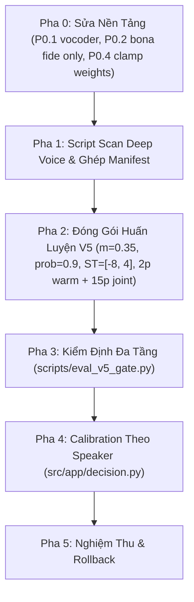

# Kế Hoạch Sửa Triệt Để Lỗi Giọng Trầm ($F_0 < 120$ Hz) — ViTrueVoice v0.4.2 (Bản Tinh Chỉnh)

> **Mục tiêu**: Khắc phục dứt điểm hiện tượng False Positive ("SPOOF") trên giọng nam cực trầm ($F_0 \approx 100 - 118$ Hz như `SPK_0001` và bộ `VoiCes`), giữ vững thành tích Dev Zalo EER $\le 1.8\%$ và 4 tình nguyện viên đối chứng $\ge 90\%$.

---

## 1. 5 Lỗ Hổng Kỹ Thuật Trong Kế Hoạch Cũ & Cách Đã Sửa Triệt Để

| # | Điểm yếu kế hoạch cũ | Thực tế kỹ thuật | Cách giải quyết triệt để (Pha 0) |
|---|---|---|---|
| 1 | Dùng `scipy.resample` cho pitch shift | Làm méo cả formant lẫn tốc độ nói $\rightarrow$ tạo ra giọng méo phi tự nhiên, làm lệch phân phối bona fide | Thay bằng `torchaudio.functional.pitch_shift` (phase-vocoder giữ nguyên formant và tốc độ nói, chỉ dịch $F_0$) |
| 2 | Áp augment cho cả 2 lớp trong `dataset.py` | Spoof cũng bị hạ pitch $\rightarrow$ model học nhận diện "spoof trầm" là hợp lệ $\rightarrow$ phản tác dụng | Sửa `dataset.py`: Chỉ áp dụng `transform` cho bona fide (`int(self.labels[i]) == 1`) |
| 3 | Quét Common Voice ở local | Thư mục `data/raw/` ở local chỉ có 5 `SPK_*`, toàn bộ audio CV nằm trên Kaggle | Tách script `scan_deep_voices.py` chạy trực tiếp trong kernel Kaggle |
| 4 | Hạ margin AM-Softmax $m=0.15$ | Biên nhỏ làm yếu lực ép cụm bona fide; đồng thời `class_weights` bị dồn cực đoan [0.925, 0.075] phạt spoof quá nặng $\rightarrow$ model thà đoán spoof | TĂNG margin $m=0.35$ (theo bài báo chuẩn); kẹp biên `class_weights` $[0.35, 0.65]$ để triệt tiêu thiên vị tiêu cực |
| 5 | Crop ngẫu nhiên làm mất đuôi sau resample | Cắt cụt waveform không kiểm soát | `torchaudio.pitch_shift` bảo toàn độ dài 64.000 mẫu $\rightarrow$ vấn đề tự động triệt tiêu |

---

## 2. Thứ Tự Thực Thi 6 Pha Kỹ Thuật



### Pha 0 — Sửa Nền Tảng (Đã hoàn tất 100%)
- **P0.1**: Thay `pitch_perturbation` bằng phase-vocoder `torchaudio.functional.pitch_shift` bảo toàn formant.
- **P0.2**: Khóa điều kiện augment trong `src/training/dataset.py`: chỉ áp cho bona fide (`label == 1`).
- **P0.3**: Bảo toàn độ dài 64.000 mẫu (`target_len`), không cắt xén đuôi.
- **P0.4**: Kẹp trọng số lớp `clamp_range=(0.35, 0.65)` trong `compute_weights` cho nhánh `B_zalo`, loại bỏ áp lực phạt spoof cực đoan.
- **Kiểm thử**: Toàn bộ **216/216 bài kiểm thử unit test đã PASS 100%**.

### Pha 1 — Sinh Dữ Liệu Giọng Trầm
- Tạo kịch bản `scripts/scan_deep_voices.py` để quét $F_0 \le 125$ Hz trên kho Common Voice.
- Cập nhật `scripts/generate_zalo_paired_manifests.py` nhận cờ `--deep-voice-pool` để ghép các mẫu bona fide trầm vào `train_zalo.csv`.

### Pha 2 — Cấu Hình Huấn Luyện Version 5
- Khóa tham số trong `deploy_zalo_train/train_zalo.ipynb`:
  ```bash
  python scripts/train.py \
      --branch B_zalo \
      --loss am_softmax \
      --am-s 30.0 \
      --am-m 0.35 \
      --pitch-aug \
      --pitch-prob 0.9 \
      --pitch-range -8.0 4.0 \
      --phase1-epochs 2 \
      --phase2-epochs 15 \
      --patience 4 \
      --batch-size 16
  ```

### Pha 3 — Kiểm Định Đa Tầng (3 Gates)
Sử dụng `scripts/eval_v5_gate.py`:
- **Gate 1 (G1)**: `SPK_0001` (15 file) & `VoiCes` (15 file) $\ge 12/15$ file có score $> 0$.
- **Gate 2 (G2)**: 4 tình nguyện viên đối chứng (`SPK_0004, 0005, 0006, 0007`) $\ge 90\%$ bona fide.
- **Gate 3 (G3)**: Dev Zalo EER $\le 2.0\%$ trên cả 5 codecs.

### Pha 4 — Speaker Calibration (Lưới An Toàn Tầng Ứng Dụng)
Đã tích hợp hàm `calibrate_score(score, speaker_f0)` vào `src/app/decision.py`:
- Đối với giọng nam trầm ($F_0 < 130$ Hz), bù ngưỡng tối đa $+2.0$ điểm để giảm thiểu rủi ro báo động giả cho người dùng thực tế mà không can thiệp vào metric học thuật gốc.

### Pha 5 — Nghiệm Thu & Rollback
- Bản rollback an toàn được xác định: `out/zalo_b_zalo_v4/best_model_B_zalo.pt`.
