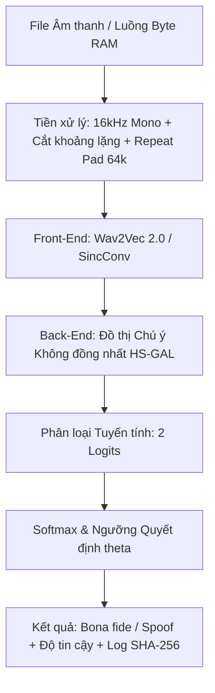

# ARCH_technical-specs — Đặc Tả Kiến Trúc Hệ Thống & Kỹ Thuật

---

## 1. Tổng Quan Kiến Trúc Hệ Thống

ViTrueVoice là hệ thống phân loại nhị phân độc lập từng mẫu âm thanh tiếng Việt nhằm phân biệt giữa **Giọng thật (`Bona fide` - nhãn `1`)** và **Giọng giả (`Spoof` - nhãn `0`)** truyền qua kênh thoại viễn thông và mạng xã hội bị nén suy hao (Opus, AMR, giới hạn băng thông 8kHz).

---

## 2. Các Chỉ Số Nghiệm Thu Đích (Target KPIs)

| Chỉ số | Mục tiêu KPI | Phương pháp nghiệm thu |
|--------|--------------|------------------------|
| **Độ chính xác nội bộ (In-domain EER)** | `EER <= 8%` | Đánh giá trên tập kiểm thử nội bộ (mẫu thật và mẫu giả từ F5-TTS, VieNeu-TTS) |
| **Độ bền nén kênh thoại (Giả thuyết H1)** | `Giảm >= 30% EER tương đối` | So sánh mô hình có tăng cường nén Codec/RawBoost với mô hình baseline không tăng cường |
| **Độ bền công cụ lạ (Unseen TTS - H2)** | `EER <= 15%` | Đánh giá trên công cụ TTS/Voice Conversion thứ 3 chưa từng xuất hiện lúc huấn luyện |
| **Thời gian phản hồi (Latency)** | `<= 3,0 giây (trung vị 30 lần)` | Đo độ trễ suy luận 30 lần liên tiếp trên đoạn thoại 5–10 giây |

---

## 3. Kiến Trúc Huấn Luyện Hybrid (Local Code <-> Kaggle GPU)

1. **Máy Local**: Quản lý kho mã nguồn, viết kịch bản kiểm thử TDD bằng `pytest`, quản lý phiên bản Git và tập dữ liệu mẫu.
2. **Kaggle GPU**: Hạ tầng tính toán đồ họa miễn phí được điều khiển qua `manage_kaggle.py`:
   - Đường dẫn nạp dữ liệu: `/kaggle/input/<ten-dataset>`
   - Đường dẫn lưu trọng số và log: `/kaggle/working/best_model.pt`
   - Tải kết quả về máy Local: Thư mục `./out/`

---

## 4. Quản Trị Đạo Đức Dữ Liệu & Bảo Mật Sinh Trắc Học

Tuân thủ nghiêm ngặt Luật Bảo vệ dữ liệu cá nhân 91/2025/QH15 và Nghị định 356/2025/NĐ-CP:
1. **Triệt tiêu PII**: Tuyệt đối không lưu tên thật, số điện thoại hoặc dữ liệu cá nhân định danh. Bắt buộc dùng mã ẩn danh `SPK_XXXX`.
2. **Xử lý trực tiếp trên RAM**: Khi nhận file qua Telegram hoặc Web Demo, dữ liệu được đọc trực tiếp vào bộ đệm RAM (`io.BytesIO`) và xóa hủy ngay tệp âm thanh tạm sau khi trả kết quả.
3. **Băm ẩn danh SHA-256**: Mọi lượt suy luận và đánh giá ghi nhận vào `benchmarks/latency_log.json` đều phải dùng mã băm `SHA-256` của nội dung âm thanh thay cho tên file gốc.

---

*v0.1.0 — 2026-10-16*
