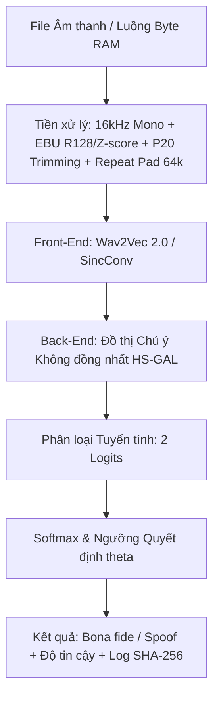

# ARCH_technical-specs — Đặc Tả Kiến Trúc Hệ Thống & Kỹ Thuật

---

## 1. Bảng Tổng Quan Kiến Trúc Pipeline Kỹ Thuật (4 Chặng)

ViTrueVoice là hệ thống phân loại nhị phân độc lập từng mẫu âm thanh tiếng Việt nhằm phân biệt giữa **Giọng thật (`Bona fide` - nhãn `1`)** và **Giọng giả (`Spoof` - nhãn `0`)** truyền qua kênh thoại viễn thông và mạng xã hội bị nén suy hao (Opus, AMR-NB, G.711 A-law, lọc băng tần $8\text{ kHz}$).

| Chặng Kỹ Thuật | Đầu Vào (Input) | Xử Lý Cốt Lõi (Core Process) | Đầu Ra (Output) |
| :--- | :--- | :--- | :--- |
| **1. Tạo & Chuẩn bị Dữ liệu (Must #1 - W3, W4)** | Giọng thật (5 tình nguyện viên `SPK_0001`..`0007` + VIVOS 65 spk & Common Voice 8.0 419 spk) + Văn bản kịch bản | Phân hoạch V12/V14/V20; clip đơn 3.5–7.5s (`allow_stitching=False`); sinh kép `DUAL_OUTPUT` (F5-TTS & VieNeu-TTS v3 Turbo); lọc 4 cổng (Gate 1–4 Label-Free Prosody); Hard Text-Disjoint; TelephonyCompressor | $\ge 1.000$ mẫu Bona fide + $\ge 2.000$ mẫu Spoof (độc lập $\approx 2:1$) + Manifests 18 cột (`pre_codec`), Paired Triplets 1:1:1 cho Eval |
| **2. Tiền xử lý & Augmentation (W4, W5)** | File âm thanh thô đa định dạng (24kHz / 48kHz / 16kHz, Stereo/Mono) | Chuyển Mono, Resample 16kHz, chuẩn hóa EBU R128 (-23 LUFS) / Z-score, cắt khoảng lặng (20th percentile), Cắt/Đệm 4s (64.000 mẫu), RawBoost + Nén Opus/AMR-NB/G.711/lọc 8kHz | Tensor Waveform chuẩn hóa $(1, 64000)$ mô phỏng lệch miền (domain shift) qua Zalo/PSTN/GSM |
| **3. Huấn luyện & Đối chứng (Must #2 - W5)** | Batch Tensor Waveform $(1, 64000)$ + Nhãn (`0`: Spoof, `1`: Bona fide) | Huấn luyện Baseline LFCC+GMM (`scripts/eval_gmm.py`) và 3 nhánh SSL-AASIST trên Kaggle GPU (`train_kaggle.ipynb`): Nhánh A (Clean, 4+60ep), Nhánh B0 (Codec, 4+20ep), Nhánh B (ViTrueVoice: Codec+RawBoost, 4+20ep). Weighted CE động $w_c = \frac{N}{2 \cdot N_c}$ sau khi loại VieNeu khỏi train. | Checkpoint `best_model_{A,B0,B}.pt` + Bảng đối chứng `h1_comparison.csv` ($\Delta\text{EER} \ge 30\%$) & `h2_unseen_tts.csv` ($\text{EER} \le 15\%$) |
| **4. Đánh giá, Triển khai & Pilot (Must #2, #3 - W5–W8)** | Đoạn thoại nghi ngờ (5–10s) từ Web Gradio hoặc chuyển tiếp qua Bot Telegram | Suy luận qua FastAPI trên AWS EC2 + Log ẩn danh SHA-256; 137/137 unit tests xanh 100%, bộ eval $\ge 30$ tình huống; Pilot với CLB ATTT HUTECH | Giảm $\ge 30\%$ EER tập nén (H1), EER Unseen TTS $\le 15\%$ (H2), Trung vị độ trễ $\le 3$ giây (30 lần đo) |

---

## 2. Các Chỉ Số Nghiệm Thu Đích (Target KPIs & Giả Thuyết)

| Chỉ số | Mục tiêu KPI | Phương pháp & Bằng chứng nghiệm thu |
|--------|--------------|-----------------------------------|
| **Độ bền nén kênh thoại (CH1 / Giả thuyết H1)** | `Giảm >= 30% EER tương đối` trên tập nén | So sánh mô hình B (ViTrueVoice) với mô hình A (không tăng cường) trên G.711 A-law & AMR-NB; script `scripts/compare_h1.py` xuất `out/comparison_A_B/h1_comparison.csv` |
| **Độ bền công cụ lạ (CH2 / Giả thuyết H2)** | `EER <= 15%` trên Unseen TTS | Đánh giá mô hình B trên `VieNeu-TTS` (đã lọc sạch khỏi Train/Dev); script `scripts/compare_h1.py` xuất `out/comparison_A_B/h2_unseen_tts.csv` |
| **Bóc tách đóng góp RawBoost (CH1 bổ trợ)** | Định lượng $\Delta\text{EER}$ và `ci_overlap` | So sánh mô hình B (Codec + RawBoost) với mô hình B0 (chỉ Codec) qua `scripts/compare_h1.py` |
| **Độ chính xác nội bộ (In-domain EER)** | `EER <= 8%` | Đánh giá trên tập kiểm thử nội bộ người nói chưa từng thấy (`test_indomain.csv`) |
| **Thời gian phản hồi (Latency - NFR1)** | `<= 3,0 giây (trung vị 30 lần)` | Đo độ trễ suy luận 30 lần liên tiếp trên đoạn thoại 5–10s; log ẩn danh SHA-256 lưu `benchmarks/latency_log.json` và bảng `benchmarks/latency_benchmark.csv` |

---

## 3. Kiến Trúc Huấn Luyện Hybrid & Môi Trường Đám Mây AWS

### Kiến Trúc Hybrid (Local Code <-> Kaggle GPU)
1. **Máy Local**: Quản lý kho mã nguồn Git, viết kịch bản TDD bằng `pytest` (137/137 unit tests xanh 100%), đóng gói mã nguồn vào `train_kaggle.ipynb`.
2. **Kaggle GPU (Tesla T4 16GB VRAM)**: Điều khiển tự động qua CLI `manage_kaggle.py`:
   - Kernel sinh dữ liệu: `nguyenthanhtai1959/vietrue-model-training` (V22) tạo ra `vitruevoice_data_processed.zip` (3.26 GB).
   - Kernel huấn luyện: `nguyenthanhtai1959/vietrue-ssl-training` nạp dữ liệu qua `kernel_sources: ["nguyenthanhtai1959/vietrue-model-training"]`.
   - Quá trình chạy: Tự động giải nén dữ liệu, lọc VieNeu vào `manifests_seen_only`, chạy Smoke Test (100 mẫu), huấn luyện 3 nhánh A/B0/B, đánh giá tự động trên test set và xuất báo cáo H1/H2 Markdown.
   - Tải kết quả về máy Local: `python manage_kaggle.py output` (lưu vào `./out/`).

### Hạ Tầng Đám Mây AWS & 2 Biện Pháp Bảo Mật (Course Package A)
- **Kiến trúc triển khai**: Container Docker trên **Amazon EC2** (G4dn/T3), lưu image trên **Amazon ECR**, lưu log ẩn danh trên **Amazon S3**, giám sát qua **AWS CloudWatch**.
- **2 Biện pháp Bảo mật bắt buộc (CP7 - W7)**:
  1. **Mã hóa truyền tải & Tự động xóa file tạm**: Cấu hình HTTPS/TLS và Server-Side Encryption kèm quy tắc **Amazon S3 Lifecycle** tự động xóa hủy vĩnh viễn dữ liệu thoại tạm ngay sau khi suy luận hoàn tất.
  2. **Quản lý quyền tối thiểu & Chống lạm dụng API**: Áp dụng **IAM Least Privilege**, giới hạn tần suất gọi API (**Rate Limiting**), kiểm tra nghiêm ngặt định dạng MIME và kích thước tệp đầu vào.
- **Ước tính chi phí vận hành**: Tính toán cho quy mô 100 / 1.000 / 10.000 người dùng bằng AWS Pricing Calculator (Bảng 3.4).

---

## 4. Kiểm Thử Độc Lập Với Đơn Vị Pilot (CLB An Toàn Thông Tin HUTECH)

- **Đơn vị Pilot chính**: **CLB An toàn thông tin HUTECH** (Người liên hệ: Thầy Nguyễn Trọng Minh Hồng Phước).
- **Đơn vị dự phòng**: CLB Trí tuệ Nhân tạo HUTECH và Dự án ChongLuaDao.vn.
- **Thời gian thực hiện**: W7–W8 (từ 04/12/2026).
- **Vai trò**: Đóng vai trò Red Team kiểm thử độc lập, tự tạo mẫu giọng giả (có phiếu đồng ý) để thử thách hệ thống, ký biên bản nghiệm thu Bảng trước–sau (Bảng 3.3). CLB nhận lại bộ dữ liệu, mô hình và Web Demo/API làm tư liệu nghiên cứu.

---

## 5. Quản Trị Đạo Đức Dữ Liệu & Bảo Mật Sinh Trắc Học

Tuân thủ nghiêm ngặt Luật Bảo vệ dữ liệu cá nhân 91/2025/QH15 và Nghị định 356/2025/NĐ-CP:
1. **Triệt tiêu PII**: Tuyệt đối không lưu tên thật, số điện thoại hoặc dữ liệu cá nhân định danh. Bắt buộc dùng mã ẩn danh `SPK_XXXX`.
2. **Xử lý trực tiếp trên RAM**: Đọc dữ liệu qua stream bộ đệm RAM (`io.BytesIO`) và xóa hủy file tạm ngay sau khi trả kết quả; ngăn chặn nguy cơ rò rỉ giọng nói sinh trắc học.
3. **Băm ẩn danh SHA-256**: Mọi bản ghi trong `benchmarks/latency_log.json` bắt buộc băm SHA-256 nội dung âm thanh thay cho tên file hoặc ID người dùng.
4. **Cam kết xóa hủy**: Xóa hủy vĩnh viễn toàn bộ dữ liệu sinh trắc học nguyên bản sau khi nghiệm thu bảo vệ đồ án (tháng 12/2026).

---

*v0.2.5 — 2026-10-29*
