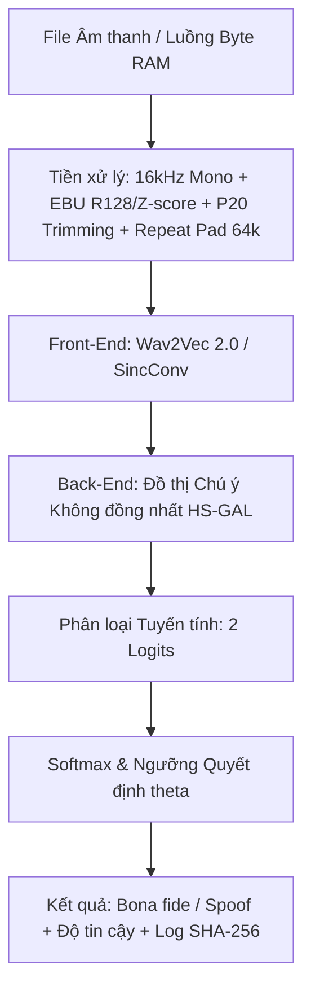

# ARCH_technical-specs — Đặc Tả Kiến Trúc Hệ Thống & Kỹ Thuật

---

## 1. Bảng Tổng Quan Kiến Trúc Pipeline Kỹ Thuật (4 Chặng)

ViTrueVoice là hệ thống phân loại nhị phân độc lập từng mẫu âm thanh tiếng Việt nhằm phân biệt giữa **Giọng thật (`Bona fide` - nhãn `1`)** và **Giọng giả (`Spoof` - nhãn `0`)** truyền qua kênh thoại viễn thông và mạng xã hội bị nén suy hao (Opus, AMR-NB, G.711 A-law, lọc băng tần $8\text{ kHz}$).

| Chặng Kỹ Thuật | Đầu Vào (Input) | Xử Lý Cốt Lõi (Core Process) | Đầu Ra (Output) |
| :--- | :--- | :--- | :--- |
| **1. Tạo & Chuẩn bị Dữ liệu (Must #1 - W3, W4)** | Giọng thật (5 tình nguyện viên `SPK_0001`..`0007` có Phiếu đồng ý + VIVOS & Common Voice) + Văn bản kịch bản | Phân hoạch chuẩn V12/V14 (`ref_pool[:3]`, `enroll_pool[3:7]`); clip đơn 3.5–7.5s (`allow_stitching=False`) qua LOO + Probe; sinh kép `DUAL_OUTPUT` (F5-TTS & VieNeu-TTS v3 Turbo 48kHz); lọc 4 cổng (Gate 1–4 Label-Free Prosody) + Multi-Seed Retry; nén G.711/AMR-NB/Opus | $\ge 1.000$ mẫu Bona fide + $\ge 2.000$ mẫu Spoof (đã sinh 200 mẫu gốc V8–V14) + 5 file Manifest 17 cột chia Speaker-Disjoint |
| **2. Tiền xử lý & Augmentation (W4, W5)** | File âm thanh thô đa định dạng (24kHz / 48kHz / 16kHz, Stereo/Mono) | Chuyển Mono, Resample 16kHz, chuẩn hóa EBU R128 (-23 LUFS) / Z-score, cắt khoảng lặng (20th percentile), Cắt/Đệm 4s (64.000 mẫu), RawBoost + Nén Opus/AMR-NB/G.711/lọc 8kHz | Tensor Waveform chuẩn hóa $(1, 64000)$ mô phỏng lệch miền (domain shift) qua Zalo/PSTN/GSM |
| **3. Huấn luyện & Đối chứng (Must #2 - W5)** | Batch Tensor Waveform $(1, 64000)$ + Nhãn (`0`: Spoof, `1`: Bona fide) | Fine-tune wav2vec 2.0 (có vs. không tăng cường nén kênh; Seen F5-TTS vs. Unseen VieNeu-TTS) & Baseline LFCC+GMM / AASIST với Weighted CE Loss [0.1, 0.9] | Trọng số `best_model.pt` + Bảng so sánh EER & minDCF có/không tăng cường nén kênh |
| **4. Đánh giá, Triển khai & Pilot (Must #2, #3 - W5–W8)** | Đoạn thoại nghi ngờ (5–10s) từ Web Gradio hoặc chuyển tiếp qua Bot Telegram | Suy luận qua FastAPI trên AWS EC2 + Log ẩn danh SHA-256; $\ge 10$ test case (31/31 unit tests xanh), bộ eval $\ge 30$ tình huống; Pilot với CLB ATTT HUTECH | Giảm $\ge 30\%$ EER tập nén (H1), EER Unseen TTS $\le 15\%$ (H2), Trung vị độ trễ $\le 3$ giây (30 lần đo) |

---

## 2. Các Chỉ Số Nghiệm Thu Đích (Target KPIs & Giả Thuyết)

| Chỉ số | Mục tiêu KPI | Phương pháp & Bằng chứng nghiệm thu |
|--------|--------------|-----------------------------------|
| **Độ bền nén kênh thoại (CH1 / Giả thuyết H1)** | `Giảm >= 30% EER tương đối` trên tập nén | So sánh mô hình wav2vec 2.0 có tăng cường nén (Opus, AMR-NB, G.711, 8kHz) với baseline không tăng cường; script `scripts/eval_eer.py` xuất `benchmarks/eval_metrics.csv` |
| **Độ bền công cụ lạ (CH2 / Giả thuyết H2)** | `EER <= 15%` trên Unseen TTS | Đánh giá tổng quát hóa ngoài miền trên công cụ TTS chưa từng xuất hiện lúc huấn luyện (VieNeu-TTS / công cụ thứ 3); báo cáo kèm minDCF & DET curve |
| **Độ chính xác nội bộ (In-domain EER)** | `EER <= 8%` | Đánh giá trên tập kiểm thử nội bộ người nói chưa từng thấy (`SPK_0007`) |
| **Thời gian phản hồi (Latency - NFR1)** | `<= 3,0 giây (trung vị 30 lần)` | Đo độ trễ suy luận 30 lần liên tiếp trên đoạn thoại 5–10s; log ẩn danh SHA-256 lưu `benchmarks/latency_log.json` và bảng `benchmarks/latency_benchmark.csv` |

---

## 3. Kiến Trúc Huấn Luyện Hybrid & Môi Trường Đám Mây AWS

### Kiến Trúc Hybrid (Local Code <-> Kaggle GPU)
1. **Máy Local**: Quản lý kho mã nguồn Git, viết kịch bản TDD bằng `pytest` (31/31 unit tests xanh), quản lý tệp dữ liệu mẫu.
2. **Kaggle GPU (Tesla T4 16GB VRAM)**: Điều khiển tự động qua CLI `manage_kaggle.py`:
   - Dữ liệu đầu vào: `/kaggle/input/<ten-dataset>`
   - Trọng số và log: `/kaggle/working/best_model.pt`
   - Tải kết quả về máy Local: Thư mục `./out/`

### Hạ Tầng Đám Mây AWS & 2 Biện Pháp Bảo Mật (Course Package A)
- **Kiến trúc triển khai**: Container Docker trên **Amazon EC2** (G4dn/T3), lưu image trên **Amazon ECR**, lưu log ẩn danh trên **Amazon S3**, giám sát qua **AWS CloudWatch**.
- **2 Biện pháp Bảo mật bắt buộc (CP7 - W7)**:
  1. **Mã hóa truyền tải & Tự động xóa file tạm**: Cấu hình HTTPS/TLS và Server-Side Encryption kèm quy tắc **Amazon S3 Lifecycle** tự động xóa hủy vĩnh viễn dữ liệu thoại tạm ngay sau khi suy luận hoàn tất.
  2. **Quản lý quyền tối thiểu & Chống lạm dụng API**: Áp dụng **IAM Least Privilege**, giới hạn tần suất gọi API (**Rate Limiting**), kiểm tra nghiêm ngặt định dạng MIME và kích thước tệp đầu vào.
- **Ước tính chi phí vận hành**: Tính toán cho quy mô 100 / 1.000 / 10.000 người dùng bằng AWS Pricing Calculator (Bảng 3.4).

---

## 4. Kiểm Thử Độc Lập Với Đơn Vị Pilot (CLB An Toàn Thông Tin HUTECH)

- **Đơn vị Pilot chính**: **CLB An toàn thông tin HUTECH** (Người liên hệ: Thầy Nguyễn Trọng Minh Hồng Phước).
- **Đơn vị dự phòng**: CLB Trí tuệ Nhân tạo HUTECH và Dự án ChongLuaDao.vn.
- **Thời gian thực hiện**: W7–W8 (từ 04/12/2026).
- **Vai trò**: Đóng vai trò Red Team kiểm thử độc lập, tự tạo mẫu giọng giả (có phiếu đồng ý) để thử thách hệ thống, ký biên bản nghiệm thu Bảng trước–sau (Bảng 3.3). CLB nhận lại bộ dữ liệu, mô hình và Web Demo/API làm tư liệu nghiên cứu.

---

## 5. Quản Trị Đạo Đức Dữ Liệu & Bảo Mật Sinh Trắc Học

Tuân thủ nghiêm ngặt Luật Bảo vệ dữ liệu cá nhân 91/2025/QH15 và Nghị định 356/2025/NĐ-CP:
1. **Triệt tiêu PII**: Tuyệt đối không lưu tên thật, số điện thoại hoặc dữ liệu cá nhân định danh. Bắt buộc dùng mã ẩn danh `SPK_XXXX`.
2. **Xử lý trực tiếp trên RAM**: Đọc dữ liệu qua stream bộ đệm RAM (`io.BytesIO`) và xóa hủy file tạm ngay sau khi trả kết quả; ngăn chặn nguy cơ rò rỉ giọng nói sinh trắc học.
3. **Băm ẩn danh SHA-256**: Mọi bản ghi trong `benchmarks/latency_log.json` bắt buộc băm SHA-256 nội dung âm thanh thay cho tên file hoặc ID người dùng.
4. **Cam kết xóa hủy**: Xóa hủy vĩnh viễn toàn bộ dữ liệu sinh trắc học nguyên bản sau khi nghiệm thu bảo vệ đồ án (tháng 12/2026).

---

*v0.2.3 — 2026-10-26 (Frozen Pipeline V14)*
