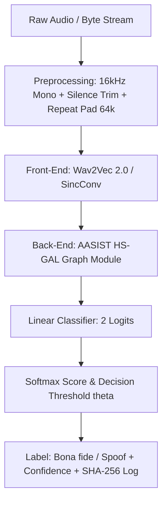

# ARCH_technical-specs — System Architecture & Technical Specifications

---

## 1. System Overview

ViTrueVoice is a binary classification system for Vietnamese speech to distinguish **Bona fide (Label 1)** from **Spoofed / Cloned voice (Label 0)** over compressed telecommunications and social media channels (Opus, AMR, 8kHz bandwidth).

---

## 2. Target KPIs

| KPI | Metric Target | Verification Method |
|-----|---------------|---------------------|
| **In-domain EER** | `EER <= 8%` | Evaluated on test set with seen tools (F5-TTS, VieNeu-TTS) |
| **Telephony Robustness (H1)** | `>= 30% relative EER reduction` | Comparing model with vs without Codec/RawBoost augmentation |
| **Unseen TTS EER (H2)** | `EER <= 15%` | Evaluated on 3rd party unseen tool / RVC |
| **Inference Latency** | `<= 3.0s (median of 30 runs)` | 5-10s clip evaluated 30 times continuously |

---

## 3. Hybrid Training Topology (Local <-> Kaggle GPU)

1. **Local Machine**: Code development, unit testing with `pytest`, git version control, dataset management.
2. **Kaggle GPU**: Execution engine via `manage_kaggle.py`:
   - Data input: `/kaggle/input/<dataset-name>`
   - Model checkpoint output: `/kaggle/working/best_model.pt`
   - Result download: local `./out/`

---

## 4. Biometrics Ethics & Privacy Governance

In compliance with Law on Personal Data Protection 91/2025/QH15 and Decree 356/2025/NĐ-CP:
1. **Zero PII**: No real names or personal identifiers in repository or logs. All contributors mapped to `SPK_XXXX`.
2. **RAM-Only Processing**: Voice messages from Telegram / Web Demo are loaded into memory buffers (`io.BytesIO`) and temporary files are wiped immediately after inference.
3. **SHA-256 Payload Logging**: All evaluation and inference requests log the `SHA-256` digest of the audio bytes rather than original filenames.

---

*v0.1.0 — 2026-10-16*
