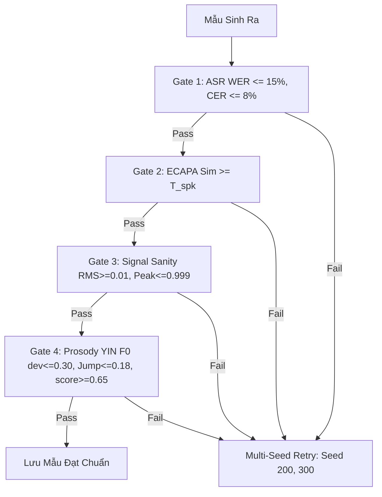

# LOGIC_data-generation — Quy Trình Sinh Dữ Liệu Giọng Giả & Kiểm Định Chất Lượng

---

## 1. Nguồn Dữ Liệu Giọng Thật (Bona fide) & Phân Hoạch Chuẩn V12/V14

### Nguồn Thu Âm Trực Tiếp & Đạo Đức Dữ Liệu
- **5 tình nguyện viên chính thức**: `SPK_0001`, `SPK_0004`, `SPK_0005`, `SPK_0006`, `SPK_0007` (79 câu thoại gốc; loại bỏ hoàn toàn `SPK_0003`; chuyển đổi `SPK_0005` từ `.m4a` sang PCM 16-bit 48kHz Mono WAV; mở rộng $\ge 30$ người nói).
- **Mã hóa PII**: Toàn bộ định danh ẩn danh dưới dạng `SPK_XXXX`.
- **Phiếu đồng ý (Consent Form - Phụ lục C.2)** tuân thủ Luật 91/2025/QH15 và Nghị định 356/2025/NĐ-CP, tách bạch 3 mục đích: (1) mẫu thật, (2) mẫu tham chiếu nhân bản giọng nghiên cứu, (3) trích xuất chỉ số EER/minDCF ẩn danh. Cam kết xóa hủy dữ liệu gốc sau bảo vệ (12/2026).
- **Dữ liệu mở sạch**: Tích hợp VIVOS (15 giờ, 65 người, CC BY-NC 4.0) và Mozilla Common Voice tiếng Việt (~6–50 giờ, CC0 1.0) nhằm đạt quy mô $\ge 1.000$ mẫu thật và $\ge 2.000$ mẫu giả.

### Phân Hoạch 3 Tập Con Độc Lập Chống Rò Rỉ (`DatasetPartitioner` V12/V14)
Trên từng người nói, danh sách file được phân hoạch nghiêm ngặt thành 3 tập rời rạc (0% data leakage):
1. **Tập ứng viên tham chiếu** $\mathcal{D}_{\text{ref\_cands}}$ (`ref_pool = files[:3]`): Dùng để chọn clip reference cho TTS.
2. **Tập đăng ký sinh trắc** $\mathcal{D}_{\text{enroll}}$ (`enroll_pool = files[3:7]`): Gồm đúng $K=4$ câu sạch tính vector Enrollment Centroid chuẩn hóa $L_2$ bằng SpeechBrain `spkrec-ecapa-voxceleb` (192 chiều):
   $$\mathbf{e}_{\text{enroll}} = \frac{\sum_{i=1}^4 \mathbf{e}_i}{\left\|\sum_{i=1}^4 \mathbf{e}_i\right\|_2}$$
3. **Tập kiểm thử** $\mathcal{D}_{\text{eval}}$: Gồm các câu held-out còn lại. Giữ cố định cơ chế phân tập V12/V14 bảo toàn clip hội thoại tự nhiên `SPK_0004_02.wav` ($4.76\text{s}$) thay vì trượt vào câu kịch bản tổng đài.

---

## 2. Tuyển Chọn Clip Đơn Dải Vàng ($3.5\text{s}$–$7.5\text{s}$) & Khung Sinh Kép (`ViTrueVoiceDualPipeline`)

### Tuyển Chọn 2 Tầng Không Ghép Nối (`allow_stitching=False`)
- Cố định dải thời lượng vàng: `min_dur=3.5s`, `max_dur=7.5s`.
- Tắt hoàn toàn ghép nối nhân tạo (`allow_stitching=False`) để tránh chèn 0.2s khoảng lặng chết làm đứt gãy token âm học của NeuCodec + Qwen LLM.
- **Tầng 1 (LOO Proximity)**: Lọc top-3 clip gần centroid nhất trong `ref_pool`.
- **Tầng 2 (Output Probe Ranking)**: Sinh thử đầu ra thực tế để chọn `best_ref` (loại clip rớt ngưỡng như `SPK_0001_04.wav` có $\text{Sim} = 0.4815 < 0.4905$).

### Khung Sinh Kép (`PipelineMode.DUAL_OUTPUT`)
- Hỗ trợ 3 chế độ: `BEST_QUALITY` (thang quyết định 4 bậc), `ADAPTIVE` (giữ VRAM $< 2.5\text{GB}$ cho GPU 4GB), `DUAL_OUTPUT` (kích hoạt đồng thời cả 2 engine trên Kaggle Tesla T4 16GB VRAM, đã sinh 200 mẫu spoof gốc V8–V14: 106 F5-TTS + 94 VieNeu-TTS).

### Đặc Tả Engine #1: F5-TTS-Vietnamese (Seen TTS #1)
- **Kiến trúc**: Non-Autoregressive Flow Matching + Vocos vocoder (24kHz Mono qua Demucs).
- **Văn bản**: Chuẩn hóa chữ thường, bảo tồn dấu câu tiếng Việt, kịch bản giục chuyển tiền gấp (thời lượng 5–10s, loại $< 1\text{s}$ hoặc $> 30\text{s}$).
- **Cơ chế**: Nhận cặp `(ref_audio, ref_text)` động từ transcript thật; fallback tự động nhận diện từ sóng âm bằng ASR trong 0.2s (**Label-Free ASR Auto-Fallback**).
- **Headroom**: Peak Headroom Scaling $\le 0.95$. Đạt 5/5 speaker $100\%$, Mean WER $6.26\%$, Mean Sim $0.8008$, Gate 3 Pass $100\%$.

### Đặc Tả Engine #2: VieNeu-TTS v3 Turbo (Unseen TTS / Seen TTS #2)
- **Kiến trúc**: Autoregressive Qwen LLM + `MOSS_48kHz` / `NeuCodec`, bộ phiên âm `sea-g2p` (Rust engine). Chốt cố định v3 Turbo ($48\text{kHz}$ PCM), nhanh hơn bản v2 GPU 6.7 lần ($2.7\text{s}$ vs $18.1\text{s}$) và Sim Ref cao hơn ($0.7231$ vs $0.6556$).
- **Cấu hình**: Preset A (`use_ref_codes=True`), `denoise=False` (bảo toàn hài âm thanh quản), `apply_watermark=False`, `temperature=0.60`, `top_p=0.90`, Peak Headroom Scaling $\le 0.95$, văn bản $\le 250$ ký tự. Đạt 4/5 speaker $100\%$, Mean WER $8.47\%$, Mean Sim $0.7108$.

---

## 3. Kiểm Định Chất Lượng 4 Cổng (Multi-Gate Label-Free Prosody) & Retry

Hệ thống lọc tự động không cần nhãn vùng miền (`MultiGateEvaluator`):



1. **Gate 1 – Nội dung ASR (`wav2vec2-base-vietnamese-250h`)**: Clean WER $\le 15\%$, CER $\le 8\%$, `is_catastrophic = False` (không vấp lặp hay đứt từ đầu câu).
2. **Gate 2 – Sinh trắc học người nói (`spkrec-ecapa-voxceleb`)**: Cosine Similarity so với Centroid ($K=4$) đạt $\text{Sim} \ge T_{\text{spk}}$ (sàn $\ge 0.4905$, shrinkage $\sigma = \alpha \sigma_{\text{local}} + (1-\alpha)\sigma_{\text{pooled}}$ với $\sigma_{\text{pooled}} = 0.08$, trần $0.62$).
3. **Gate 3 – Sanity tín hiệu**: Không NaN/Inf, $\text{RMS} \ge 0.01$, thời lượng $\ge 1.0\text{s}$, $\text{Peak} \le 0.999$ (nhờ Headroom $\le 0.95$).
4. **Gate 4 – Ngữ điệu & Phương ngữ Thuần Âm học (`dialect_evaluator.py`)**: Đường cao độ $F_0$ trích xuất bằng thuật toán **YIN** trên dải $[65\text{Hz} - 400\text{Hz}]$. Yêu cầu:
   - Độ lệch cao độ tương đối: $\frac{|F_{0,\text{synth}} - F_{0,\text{ref}}|}{F_{0,\text{ref}}} \le 0.30$
   - Độ lệch hệ số biến thiên: $|\Delta CV_{F0}| \le 0.12$
   - Tỷ lệ bước nhảy cao độ tức thời: $|dF_0/dt| > 25\text{Hz} \le 0.18$
   - Điểm tổng hợp: `dialect_score >= 0.65`
5. **Multi-Seed Retry**: Nếu trượt cổng, tự động đổi seed (`200`, `300`) để sinh lại (trung bình 1.4 lần thử/mẫu).

---

## 4. Suy Giảm Kênh Thoại Viễn Thông & 5 Tệp Manifest 17 Cột

### Chuỗi Suy Giảm Kênh Thoại (`TelephonyCompressor`)
- `clean_16khz`: 16kHz Mono chuẩn phòng thu.
- `g711_alaw`: 8kHz Mono, 64kbps (PSTN/ISDN, dải thông 300–3400Hz).
- `amr_nb`: 8kHz Mono, 12.2kbps (2G/3G GSM) + `opus` (16–32kbps).
- **Hiện tượng Dịch chuyển Ngưỡng (Narrowband Upward Shift)**: Băng hẹp 8kHz triệt tiêu hài âm $> 3.4\text{kHz}$ làm phân tán phân phối Impostor ($\sigma_I: 0.0875 \rightarrow 0.1011$), giảm độ nhạy $d'$ mạnh ($22.8\%$ trên G.711: $d'=4.02$; $25.5\%$ trên AMR-NB: $d'=3.89$ so với Studio $d'=5.21$), đẩy $T_{\text{FAR 1\%}}$ từ $0.4800 \rightarrow 0.5958$ (G.711) và $0.6195$ (AMR-NB).

### 5 Tệp Manifest 17 Cột Chuẩn Tắc (`data/manifests/`)
Các tệp: `train_manifest.csv`, `dev_manifest.csv`, `test_manifest.csv`, `spoof_manifest.csv`, `full_manifest.csv`.
Cấu trúc 17 cột:
```csv
utt_id,audio_path,speaker_id,label,tts_generator,vocoder,codec,split,duration_sec,transcript,wer,cer,ecapa_sim,derived_tier,engine_name,ref_audio_path,seed
```

### Phân Vùng Độc Lập Người Nói (`Speaker-Disjoint`)
- **Tập Train**: `SPK_0001`, `SPK_0004`, `SPK_0005`.
- **Tập Dev**: `SPK_0006` (kiểm soát overfitting, căn chỉnh ngưỡng EER).
- **Tập Test In-Domain**: `SPK_0007` (người nói hoàn toàn chưa thấy khi train).
- Duy trì tỷ lệ $70\%$ Train / $15\%$ Dev / $15\%$ Test khi mở rộng cùng VIVOS và Common Voice.
- Toàn bộ **31/31 unit tests** TDD vượt qua thành công.

---

*v0.2.3 — 2026-10-26 (Frozen Pipeline V14)*
