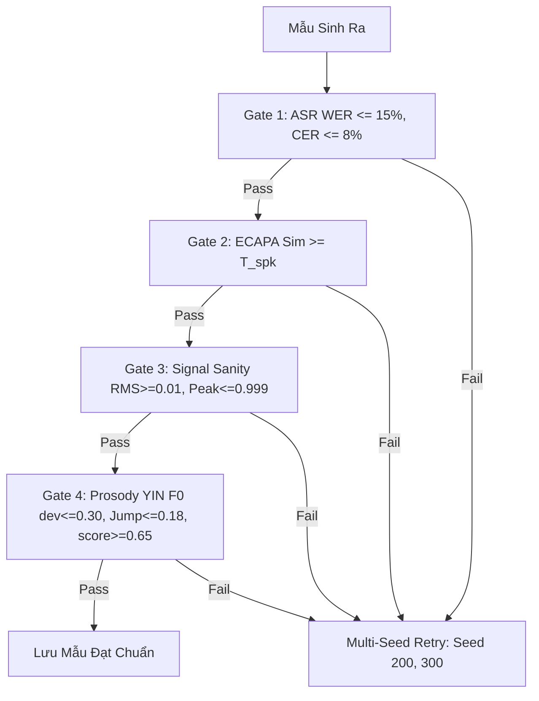

# LOGIC_data-generation — Quy Trình Sinh Dữ Liệu Giọng Giả & Kiểm Định Chất Lượng

---

## 1. Nguồn Dữ Liệu Giọng Thật (Bona fide) & Phân Hoạch Chuẩn V12/V14/V20

### Nguồn Thu Âm Trực Tiếp & Đạo Đức Dữ Liệu
- **5 tình nguyện viên chính thức**: `SPK_0001`, `SPK_0004`, `SPK_0005`, `SPK_0006`, `SPK_0007` (79 câu thoại gốc; loại bỏ hoàn toàn `SPK_0003`; chuyển đổi `SPK_0005` từ `.m4a` sang PCM 16-bit 48kHz Mono WAV).
- **Mã hóa PII**: Toàn bộ định danh ẩn danh dưới dạng `SPK_XXXX`.
- **Phiếu đồng ý (Consent Form - Phụ lục C.2)** tuân thủ Luật 91/2025/QH15 và Nghị định 356/2025/NĐ-CP, tách bạch 3 mục đích: (1) mẫu thật, (2) mẫu tham chiếu nhân bản giọng nghiên cứu, (3) trích xuất chỉ số EER/minDCF ẩn danh. Cam kết xóa hủy dữ liệu gốc sau bảo vệ (12/2026).
- **Dữ liệu mở sạch**:
  - **VIVOS** (15 giờ, 65 người nói, CC BY-NC 4.0, `kynthesis/vivos-vietnamese-speech-corpus-for-asr` trên Kaggle).
  - **Mozilla Common Voice tiếng Việt 8.0** (2022-01-19, 22.97 giờ, 419 người nói, CC0 1.0, `tuannguyenvananh/vi-common-voice` trên Kaggle).
  - Mục tiêu quy mô: $\ge 1.000$ mẫu thật độc lập và $\ge 2.000$ mẫu giả độc lập (tỷ lệ $\approx 2:1$).

### Đặc Tả Tải & Lọc Dữ Liệu Common Voice 8.0 (Chống Lỗi Vệt Âm)
- **Ánh xạ tệp gốc**: Tìm gốc tập dữ liệu trực tiếp dưới `/kaggle/input/` và quét toàn bộ `.mp3` bằng `rglob('*.mp3')` thành từ điển `stem -> path` một lần duy nhất, nối với cột `path` trong `validated.tsv`.
- **Chặn Fallback Im Lặng**: Tuyệt đối không fallback im lặng; nếu không tìm thấy `validated.tsv` lập tức ném `FileNotFoundError`. Kiểm tra tỷ lệ khớp tệp âm thanh `assert match_ratio >= 0.95`.
- **Bộ lọc chất lượng nghiêm ngặt**:
  - `up_votes >= 2` và `down_votes == 0`.
  - Độ dài câu thoại: $\text{len}(text) > 10$ ký tự.
  - Loại bỏ hoàn toàn câu chứa chữ số (`~has_digits(text)`) để tránh lỗi WER giả do ASR đọc số thành chữ.
- **Thăm dò Bitrate MP3 (`ffprobe`)**: Đo bitrate thực tế của các clip Common Voice và ghi nhận thuộc tính `pre_codec: mp3_<bitrate>`.

### Chuẩn Hóa Văn Bản Tách Rời (Prompt vs Evaluation)
- **Hàm `normalize_for_eval(text)`**:
  1. Chuẩn hóa dạng dựng sẵn Unicode: `unicodedata.normalize("NFC", text)`.
  2. Chuẩn hóa vị trí dấu thanh theo quy tắc âm tiết kết thúc (`_fix_tone_token`): chỉ thay thế khi vần kết thúc âm tiết (`hoà` $\rightarrow$ `hòa`, `thuỷ` $\rightarrow$ `thủy`, `khoẻ` $\rightarrow$ `khỏe`), bảo tồn tuyệt đối các vần có phụ âm cuối (`toàn`, `hoàng`, `khoảng`, `ngoài`), nguyên âm đi sau (`thuở`) và âm đầu `qu` (`quý`, `quỳ`).
  3. Loại bỏ toàn bộ dấu câu và chuyển chữ thường.
- **Ranh giới cô lập (Isolation Boundary)**: Chuỗi đã chuẩn hóa CHỈ dùng để tính WER/CER (Gate 1) và khử trùng lặp (Deduplication). Prompt đầu vào của TTS bắt buộc dùng văn bản thô ban đầu để không làm sai lệch ngữ âm tổng hợp.

### Ràng Buộc Phân Hoạch Triệt Để Chống Rò Rỉ (Speaker & Text Disjoint)
1. **Speaker-Disjoint**:
   - VIVOS: 50 người Train, 15 người Test In-Domain.
   - Tập Dev: Tình nguyện viên nội bộ (`SPK_0006`).
   - Common Voice: Phân định người nói độc lập cho tập Test OOD.
2. **Hard Text-Disjoint**:
   - Ràng buộc cứng giữa mọi cặp split trên tập văn bản chuẩn hóa (`assert isdisjoint`).
   - Ưu tiên giữ câu theo thứ tự: Giữ trọn vẹn ở Test $\rightarrow$ Lọc bỏ câu trùng khỏi Dev $\rightarrow$ Lọc bỏ câu trùng khỏi Train.
3. **Intra-Speaker Disjointness**:
   - Trong cùng một người nói, câu thuộc vai trò `ref` và `enroll` tuyệt đối không được trùng với câu thuộc vai trò `eval`.

---

## 2. Tuyển Chọn Clip Đơn Dải Vàng ($3.5\text{s}$–$7.5\text{s}$) & Khung Sinh Kép (`ViTrueVoiceDualPipeline`)

### Tuyển Chọn 2 Tầng Không Ghép Nối (`allow_stitching=False`)
- Cố định dải thời lượng vàng: `min_dur=3.5s`, `max_dur=7.5s`.
- Tắt hoàn toàn ghép nối nhân tạo (`allow_stitching=False`) để tránh chèn 0.2s khoảng lặng chết làm đứt gãy token âm học của NeuCodec + Qwen LLM.
- **Tầng 1 (LOO Proximity)**: Lọc top-3 clip gần centroid nhất trong `ref_pool`.
- **Tầng 2 (Output Probe Ranking)**: Sinh thử đầu ra thực tế để chọn `best_ref`.

### Khung Sinh Kép (`PipelineMode.DUAL_OUTPUT`)
- Kích hoạt song song cả 2 engine trên GPU Kaggle:
  - **Engine #1: F5-TTS-Vietnamese (Seen TTS #1)**: Flow Matching + Vocos vocoder (24kHz Mono), Peak Headroom Scaling $\le 0.95$.
  - **Engine #2: VieNeu-TTS v3 Turbo (Seen #2 / Unseen TTS)**: Autoregressive Qwen LLM + `MOSS_48kHz` / `NeuCodec`, `denoise=False`, Peak Headroom Scaling $\le 0.95$.
- Tỷ lệ sinh: 15 prompt độc lập cho mỗi người nói mục tiêu qua 2 engine, bảo đảm $\ge 2.000$ mẫu spoof độc lập trước khi nhân bản codec.

---

## 3. Kiểm Định Chất Lượng 4 Cổng (Multi-Gate Label-Free Prosody) & Retry



1. **Gate 1 – Nội dung ASR (`wav2vec2-base-vietnamese-250h`)**: Clean WER $\le 15\%$, CER $\le 8\%$, `is_catastrophic = False` (văn bản được chuẩn hóa qua `normalize_for_eval`).
2. **Gate 2 – Sinh trắc học người nói (`spkrec-ecapa-voxceleb`)**: Cosine Similarity so với Centroid ($K=4$) đạt $\text{Sim} \ge T_{\text{spk}}$ (sàn $\ge 0.4905$, shrinkage $\sigma = \alpha \sigma_{\text{local}} + (1-\alpha)\sigma_{\text{pooled}}$ với $\sigma_{\text{pooled}} = 0.08$, trần $0.62$).
3. **Gate 3 – Sanity tín hiệu**: Không NaN/Inf, $\text{RMS} \ge 0.01$, thời lượng $\ge 1.0\text{s}$, $\text{Peak} \le 0.999$ (nhờ Headroom $\le 0.95$).
4. **Gate 4 – Ngữ điệu & Phương ngữ Thuần Âm học (`dialect_evaluator.py`)**: Đường cao độ $F_0$ trích xuất bằng thuật toán **YIN** trên dải $[65\text{Hz} - 400\text{Hz}]$. Yêu cầu độ lệch cao độ $\le 0.30$, $|\Delta CV_{F0}| \le 0.12$, bước nhảy tức thời $\le 0.18$, điểm tổng hợp $\ge 0.65$.
5. **Multi-Seed Retry**: Nếu trượt cổng, tự động đổi seed (`200`, `300`) để sinh lại.

---

## 4. Suy Giảm Kênh Thoại Viễn Thông & Cấu Trúc Manifest 18 Cột

### Chuỗi Suy Giảm Kênh Thoại & Ghép Đôi Tam Hợp (Paired Triplets 1:1:1)
- **3 Codec Chuẩn Hóa**:
  - `clean_16khz`: 16kHz Mono chuẩn phòng thu.
  - `g711_alaw`: 8kHz Mono, 64kbps (PSTN/ISDN, dải thông 300–3400Hz).
  - `amr_nb`: 8kHz Mono, 12.2kbps (2G/3G GSM).
- **Quy tắc Paired Triplets cho Tập Eval (Dev & Test)**:
  - Mọi câu thoại sạch (Bona fide hoặc Spoof) trong tập eval đều được xuất đủ chính xác 3 bản codec (`clean_16khz`, `g711_alaw`, `amr_nb`).
  - Đảm bảo tỷ lệ 1:1:1 cấu trúc (`count_clean == count_g711 == count_amr`), triệt tiêu độ lệch số lượng và cho phép đo kiểm tác động codec trên các cặp mẫu đồng nhất.
- **Xử lý Vệt MP3 trên Tập OOD (Common Voice)**:
  - Mẫu spoof thuộc tập OOD được cho chạy qua một vòng nén MP3 tương đương bitrate của Common Voice (`pre_codec: mp3_<bitrate>`), trong khi VIVOS giữ nguyên studio (`pre_codec: none`).

### Cấu Trúc Manifest 18 Cột Chuẩn Tắc
Tất cả các tệp manifest (`train.csv`, `dev.csv`, `test_indomain.csv`, `test_ood.csv`, `full_manifest.csv`) bắt buộc tuân thủ đúng thứ tự 18 cột:
```csv
utt_id,audio_path,speaker_id,source,label,role,tts_generator,codec,pre_codec,split,duration_sec,transcript,raw_wer,raw_cer,ecapa_sim,wavlm_sim,derived_tier,seed
```

### Bộ Dò Shortcut Quang Phổ (`scripts/detect_shortcuts.py`)
- Huấn luyện bộ phân loại nông (Logistic Regression) chỉ trên 2 đặc trưng bề mặt:
  1. Tỷ lệ năng lượng dải tần số cao ($> 7\text{ kHz}$) so với tổng năng lượng phổ.
  2. Tỷ lệ thời lượng khoảng lặng (silence duration ratio).
- Phân chia tập huấn luyện và kiểm thử theo chuẩn **Speaker-Disjoint**.
- Đánh giá riêng biệt theo từng Codec và từng Source, tính chỉ số ROC-AUC kèm khoảng tin cậy 95% Bootstrap.
- Ngưỡng cảnh báo: Nếu $\text{AUC} > 0.65$, cảnh báo tập dữ liệu có nguy cơ rò rỉ vết nén bề mặt thay vì biểu diễn âm học giọng nói.
- Bộ kiểm thử unit test TDD đạt **44/44 bài xanh 100%**.

---

*v0.2.4 — 2026-10-28 (Frozen Pipeline V20)*
