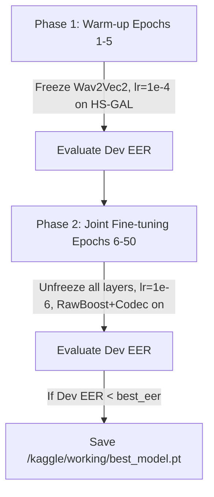

# LOGIC_models — Neural Architectures & Training Strategy

---

## 1. Model Architectures

### Baseline Model: AASIST (Original Clova AI)
- **Input**: Raw waveform tensor `(batch_size, 1, 64000)`.
- **Front-end**: `SincConv` filters extracting spectro-temporal features.
- **Back-end**: 6-block `ResNet` + Heterogeneous Spectro-Temporal Graph Attention Layer (`HS-GAL`) with Master Node.
- **Output**: 2 logits `[s_spoof, s_bonafide]`.

### Main Model: SSL-AASIST
- **Front-end**: Self-Supervised Learning (SSL) feature extractor using Vietnamese pre-trained checkpoint:
  - Backbone: `nguyenvulebinh/wav2vec2-base-vietnamese-250h` (truncated at Transformer layer, removing `lm_head`).
  - Alternative benchmark: `Wav2Vec2-XLS-R` (300M multi-lingual).
- **Projection**: Linear projection mapping Transformer representations into AASIST graph dimension.
- **Back-end**: AASIST `HS-GAL` graph attention capturing micro-artifacts across temporal and spectral nodes.

---

## 2. Loss Function & Optimization

### Weighted Cross-Entropy Loss
```python
weights = torch.FloatTensor([0.1, 0.9]).to(device)  # [Spoof, Bona fide]
criterion = nn.CrossEntropyLoss(weight=weights)
```
> STUBBORN_FACT: Weight is strictly [0.1, 0.9] to prevent high False Alarm rates against real speech given the 2:1 ratio of spoof samples in the training set.

### Optimizer & Hyperparameters
- **Optimizer**: AdamW (`lr=1e-6`, `betas=(0.9, 0.98)`, `eps=1e-8`, `weight_decay=1e-4`).
- **Batch Size**: 16 / 32 with Gradient Accumulation.
- **Early Stopping**: 10 epochs without validation EER improvement.

---

## 3. Two-Phase Training Strategy



1. **Phase 1 (Warm-up, 3-5 epochs)**:
   - Freeze all Wav2Vec 2.0 weights.
   - Train only the HS-GAL graph back-end and linear classifier at `lr=1e-4`.
2. **Phase 2 (Joint Fine-tuning, remaining epochs)**:
   - Unfreeze full Wav2Vec 2.0 backbone.
   - Reduce global learning rate to `lr=1e-6` to prevent catastrophic forgetting.
   - Enable on-the-fly RawBoost and Codec simulation.
   - Save checkpoint `best_model.pt` strictly when validation EER reaches a new minimum.

---

*v0.1.0 — 2026-10-16*
