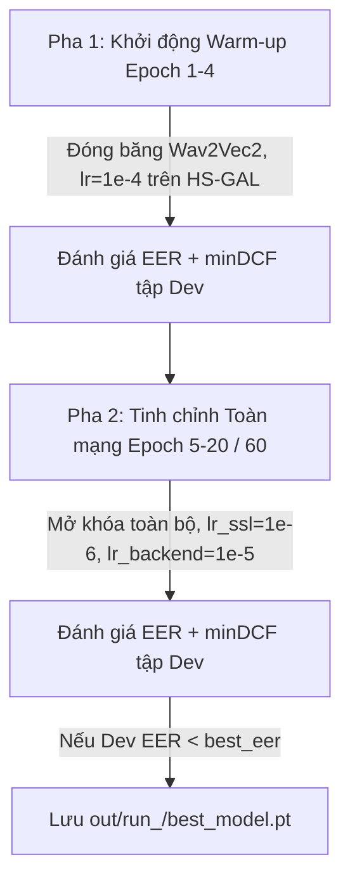

# LOGIC_models — Kiến Trúc Mô Hình, Thiết Kế Đối Chứng & Huấn Luyện

---

## 1. Thiết Kế Kiến Trúc Mô Hình & Các Nhánh Đối Chứng (ADR-1, ADR-2)

### Mô Hình Cơ Sở (Baseline): LFCC + GMM
- **Triển khai**: `src/models/baseline_gmm.py` và CLI `scripts/eval_gmm.py`.
- **Trích xuất đặc trưng**: `extract_lfcc` trích xuất 60 chiều (20 hệ số tĩnh LFCC + 20 delta + 20 delta-delta) trên dải tần tuyến tính ($0–8\text{ kHz}$) ở tần số lấy mẫu $16\text{ kHz}$.
- **Cấu hình GMM**: 512 thành phần Gauss hỗn hợp (`GaussianMixture(n_components=512, covariance_type='diag')`), chia thành 2 mô hình độc lập $P(X|\text{bona})$ và $P(X|\text{spoof})$.
- **Lấy mẫu khung (Subsampling)**: Hỗ trợ `max_frames_per_utt` (ngẫu nhiên 20–100 khung/mẫu) để tối ưu thời gian huấn luyện và bộ nhớ RAM.
- **Điểm số Log-Likelihood Ratio (LLR)**:
  $$s(X) = \frac{1}{T} \sum_{t=1}^T \left[ \log P(x_t \mid \text{bonafide}) - \log P(x_t \mid \text{spoof}) \right]$$
  Điểm số $s(X) > 0$ nghiêng về giọng thật (`bonafide`), khớp quy ước chung của toàn hệ thống.

### Mô Hình Chủ Lực: SSL-AASIST
- **Triển khai**: `src/models/ssl_aasist.py`.
- **Quy ước đầu ra**: Logits $[z_{\text{spoof}}, z_{\text{bonafide}}]$, điểm số phân loại $s = z_{\text{bonafide}} - z_{\text{spoof}}$ (điểm cao = bonafide).
- **Front-end (Tự giám sát SSL)**:
  - Checkpoint tiếng Việt: `nguyenvulebinh/wav2vec2-base-vietnamese-250h` (loại bỏ tầng phân loại ký tự `lm_head`, giữ lại Transformer `Wav2Vec2Model`).
  - Chuẩn hóa biên độ theo mẫu: $\hat{x} = \frac{x - \mu}{\sqrt{\sigma^2 + 10^{-7}}}$.
  - Phép chiếu đặc trưng (`Projection`): Tuyến tính `nn.Linear(hidden_size, 128)`.
- **Back-end (Đồ thị Chú ý Compact AASIST)**:
  - Khối tích chập 2D (`ResBlock2d`): 2 tầng tích chập $3 \times 3$ với chuẩn hóa `BatchNorm2d`, kích hoạt `SELU` và đường tắt `skip connection`.
  - Mạng chú ý đồ thị (`GraphAttention` & `HSGAL`): Tích hợp nút trung tâm (`Master Node`), chú ý không đồng nhất trên cả hai trục thời gian và tần số.
  - Tầng đọc đặc trưng (`Readout`): Kết hợp gộp cực đại và trung bình (`max + mean pool`), chiếu qua tầng tuyến tính xuất 2 logits.
- **Cơ chế 2 pha tích hợp sẵn**: Hỗ trợ `freeze_ssl()`, `unfreeze_ssl()`, và phân chia `param_groups(lr_ssl, lr_backend)` cho bộ tối ưu.

---

## 2. Thiết Kế Thí Nghiệm Đối Chứng (Biến Kiểm Soát CH1 & CH2)

Nhằm trả lời câu hỏi nghiên cứu CH1 (Độ bền nén kênh thoại) và CH2 (Khả năng tổng quát hóa trên TTS chưa thấy), hệ thống phân rã thành **3 nhánh thí nghiệm**:

| Nhánh | Mô tả Kỹ thuật | Dữ liệu Huấn luyện | Augmentation | Cấu hình Epoch | Mục đích Đối chứng |
| :---: | :--- | :--- | :--- | :---: | :--- |
| **Nhánh A** | Baseline Không tăng cường | `mode="clean"` (~9.971 mẫu) | `None` | Phase 1: 4 ep<br>Phase 2: 60 ep | Mốc so sánh cơ sở (CH1/H1). Nhân 3 epoch Phase 2 để cân bằng tổng optimizer steps. |
| **Nhánh B0** | Chỉ nén Codec, không RawBoost | `mode="augmented"` (~29.143 mẫu) | `None` (Đã nén G.711, AMR-NB) | Phase 1: 4 ep<br>Phase 2: 20 ep | Bóc tách chính xác đóng góp riêng biệt của nén kênh thoại so với RawBoost. |
| **Nhánh B** | **ViTrueVoice Đầy đủ** | `mode="augmented"` (~29.143 mẫu) | `make_rawboost()` online | Phase 1: 4 ep<br>Phase 2: 20 ep | Mô hình hoàn chỉnh (Codec + RawBoost: LnL, ISD, SSI). |

### Ràng Buộc Khử Trùng Lặp Unseen TTS (VieNeu-TTS) Bảo Vệ H2
> STUBBORN_FACT: Để giả thuyết H2 giữ nguyên giá trị khoa học, `VieNeu-TTS` bắt buộc phải là công cụ **hoàn toàn chưa từng thấy** lúc huấn luyện.
- Cơ chế kiểm định: `check_unseen_excluded(df, "vieneu", split_name)` chặn đứng nếu `train.csv` hoặc `dev.csv` chứa VieNeu.
- Phân hoạch `manifests_seen_only`:
  - `train.csv`: Loại bỏ toàn bộ 2.184 hàng VieNeu (còn ~2.196 spoof F5-TTS và 26.947 bonafide).
  - `dev.csv`: Loại bỏ toàn bộ hàng VieNeu.
  - `test_indomain.csv` & `test_ood.csv`: Giữ nguyên 100% mẫu VieNeu để đo đạc và kiểm chứng H2.

---

## 3. Hàm Mất Mát & Bảng Siêu Tham Số Huấn Luyện

| Thành phần Huấn luyện | Cấu hình Tham số Chi tiết | Mục đích Kỹ thuật trong Đề tài |
| :--- | :--- | :--- |
| **Hàm mất mát (Loss Function)** | Weighted Cross-Entropy Loss Động<br>Công thức: $w_c = \frac{N}{2 \cdot N_c}$ chuẩn hóa $\sum w_c = 1.0$<br>Hàm: `loss_weights_from_counts(n_spoof, n_bona)` | Bù đắp chính xác tỷ lệ mất cân bằng giữa Spoof (sau khi lọc VieNeu còn $\approx 7.5\%$) và Bona fide ($\approx 92.5\%$). Trọng số tính ra: $w \approx [0.925, 0.075]$. Tuyệt đối không gán cứng. |
| **Bộ tối ưu (Optimizer)** | Adam / AdamW<br>$\beta_1 = 0.9$, $\beta_2 = 0.98$, $\epsilon = 10^{-8}$, $\text{Weight Decay} = 10^{-4}$ | Giữ ổn định đạo hàm khi tinh chỉnh đồng thời cả khối Transformer wav2vec 2.0 và lớp đồ thị HS-GAL. |
| **Tốc độ học (Learning Rate)** | $\bullet$ Pha 1 (Warm-up 4 epochs): $lr = 10^{-4}$ (chỉ back-end)<br>$\bullet$ Pha 2 (Joint Fine-tuning): $lr_{\text{ssl}} = 10^{-6}$, $lr_{\text{backend}} = 10^{-5}$ | $lr_{\text{ssl}} = 10^{-6}$ cực nhỏ ngăn quên thảm khốc (catastrophic forgetting) các biểu diễn âm học tiếng Việt đã tiền huấn luyện. |
| **Batch Size & Bước tích lũy** | $\text{Batch Size} = 16$ (kèm Gradient Accumulation = 2); Cắt/đệm cố định 64.000 mẫu | Đảm bảo kích thước batch hiệu dụng = 32 trên GPU Kaggle (T4 16GB). |
| **Dừng sớm (Early Stopping)** | `patience = 10` epochs theo dõi `dev_eer` | Tự động ngắt huấn luyện khi EER tập Dev ngừng giảm, lưu checkpoint tối ưu nhất. |

> STUBBORN_FACT: Trọng số Loss Cross-Entropy bắt buộc tính động từ tần suất nghịch của tập Train theo công thức $w_c = \frac{N}{2 \cdot N_c}$ qua `loss_weights_from_counts`. Tuyệt đối KHÔNG sử dụng đồng thời `WeightedRandomSampler` cùng Weighted Loss để tránh lỗi bù trừ kép (double penalty).

---

## 4. Chiến Lược Huấn Luyện 2 Pha & Lưu Checkpoint



1. **Pha 1 (Khởi động Warm-up — 4 epoch đầu)**:
   - Đóng băng (`Freeze`) khối front-end wav2vec 2.0 (`ssl.frozen = True`, không tính gradient).
   - Chỉ mở khóa huấn luyện phần back-end đồ thị AASIST với tốc độ học $lr = 10^{-4}$.
2. **Pha 2 (Tinh chỉnh Toàn mạng Joint Fine-tuning)**:
   - Mở khóa (`Unfreeze`) toàn bộ các tầng Transformer của wav2vec 2.0.
   - Sử dụng 2 tốc độ học riêng biệt: $lr_{\text{ssl}} = 10^{-6}$ cho Wav2Vec2 và $lr_{\text{backend}} = 10^{-5}$ cho HS-GAL.
3. **Cấu trúc Lưu Checkpoint**:
   - Checkpoint `best_model.pt` lưu trữ đầy đủ:
     ```python
     {
         "epoch": epoch,
         "phase": phase,
         "model": model.state_dict(),
         "dev_eer": best_eer,
         "branch": cfg.branch,
         "model_kwargs": {"d_graph": 64, "conv_channels": (64, 128), "n_hs": 1},
         "config": dataclasses.asdict(cfg),
     }
     ```
   - Cho phép hàm `load_model` trong `scripts/eval_ssl_aasist.py` tự động phục hồi kiến trúc chính xác mà không cần truyền lại tham số thủ công.

---

## 5. Quy Trình Chấm Điểm & Kiểm Chứng Giả Thuyết Tự Động

### Đánh giá Chấm điểm (`scripts/eval_ssl_aasist.py`)
- Lọc mặc định `role == 'eval'` để đảm bảo bộ ba ghép cặp (Paired Triplets 1:1:1) nguyên vẹn trên cả 3 codec (`clean_16khz`, `g711_alaw`, `amr_nb`).
- Chấm điểm từng mẫu: $s = z_{\text{bonafide}} - z_{\text{spoof}}$, tính EER, khoảng tin cậy Bootstrap 95% (`cluster_bootstrap_ci` theo speaker), và minDCF ($P_{\text{spoof}}=0.05, C_{\text{miss}}=1, C_{\text{fa}}=1$).
- Xuất bảng chuẩn hóa 14 cột tương thích hoàn toàn giữa Baseline GMM và SSL-AASIST.

### Đối chứng Giả thuyết Khoa học (`scripts/compare_h1.py`)
- **Giả thuyết H1 (CH1)**: Đo độ giảm EER tương đối trên từng kênh thoại nén:
  $$\Delta\text{EER}_{\text{rel}} = \frac{\text{EER}_A - \text{EER}_B}{\text{EER}_A} \times 100\% \ge 30.0\%$$
  Verdict `PASS` khi toàn bộ các điều kiện nén đều vượt ngưỡng $30\%$; kiểm tra cờ `ci_overlap` xem khoảng tin cậy 95% có bị chồng lấn hay không.
- **Giả thuyết H2 (CH2)**: Đo EER của Mô hình B trên công cụ chưa từng thấy (`VieNeu-TTS`):
  $$\text{EER}_{\text{unseen}} \le 15.0\% \implies \text{PASS}$$
  Kiểm tra thêm điều kiện cận trên khoảng tin cậy: `ci_hi_pass = (eer_ci_hi <= 0.15)`.
- **Phân rã biến B0 vs B**: Đo đạc độ lệch tương đối giữa B0 (chỉ nén) và B (nén + RawBoost) để định lượng chính xác đóng góp của kỹ thuật RawBoost.

---

*v0.2.5 — 2026-10-29*
