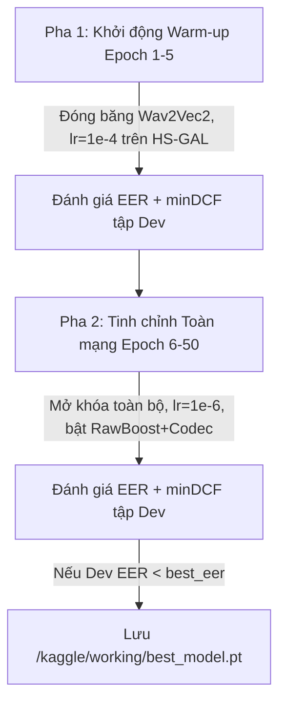

# LOGIC_models — Kiến Trúc Mô Hình, Thiết Kế Đối Chứng & Huấn Luyện

---

## 1. Thiết Kế Kiến Trúc Mô Hình & Các Nhánh Đối Chứng (ADR-1, ADR-2)

### Mô Hình Cơ Sở (Baseline)
- **LFCC + GMM**: Trích xuất đặc trưng cepstral tần số tuyến tính thủ công (LFCC) kết hợp mô hình hỗn hợp Gauss (GMM) chạy trên CPU, làm mốc cơ sở đánh giá độ bền trước nén kênh thoại và chứng minh ưu thế của học tự giám sát.
- **AASIST Nguyên Bản (Clova AI)**:
  - Đầu vào: Tensor waveform thô kích thước `(batch_size, 1, 64000)`.
  - Front-end: Lớp tích chập biến đổi `SincConv` trích xuất đặc trưng phổ - thời gian cấp thấp.
  - Back-end: Mạng tích chập `ResNet` 6 khối kết hợp Mô-đun Mạng chú ý đồ thị không đồng nhất phổ - thời gian (`HS-GAL`) cùng nút trung tâm (`Master Node`).
  - Đầu ra: 2 logit phân loại tuyến tính `[s_spoof, s_bonafide]`.

### Mô Hình Chủ Lực: SSL-AASIST
- **Front-end**: Khối trích xuất đặc trưng tự giám sát (Self-Supervised Learning):
  - Checkpoint tiếng Việt: `nguyenvulebinh/wav2vec2-base-vietnamese-250h` (loại bỏ tầng phân loại ký tự `lm_head`, giữ lại khối Transformer `Wav2Vec2Model`).
  - Checkpoint đối chứng đa ngôn ngữ: `Wav2Vec2-XLS-R` (300M tham số).
- **Phép chiếu (Projection)**: Lớp tuyến tính `Linear` chiếu biểu diễn từ tầng Transformer cuối cùng vào không gian nút của đồ thị AASIST.
- **Back-end**: Thân đồ thị `HS-GAL` của AASIST bắt trọn các dấu vết giả mạo vi mô (micro-artefacts) trên các trục phổ và thời gian.

### Thiết Kế Thí Nghiệm Đối Chứng (Biến Kiểm Soát - Mục 3.5)
- **Nhánh Đối chứng cho CH1 / H1**:
  - *Mô hình A (Không tăng cường nén)*: SSL-AASIST huấn luyện chỉ trên âm thanh sạch (`clean_16khz`).
  - *Mô hình B (Có tăng cường nén - ViTrueVoice)*: SSL-AASIST huấn luyện với tăng cường nén kênh thoại (Opus, AMR-NB, G.711 A-law, lọc $8\text{ kHz}$ + RawBoost).
  - *Mục tiêu*: Chứng minh giả thuyết **H1** (giảm $\ge 30\%$ EER tương đối trên tập kiểm thử nén).
- **Nhánh Đối chứng cho CH2 / H2 (Khả năng Tổng quát hóa)**:
  - *Seen TTS (In-Domain)*: Mẫu giả sinh từ `F5-TTS-Vietnamese` có mặt trong tập huấn luyện.
  - *Unseen TTS (Out-of-Distribution)*: Mẫu giả sinh từ `VieNeu-TTS v3 Turbo` (kèm công cụ thứ 3 ở mức Could) hoàn toàn chưa xuất hiện khi huấn luyện.
  - *Mục tiêu*: Kiểm chứng giả thuyết **H2** ($\text{EER} \le 15\%$ trên Unseen TTS).
- **Biến Giữ Cố Định**: Cùng kiến trúc mô hình, cùng tập kiểm thử, cùng số bước huấn luyện (50–100 epochs).

---

## 2. Hàm Mất Mát & Bảng Siêu Tham Số Huấn Luyện

| Thành phần Huấn luyện | Cấu hình Tham số Chi tiết | Mục đích Kỹ thuật trong Đề tài |
| :--- | :--- | :--- |
| **Hàm mất mát (Loss Function)** | Weighted Cross-Entropy Loss<br>Trọng số lớp: $W = [0.1, 0.9]$ (Spoof: $0.1$, Bona fide: $0.9$) | Bù đắp mất cân bằng số lượng mẫu giữa tập Spoof ($\ge 2.000$) và Bona fide ($\ge 1.000$), giảm thiểu báo động giả trên người dùng thật. |
| **Bộ tối ưu (Optimizer)** | Adam / AdamW<br>$\beta_1 = 0.9$, $\beta_2 = 0.98$, $\epsilon = 10^{-8}$, $\text{Weight Decay} = 10^{-4}$ | Giữ ổn định đạo hàm khi tinh chỉnh đồng thời cả khối Transformer wav2vec 2.0 và lớp đồ thị HS-GAL. |
| **Tốc độ học (Learning Rate)** | $\bullet$ Khởi động (Warm-up 3–5 epochs): $lr = 10^{-4}$<br>$\bullet$ Tinh chỉnh wav2vec 2.0 (Fine-tune): $lr = 10^{-6}$ | Learning rate cực nhỏ ($10^{-6}$) ngăn hiện tượng quên thảm khốc (catastrophic forgetting) các biểu diễn âm học đã học của wav2vec 2.0. |
| **Batch Size & Bước huấn luyện** | $\text{Batch Size} = 16$ hoặc $32$ (kèm Gradient Accumulation); cố định 50–100 epochs | Đảm bảo hội tụ ổn định trên GPU Kaggle; dừng sớm (`Early Stopping = 10 epochs`) khi EER trên tập Dev ngừng giảm. |

> STUBBORN_FACT: Trọng số bắt buộc là [0.1, 0.9] để triệt tiêu hiện tượng mô hình thiên vị lớp giả do tập Spoof (>= 2.000 mẫu) gấp đôi tập Bona fide (>= 1.000 mẫu), đồng thời phạt nặng lỗi nhận diện nhầm người dùng thật thành giả mạo.

---

## 3. Chiến Lược Huấn Luyện 2 Pha & Lưu Checkpoint



1. **Pha 1 (Khởi động Warm-up — 3 đến 5 epoch đầu)**:
   - Đóng băng (`Freeze`) toàn bộ trọng số của khối front-end wav2vec 2.0.
   - Chỉ mở khóa huấn luyện phần back-end đồ thị AASIST và tầng phân loại với tốc độ học `lr = 1e-4`.
2. **Pha 2 (Tinh chỉnh Toàn mạng Joint Fine-tuning — Epoch 6 đến 50–100)**:
   - Mở khóa (`Unfreeze`) toàn bộ các tầng Transformer của wav2vec 2.0.
   - Hạ Learning Rate toàn cục xuống `lr = 1e-6` và huấn luyện đồng thời cả Front-end lẫn Back-end kết hợp `RawBoost` + `Codec Augmentation`.
3. **Kiểm định & Lưu Checkpoint**:
   - Sau mỗi epoch, chạy `model.eval()` trên tập Dev (`dev_manifest.csv`), tính toán chỉ số **EER (%)** và **minDCF**.
   - Chỉ lưu đè file checkpoint `/kaggle/working/best_model.pt` khi EER trên tập Dev đạt mức thấp nhất mới.

```python
# Vòng lặp huấn luyện PyTorch chuẩn
import torch, torch.nn as nn
from torch.optim import Adam

device = torch.device('cuda' if torch.cuda.is_available() else 'cpu')
model = SSLAASISTModel(ssl_pretrained='nguyenvulebinh/wav2vec2-base-vietnamese-250h').to(device)
weights = torch.FloatTensor([0.1, 0.9]).to(device)  # [Spoof, Bona fide]
criterion = nn.CrossEntropyLoss(weight=weights)
optimizer = Adam(model.parameters(), lr=1e-6, betas=(0.9, 0.98), eps=1e-8, weight_decay=1e-4)

best_eer = float('inf')
for epoch in range(1, num_epochs + 1):
    model.train()
    for batch_x, batch_y in train_loader:
        batch_x, batch_y = batch_x.to(device), batch_y.to(device)
        optimizer.zero_grad()
        logits = model(batch_x)           # Output shape: (batch_size, 2)
        loss = criterion(logits, batch_y)
        loss.backward()
        optimizer.step()
    
    # Đánh giá EER & minDCF trên tập Dev cuối mỗi Epoch
    dev_eer, dev_mindcf = evaluate_eer_mindcf(model, dev_loader, device)
    if dev_eer < best_eer:
        best_eer = dev_eer
        torch.save(model.state_dict(), '/kaggle/working/best_model.pt')
```

---

*v0.2.3 — 2026-10-26 (Frozen Pipeline V14)*
