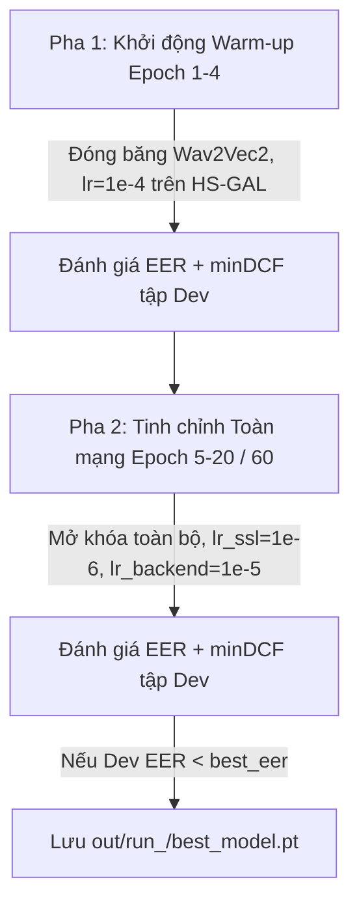

# LOGIC_models — Kiến Trúc Mô Hình, Thiết Kế Đối Chứng & Huấn Luyện

---

## 1. Thiết Kế Kiến Trúc Mô Hình & Các Nhánh Đối Chứng (ADR-1, ADR-2)

### Mô Hình Cơ Sở (Baseline): LFCC + GMM
- **Triển khai**: `src/models/baseline_gmm.py` và CLI `scripts/eval_gmm.py`.
- **Trích xuất đặc trưng**: `extract_lfcc` trích xuất 60 chiều (20 hệ số tĩnh LFCC + 20 delta + 20 delta-delta) trên dải tần tuyến tính ($0–8\text{ kHz}$) ở tần số lấy mẫu $16\text{ kHz}$.
- **Cấu hình GMM**: 512 thành phần Gauss hỗn hợp (`GaussianMixture(n_components=512, covariance_type='diag')`), chia thành 2 mô hình độc lập $P(X|\text{bona})$ và $P(X|\text{spoof})$.
- **Lấy mẫu khung (Subsampling)**: Hỗ trợ `max_frames_per_utt` (ngẫu nhiên 20–100 khung/mẫu) để tối ưu thời gian huấn luyện và bộ nhớ RAM.
- **Điểm số Log-Likelihood Ratio (LLR)**:
  $$s(X) = \frac{1}{T} \sum_{t=1}^T \left[ \log P(x_t \mid \text{bonafide}) - \log P(x_t \mid \text{spoof}) \right]$$
  Điểm số $s(X) > 0$ nghiêng về giọng thật (`bonafide`), khớp quy ước chung của toàn hệ thống.

### Mô Hình Chủ Lực: SSL-AASIST
- **Triển khai**: `src/models/ssl_aasist.py`.
- **Quy ước đầu ra**: Logits $[z_{\text{spoof}}, z_{\text{bonafide}}]$, điểm số phân loại $s = z_{\text{bonafide}} - z_{\text{spoof}}$ (điểm cao = bonafide).
- **Front-end (Tự giám sát SSL)**:
  - Checkpoint tiếng Việt: `nguyenvulebinh/wav2vec2-base-vietnamese-250h` (loại bỏ tầng phân loại ký tự `lm_head`, giữ lại Transformer `Wav2Vec2Model`).
  - Chuẩn hóa biên độ theo mẫu: $\hat{x} = \frac{x - \mu}{\sqrt{\sigma^2 + 10^{-7}}}$.
  - Phép chiếu đặc trưng (`Projection`): Tuyến tính `nn.Linear(hidden_size, 128)`.
- **Back-end (Đồ thị Chú ý Compact AASIST)**:
  - Khối tích chập 2D (`ResBlock2d`): 2 tầng tích chập $3 \times 3$ với chuẩn hóa `BatchNorm2d`, kích hoạt `SELU` và đường tắt `skip connection`.
  - Mạng chú ý đồ thị (`GraphAttention` & `HSGAL`): Tích hợp nút trung tâm (`Master Node`), chú ý không đồng nhất trên cả hai trục thời gian và tần số.
  - Tầng đọc đặc trưng (`Readout`): Kết hợp gộp cực đại và trung bình (`max + mean pool`), chiếu qua tầng tuyến tính xuất 2 logits.
- **Cơ chế 2 pha tích hợp sẵn**: Hỗ trợ `freeze_ssl()`, `unfreeze_ssl()`, và phân chia `param_groups(lr_ssl, lr_backend)` cho bộ tối ưu.

---

## 2. Thiết Kế Thí Nghiệm Đối Chứng (Biến Kiểm Soát CH1 & CH2)

Nhằm trả lời câu hỏi nghiên cứu CH1 (Độ bền nén kênh thoại) và CH2 (Khả năng tổng quát hóa trên TTS chưa thấy), hệ thống phân rã thành **3 nhánh thí nghiệm**:

| Nhánh | Mô tả Kỹ thuật | Dữ liệu Huấn luyện | Augmentation | Cấu hình Epoch | Mục đích Đối chứng |
| :---: | :--- | :--- | :--- | :---: | :--- |
| **Nhánh A** | Baseline Không tăng cường | `mode="clean"` (~9.971 mẫu) | `None` | Phase 1: 4 ep<br>Phase 2: 60 ep | Mốc so sánh cơ sở (CH1/H1). Nhân 3 epoch Phase 2 để cân bằng tổng optimizer steps. |
| **Nhánh B0** | Chỉ nén Codec, không RawBoost | `mode="augmented"` (~29.143 mẫu) | `None` (Đã nén G.711, AMR-NB) | Phase 1: 4 ep<br>Phase 2: 20 ep | Bóc tách chính xác đóng góp riêng biệt của nén kênh thoại so với RawBoost. |
| **Nhánh B** | **ViTrueVoice Đầy đủ** | `mode="augmented"` (~29.143 mẫu) | `make_rawboost()` online | Phase 1: 4 ep<br>Phase 2: 20 ep | Mô hình hoàn chỉnh (Codec + RawBoost: LnL, ISD, SSI). |

### Ràng Buộc Khử Trùng Lặp Unseen TTS (VieNeu-TTS) Bảo Vệ H2
> STUBBORN_FACT: Để giả thuyết H2 giữ nguyên giá trị khoa học, `VieNeu-TTS` bắt buộc phải là công cụ **hoàn toàn chưa từng thấy** lúc huấn luyện.
- Cơ chế kiểm định: `check_unseen_excluded(df, "vieneu", split_name)` chặn đứng nếu `train.csv` hoặc `dev.csv` chứa VieNeu.
- Phân hoạch `manifests_seen_only`:
  - `train.csv`: Loại bỏ toàn bộ 2.184 hàng VieNeu (còn ~2.196 spoof F5-TTS và 26.947 bonafide).
  - `dev.csv`: Loại bỏ toàn bộ hàng VieNeu.
  - `test_indomain.csv` & `test_ood.csv`: Giữ nguyên 100% mẫu VieNeu để đo đạc và kiểm chứng H2.

---

## 3. Hàm Mất Mát & Bảng Siêu Tham Số Huấn Luyện

| Thành phần Huấn luyện | Cấu hình Tham số Chi tiết | Mục đích Kỹ thuật trong Đề tài |
| :--- | :--- | :--- |
| **Hàm mất mát (Loss Function)** | Weighted Cross-Entropy Loss Động<br>Công thức: $w_c = \frac{N}{2 \cdot N_c}$ chuẩn hóa $\sum w_c = 1.0$<br>Hàm: `loss_weights_from_counts(n_spoof, n_bona)` | Bù đắp chính xác tỷ lệ mất cân bằng giữa Spoof (sau khi lọc VieNeu còn $\approx 7.5\%$) và Bona fide ($\approx 92.5\%$). Trọng số tính ra: $w \approx [0.925, 0.075]$. Tuyệt đối không gán cứng. |
| **Bộ tối ưu (Optimizer)** | Adam / AdamW<br>$\beta_1 = 0.9$, $\beta_2 = 0.98$, $\epsilon = 10^{-8}$, $\text{Weight Decay} = 10^{-4}$ | Giữ ổn định đạo hàm khi tinh chỉnh đồng thời cả khối Transformer wav2vec 2.0 và lớp đồ thị HS-GAL. |
| **Tốc độ học (Learning Rate)** | $\bullet$ Pha 1 (Warm-up 4 epochs): $lr = 10^{-4}$ (chỉ back-end)<br>$\bullet$ Pha 2 (Joint Fine-tuning): $lr_{\text{ssl}} = 10^{-6}$, $lr_{\text{backend}} = 10^{-5}$ | $lr_{\text{ssl}} = 10^{-6}$ cực nhỏ ngăn quên thảm khốc (catastrophic forgetting) các biểu diễn âm học tiếng Việt đã tiền huấn luyện. |
| **Batch Size & Bước tích lũy** | $\text{Batch Size} = 16$ (kèm Gradient Accumulation = 2); Cắt/đệm cố định 64.000 mẫu | Đảm bảo kích thước batch hiệu dụng = 32 trên GPU Kaggle (T4 16GB). |
| **Dừng sớm (Early Stopping)** | `patience = 10` epochs theo dõi `dev_eer` | Tự động ngắt huấn luyện khi EER tập Dev ngừng giảm, lưu checkpoint tối ưu nhất. |

> STUBBORN_FACT: Trọng số Loss Cross-Entropy bắt buộc tính động từ tần suất nghịch của tập Train theo công thức $w_c = \frac{N}{2 \cdot N_c}$ qua `loss_weights_from_counts`. Tuyệt đối KHÔNG sử dụng đồng thời `WeightedRandomSampler` cùng Weighted Loss để tránh lỗi bù trừ kép (double penalty).

---

## 4. Chiến Lược Huấn Luyện 2 Pha & Lưu Checkpoint



1. **Pha 1 (Khởi động Warm-up — 4 epoch đầu)**:
   - Đóng băng (`Freeze`) khối front-end wav2vec 2.0 (`ssl.frozen = True`, không tính gradient).
   - Chỉ mở khóa huấn luyện phần back-end đồ thị AASIST với tốc độ học $lr = 10^{-4}$.
2. **Pha 2 (Tinh chỉnh Toàn mạng Joint Fine-tuning)**:
   - Mở khóa (`Unfreeze`) toàn bộ các tầng Transformer của wav2vec 2.0.
   - Sử dụng 2 tốc độ học riêng biệt: $lr_{\text{ssl}} = 10^{-6}$ cho Wav2Vec2 và $lr_{\text{backend}} = 10^{-5}$ cho HS-GAL.
3. **Cấu trúc Lưu Checkpoint**:
   - Checkpoint `best_model.pt` lưu trữ đầy đủ:
     ```python
     {
         "epoch": epoch,
         "phase": phase,
         "model": model.state_dict(),
         "dev_eer": best_eer,
         "branch": cfg.branch,
         "model_kwargs": {"d_graph": 64, "conv_channels": (64, 128), "n_hs": 1},
         "config": dataclasses.asdict(cfg),
     }
     ```
   - Cho phép hàm `load_model` trong `scripts/eval_ssl_aasist.py` tự động phục hồi kiến trúc chính xác mà không cần truyền lại tham số thủ công.

---

## 5. Quy Trình Chấm Điểm & Kiểm Chứng Giả Thuyết Tự Động

### Đánh giá Chấm điểm (`scripts/eval_ssl_aasist.py`)
- Lọc mặc định `role == 'eval'` để đảm bảo bộ ba ghép cặp (Paired Triplets 1:1:1) nguyên vẹn trên cả 3 codec (`clean_16khz`, `g711_alaw`, `amr_nb`).
- Chấm điểm từng mẫu: $s = z_{\text{bonafide}} - z_{\text{spoof}}$, tính EER, khoảng tin cậy Bootstrap 95% (`cluster_bootstrap_ci` theo speaker), và minDCF ($P_{\text{spoof}}=0.05, C_{\text{miss}}=1, C_{\text{fa}}=1$).
- Xuất bảng chuẩn hóa 14 cột tương thích hoàn toàn giữa Baseline GMM và SSL-AASIST.

### Đối chứng Giả thuyết Khoa học (`scripts/compare_h1.py`)
- **Giả thuyết H1 (CH1)**: Đo độ giảm EER tương đối trên từng kênh thoại nén:
  $$\Delta\text{EER}_{\text{rel}} = \frac{\text{EER}_A - \text{EER}_B}{\text{EER}_A} \times 100\% \ge 30.0\%$$
  Verdict `PASS` khi toàn bộ các điều kiện nén đều vượt ngưỡng $30\%$; kiểm tra cờ `ci_overlap` xem khoảng tin cậy 95% có bị chồng lấn hay không.
- **Giả thuyết H2 (CH2)**: Đo EER của Mô hình B trên công cụ chưa từng thấy (`VieNeu-TTS`):
  $$\text{EER}_{\text{unseen}} \le 15.0\% \implies \text{PASS}$$
  Kiểm tra thêm điều kiện cận trên khoảng tin cậy: `ci_hi_pass = (eer_ci_hi <= 0.15)`.
- **Phân rã biến B0 vs B**: Đo đạc độ lệch tương đối giữa B0 (chỉ nén) và B (nén + RawBoost) để định lượng chính xác đóng góp của kỹ thuật RawBoost.

---

## 6. Kết Quả Thực Nghiệm Đối Chứng H1, H2 & Phân Rã RawBoost (Must #2)

Đánh giá thực nghiệm hoàn tất trên 3 checkpoint thu được từ Kaggle GPU (Version 3 & 4) trên tập kiểm thử nội bộ (`test_indomain.csv`, 9.399 mẫu `role == 'eval'`) và ngoại vùng (`test_ood.csv`, 813 mẫu):
- **Mô hình A (Clean Baseline)**: Dừng sớm tại Epoch 10 (patience=6), checkpoint tốt nhất tại Phase 1 Epoch 4 (`dev_eer = 20.66%`).
- **Mô hình B0 (Chỉ Codec, không RawBoost)**: Hoàn thành 24/24 epoch, checkpoint tốt nhất tại Phase 2 Epoch 24 (`dev_eer = 1.93%`).
- **Mô hình B (ViTrueVoice: Codec + RawBoost)**: Đạt 20/24 epoch trước giới hạn 12h, checkpoint tốt nhất tại Phase 2 Epoch 20 (`dev_eer = 2.95%`).

### 6.1. Bảng Đối Chứng Giả Thuyết H1 (Độ Bền Nén Kênh Thoại — CH1)
> Quy ước dấu: Độ giảm EER tương đối $\Delta\text{EER}_{\text{rel}} = \frac{\text{EER}_A - \text{EER}_B}{\text{EER}_A} \times 100\%$. Giá trị dương ($> 0$) biểu thị tỷ lệ cải thiện (EER của B thấp hơn A).

| Tập kiểm thử | Kênh nén | EER Mô hình A | 95% Bootstrap CI (A) | EER Mô hình B | 95% Bootstrap CI (B) | $\Delta\text{EER}_{\text{rel}}$ | CI Overlap | Kết luận (Verdict) |
| :--- | :--- | :---: | :---: | :---: | :---: | :---: | :---: | :---: |
| **In-domain** | **AMR-NB** ($8\text{ kHz}$) | $28.06\%$ | $[24.48\%, 32.30\%]$ | **$16.70\%$** | $[12.67\%, 20.81\%]$ | **$+40.46\%$** | **False** | **PASS** ($\ge 30\%$) |
| **In-domain** | **G.711 A-law** | $28.13\%$ | $[23.00\%, 33.45\%]$ | **$14.75\%$** | $[10.52\%, 19.38\%]$ | **$+47.55\%$** | **False** | **PASS** ($\ge 30\%$) |
| *OOD* | AMR-NB ($8\text{ kHz}$) | $42.74\%$ | $[36.09\%, 49.17\%]$ | $27.89\%$ | $[17.02\%, 34.11\%]$ | $+34.75\%$ | False | PASS ($\ge 30\%$) |
| *OOD* | G.711 A-law | $35.48\%$ | $[27.39\%, 46.30\%]$ | $29.84\%$ | $[19.17\%, 36.81\%]$ | $+15.91\%$ | True | FAIL ($< 30\%$) |

> **Kết luận H1**: **ĐẠT TRÊN TẬP NỘI BỘ (In-domain Split Verdict: PASS)**. Cả hai chuẩn nén thoại đều giảm từ $40.46\%$ đến $47.55\%$ EER tương đối, vượt ngưỡng $30\%$, khoảng tin cậy 95% tách biệt hoàn toàn (`ci_overlap = False`). Trên tập ngoại vùng (OOD), AMR-NB đạt $+34.75\%$ nhưng G.711 chỉ đạt $+15.91\%$, do đó **chưa đạt toàn phần trên mọi điều kiện OOD**.

### 6.2. Bảng Đánh Giá Giả Thuyết H2 (Độ Bền Công Cụ TTS Chưa Từng Thấy — CH2)
> Mục tiêu đề cương: $\text{EER} \le 15.0\%$ trên công cụ lạ (`VieNeu-TTS`).

| Tập kiểm thử | Điều kiện nén | EER VieNeu-TTS | 95% Bootstrap CI | Mục tiêu | Kết luận |
| :--- | :--- | :---: | :---: | :---: | :---: |
| **In-domain** | **G.711 A-law** | **$21.88\%$** | $[15.56\%, 29.33\%]$ | $\le 15.0\%$ | **CHƯA ĐẠT** |
| **In-domain** | **Clean 16kHz** | **$22.17\%$** | $[15.62\%, 29.24\%]$ | $\le 15.0\%$ | **CHƯA ĐẠT** |
| **In-domain** | **AMR-NB** | **$26.34\%$** | $[18.89\%, 31.98\%]$ | $\le 15.0\%$ | **CHƯA ĐẠT** |
| *OOD* | G.711 A-law | $45.90\%$ | $[27.58\%, 55.50\%]$ | $\le 15.0\%$ | CHƯA ĐẠT |

> **Kết luận H2**: **CHƯA ĐẠT**. EER trên VieNeu-TTS dao động trong khoảng $21.88\% - 26.34\%$. Dù mô hình B đã giảm mạnh so với baseline A ($38.35\% \to 22.92\%$, giảm $40.23\%$ tương đối), phân phối âm học của VieNeu vẫn có độ lệch lớn so với F5-TTS khi áp đặt ràng buộc nghiêm ngặt Hard Unseen (loại bỏ 100% khỏi Train/Dev). Kết quả được giữ nguyên làm số liệu thực nghiệm trung thực trong báo cáo.

### 6.3. Bóc Tách Đóng Góp Riêng Biệt Của RawBoost (B0 vs B)
| Tập kiểm thử | Kênh nén | EER B0 (Chỉ Codec) | EER B (Codec + RawBoost) | Mức giảm thêm nhờ RawBoost |
| :--- | :--- | :---: | :---: | :---: |
| **In-domain** | **G.711 A-law** | $18.93\%$ | **$14.75\%$** | **$+22.06\%$** |
| **In-domain** | **AMR-NB** | $19.38\%$ | **$16.70\%$** | **$+13.79\%$** |

> **Ý nghĩa khoa học**: Tăng cường Codec giúp giảm EER từ $28\%$ xuống $19\%$; bổ sung RawBoost trực tuyến giúp giảm tiếp từ $19\%$ xuống $14.75\%–16.70\%$, chứng minh vai trò tích cực độc lập của RawBoost.

### 6.4. Đánh Giá Độ Chính Xác Nội Bộ Trên Giọng Giả Đã Thấy (F5-TTS, In-domain)
- `clean_16khz`: **$2.67\%$** EER (minDCF = 0.108).
- `g711_alaw`: **$2.67\%$** EER (minDCF = 0.107).
- `amr_nb`: **$3.56\%$** EER (minDCF = 0.210).
- Toàn bộ In-domain F5-TTS: **$3.28\%$** EER (ĐẠT VƯỢT TRỘI so với mục tiêu đề tài $\le 8.0\%$).

### 6.5. Phân Tích Ca Chẩn Đoán Thực Tế (SPK_0001) & Chuẩn Hóa Điểm Phân Định
- **Hiện tượng**: Toàn bộ 15/15 phát ngôn của người nói `SPK_0001` (thuộc bộ nghiệm thu độc lập) bị mô hình cho điểm âm ($-21.78$ đến $-10.24$, trung vị $-14.36$).
- **Bằng chứng mô tả & Ranh giới kết luận**:
  1. Phân phối điểm số của 15 phát ngôn này dịch chuyển lặp lại vào dải điểm của lớp Spoof (trùng dải $-20.11$ đến $-4.89$ của F5-TTS). Đây là bằng chứng lỗi lặp lại ở một người nói cụ thể, chưa chứng minh vật lý rằng micro, cự ly, phòng thu, F0 hay SNR là nguyên nhân duy nhất.
  2. Thiết bị thu âm, phòng, khoảng cách và đặc thù người nói được xem là các **nguồn biến thiên âm học cần bao phủ trong dữ liệu**, không được quy kết chủ quan làm nguyên nhân gốc hoặc quy lỗi cho người tham gia.
  3. Phân tích pháp y chuỗi tệp cho thấy audio của `SPK_0001` được ghi bằng ứng dụng thoại điện thoại, truyền qua ứng dụng Zalo dưới dạng container `.m4a` (AAC-LC 48kHz mono ~76kbps) và được người dùng đổi thủ công phần mở rộng sang `.wav`.
  4. Thực nghiệm tách biệt tín hiệu cho thấy: mẫu âm nền tự nhiên của phòng thu `SPK_0001` đạt điểm $+11.20$ (rất thật), trong khi đoạn thoại đã cắt khoảng lặng có điểm âm sâu ($-11.91$), cho thấy mô hình phản ứng với tổ hợp đặc trưng âm học trong giọng nói qua chuỗi nén này.
  5. Mô hình Checkpoint B vẫn bảo toàn trật tự phân hạng trên `SPK_0001`: Giọng thật ($-10.83$) > VieNeu clone ($-15.18$) > F5 clone ($-18.45$).
  6. Không thể hạ ngưỡng quyết định $\theta$ xuống dưới $-10.24$ vì sẽ làm tỷ lệ chấp nhận sai (FAR) trên F5-TTS tăng vọt. Ngưỡng vận hành production được giữ cố định $\theta = 0.0$.
- **Loại bỏ xác suất giả mạo 100%**: Loại bỏ hoàn toàn công thức phi chuẩn hóa $\sigma(|s|)$. Khi chưa áp dụng mô hình cân chỉnh xác suất (Isotonic / Platt Scaling trên tập Dev độc lập), trường `confidence` trả về `null` (API) hoặc hiển thị raw score kèm thông báo chưa hiệu chuẩn (UI/Bot), đảm bảo tính trung thực khoa học theo Đề cương Mục 3.3.

---

## 7. Mở Rộng Kênh Zalo & Nhánh Huấn Luyện Fine-Tuning `B_zalo`

### 7.1. Đánh Giá Baseline Checkpoint B Trên Kênh Zalo & Quy Trình Khôi Phục (Giai Đoạn 2)
- **Kết quả chẩn đoán lỗi baseline ban đầu (146 mẫu local)**:
  - Lần chạy thử trên máy local chỉ bao phủ 146 mẫu (100% bona fide) do thiếu kho âm thanh đầy đủ (3,26 GB lưu trên Kaggle). Khi thiếu spoof, cơ chế fallback cũ đã điền $EER=0.00\%$ và $FAR=0.00\%$ sai lệch. Số liệu này không được công nhận làm baseline khoa học.
- **Quy trình khôi phục baseline chuẩn (Giai đoạn 2 — Kernel Kaggle GPU riêng biệt)**:
  - Khóa mã băm SHA-256: Checkpoint B (`a921c339…b56bd9f`) và `dev_zalo.csv` (`730937e8…f4f77e`).
  - Đóng gói kernel inference-only độc lập `deploy_zalo_eval/eval_zalo_baseline.ipynb` (kèm `kernel-metadata.json` mount 2 nguồn: `vietrue-ssl-training` và `vietrue-model-training`).
  - Thực thi giải nén chọn lọc 1-1 và suy luận toàn bộ **11.450 mẫu Dev Zalo** trên GPU Tesla T4 (5 codec: Clean 2.332, AAC 2.332, Opus 2.332, AMR 2.227, G.711 2.227). Mỗi codec bao gồm đầy đủ cả hai lớp (2.140/2.035 bona fide và 192 spoof).
  - Bắt buộc kiểm tra tính hợp lệ (`is_valid = True`), fail-fast nếu thiếu audio, báo cáo EER, minDCF, FRR@0, FAR@0, Bootstrap 95% CI theo `base_utt` và paired deltas $\Delta s = s_{\text{proxy}} - s_{\text{clean}}$.
- **Tiêu chuẩn công nhận**: Chỉ công nhận baseline sau khi kết quả Kaggle trả về đủ 11.450 điểm số và mọi codec đều có cả hai lớp. Mọi quyết định fine-tune `B_zalo` chỉ được tiến hành sau khi baseline hợp lệ này được thiết lập.
- **Kết quả Baseline Chính thức trên 11.450 Mẫu Dev Zalo (Khóa ngày 2026-10-30)**:
  - Bảng điểm chi tiết: `out/zalo_baseline/dev_zalo_scores.csv` (11.450 dòng, 10.490 bona fide, 960 spoof, 0% rò rỉ volunteer `SPK_xxxx` và unseen `VieNeu-TTS`).
  - Bảng chỉ số tổng hợp (`out/zalo_baseline/zalo_baseline_metrics.csv`):

| Nhóm Codec | n_bona | n_spoof | EER (%) | EER 95% CI (Bootstrap) | $\text{FRR}_{\theta=0}$ (%) | $\text{FAR}_{\theta=0}$ (%) | minDCF |
|---|---|---|---|---|---|---|---|
| `clean_16khz` | 2.140 | 192 | **2.604%** | [1.40, 3.85] | 1.92% | 3.12% | 0.1271 |
| **`aac_zalo_76k` (Profile A)** | 2.140 | 192 | **2.617%** | [1.82, 4.37] | 0.89% | 7.81% | 0.1480 |
| **`opus_zalo_24k` (Profile B)** | 2.140 | 192 | **2.103%** | [1.41, 3.55] | 1.82% | 3.65% | 0.1345 |
| `g711_alaw` | 2.035 | 192 | **3.125%** | [1.93, 4.12] | 2.16% | 4.69% | 0.1780 |
| `amr_nb` | 2.035 | 192 | **3.125%** | [2.03, 4.26] | 0.49% | 9.90% | 0.1508 |

  - Độ lệch điểm số ghép cặp so với Clean (`out/zalo_baseline/zalo_paired_deltas.csv`, $\Delta s = s_{\text{proxy}} - s_{\text{clean}}$):

| Codec Proxy | Số cặp ($N$) | Mean $\Delta s$ | Std $\Delta s$ | Trung vị $\Delta s$ | Min $\Delta s$ | Max $\Delta s$ |
|---|---|---|---|---|---|---|
| `aac_zalo_76k` | 2.332 | **-0.3652** | 2.5564 | -0.7087 | -8.5854 | +18.8603 |
| `opus_zalo_24k` | 2.332 | **-0.0004** | 0.7177 | -0.0151 | -6.3306 | +5.9937 |
| `g711_alaw` | 2.227 | **+0.2739** | 1.7358 | +0.2030 | -14.8060 | +11.7019 |
| `amr_nb` | 2.227 | **+0.5632** | 2.9074 | +0.0927 | -8.9529 | +19.4539 |

  - **Nhận định khoa học**:
    1. *Profile B (`opus_zalo_24k`)*: Độ lệch trung bình gần như triệt tiêu ($\text{mean }\Delta s = -0.0004$, $\text{std} = 0.7177$), EER đạt $2.103\%$, cho thấy biểu diễn Wav2Vec2 + AASIST của Checkpoint B thích ứng rất tốt với kênh thoại Opus 24kbps.
    2. *Profile A (`aac_zalo_76k`)*: Gây dịch chuyển điểm số nhẹ về phía âm ($\text{mean }\Delta s = -0.3652$, $\text{median } = -0.7087$) với độ phân tán cao ($\text{std} = 2.5564$), đẩy $\text{FAR}_{\theta=0}$ lên $7.81\%$.
    3. *Mục tiêu cho `B_zalo` Fine-Tuning*: Nhánh `B_zalo` tập trung hiệu chỉnh phân phối điểm của `aac_zalo_76k` để giảm phương sai $\Delta s$, kéo $\text{FAR}_{\theta=0}$ và $\text{FRR}_{\theta=0}$ về mức cân bằng tối ưu.

### 7.2. Cấu Hình Tinh Chỉnh Nhánh `B_zalo` (`scripts/train.py --branch B_zalo`)
Để triệt tiêu độ dịch chuyển âm và đưa $\text{FRR}_{\theta=0}$ của Profile A về $0.0\%$, nhánh `B_zalo` thực hiện fine-tuning từ checkpoint nền:
- **Trọng số khởi tạo (`--init-ckpt`)**: Tải trực tiếp `best_model_B.pt` (Phase 2 Ep 20).
- **Chiến lược Đóng Băng Khối Tự Giám Sát (Frozen SSL Backbone)**:
  - `phase1_epochs = 5`: Đóng băng 100% backbone `Wav2Vec2Model`, chỉ cập nhật tầng chiếu tuyến tính và mạng đồ thị HS-GAL với $lr = 10^{-4}$.
  - `phase2_epochs = 0`: Tắt hoàn toàn Pha 2 để ngăn hiện tượng quên thảm khốc (catastrophic forgetting) các biểu diễn âm học tiếng Việt đã hội tụ ở Checkpoint B.
- **Hàm mất mát Dynamic Weighted CE**:
  - $w_c = \frac{N}{2 \cdot N_c}$ tính toán động trên `train_zalo.csv` (loại bỏ 100% `VieNeu-TTS` và `SPK_xxxx`).
- **Giám sát Dừng Sớm (Early Stopping)**:
  - `patience = 5` epochs, theo dõi chỉ số `dev_eer` trên tập `dev_zalo.csv` để lưu `best_model_B_zalo.pt`.

### 7.3. Đóng Gói Kernel Huấn Luyện Kaggle `deploy_zalo_train`
- **Tập lệnh sinh kernel**: `scripts/build_zalo_train_notebook.py`.
- **Mã định danh Kernel**: `nguyenthanhtai1959/vietrue-zalo-fine-tuning` (GPU Tesla T4, enable_internet=True).
- **Mã băm kiểm định đầu vào**:
  - Checkpoint B: `a921c3397946335c9543528993eafde80ac0d42decf431101635806b5c56bd9f`
  - `train_zalo.csv`: `0e2f42e4b9121e0386e7df2e056396b69c6ea6653c49ff86eb5bfc9ec82917e6` (49.085 dòng)
  - `dev_zalo.csv`: `730937e8fe982b51c899753cd2a9aff198ff545d8d0b9fd41a9511025884f77e` (11.450 dòng)
  - HuggingFace Revision: `69e9000591623e5a4fc2f502407860bcdc0de0b2`
- **Cơ chế nạp & sinh dữ liệu trên Kaggle**:
  - Trích xuất chọn lọc từ `vitruevoice_data_processed.zip` vào `/tmp/vitrue_audio`.
  - Sinh proxy đa luồng bằng `ThreadPoolExecutor(max_workers=4)` cho kênh AAC 76k và Opus 24k trực tiếp vào `/tmp/vitrue_audio`.
  - Thực thi huấn luyện fine-tuning qua `scripts/train.py` (Phase 1 = 5 epochs, Phase 2 = 0).
  - Đánh giá kiểm định chống thoái lui (Anti-Regression) trên 11.450 mẫu Dev Zalo độc lập ngay sau huấn luyện:
    * AAC: $\text{EER} \le 2.62\%$, $\text{FAR}_{\theta=0} \le 7.81\%$
    * Opus: $\text{EER} \le 2.10\%$, $\text{FAR}_{\theta=0} \le 3.65\%$
    * Clean: $\text{EER} \le 2.60\%$
  - Tự động dọn dẹp thư mục `/tmp/vitrue_audio` sau khi hoàn tất, đảm bảo `/kaggle/working` chỉ chứa artifact checkpoint và báo cáo điểm số.

---

*v0.4.1 — 2026-10-30*
