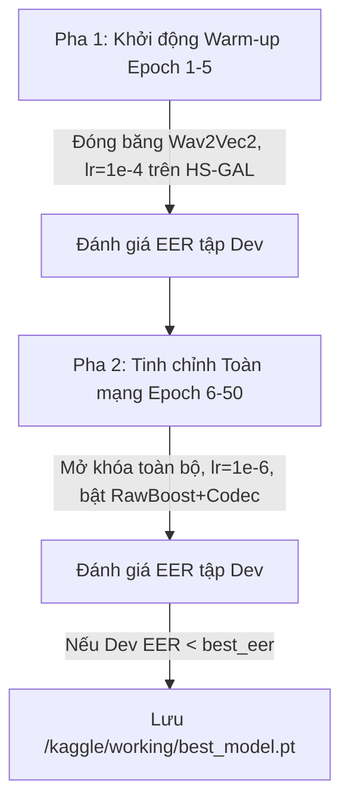

# LOGIC_models — Kiến Trúc Mô Hình & Chiến Lược Huấn Luyện

---

## 1. Thiết Kế Kiến Trúc Mô Hình

### Mô Hình Cơ Sở: Baseline AASIST (Clova AI)
- **Đầu vào**: Tensor waveform thô kích thước `(batch_size, 1, 64000)`.
- **Front-end**: Lớp tích chập biến đổi `SincConv` trích xuất đặc trưng phổ - thời gian cấp thấp.
- **Back-end**: Mạng tích chập `ResNet` 6 khối kết hợp Mô-đun Mạng chú ý đồ thị không đồng nhất phổ - thời gian (`HS-GAL`) cùng nút trung tâm (`Master Node`).
- **Đầu ra**: 2 logit phân loại tuyến tính `[s_spoof, s_bonafide]`.

### Mô Hình Chủ Lực: SSL-AASIST
- **Front-end**: Khối trích xuất đặc trưng tự giám sát (Self-Supervised Learning) tiếng Việt:
  - Checkpoint backbone: `nguyenvulebinh/wav2vec2-base-vietnamese-250h` (loại bỏ tầng phân loại ký tự `lm_head`, giữ lại khối Transformer `Wav2Vec2Model`).
  - Nhánh đối chứng đa ngôn ngữ: `Wav2Vec2-XLS-R` (300M tham số).
- **Phép chiếu (Projection)**: Lớp tuyến tính `Linear` chiếu biểu diễn đặc trưng từ tầng Transformer cuối cùng vào không gian nút của đồ thị AASIST.
- **Back-end**: Phần thân đồ thị `HS-GAL` của AASIST bắt trọn các dấu vết giả mạo vi mô (micro-artefacts) trên các nút phổ và thời gian.

---

## 2. Hàm Mất Mát & Siêu Tham Số Huấn Luyện

### Hàm Mất Mát Weighted Cross-Entropy Loss
```python
weights = torch.FloatTensor([0.1, 0.9]).to(device)  # [Spoof, Bona fide]
criterion = nn.CrossEntropyLoss(weight=weights)
```
> STUBBORN_FACT: Trọng số bắt buộc là [0.1, 0.9] để triệt tiêu hiện tượng mô hình thiên vị lớp giả do tập Spoof (>= 2.000 mẫu) gấp đôi tập Bona fide (>= 1.000 mẫu), đồng thời phạt nặng lỗi nhận diện nhầm người dùng thật thành giả mạo.

### Bộ Tối Ưu & Siêu Tham Số
- **Bộ tối ưu (Optimizer)**: AdamW (`betas=(0.9, 0.98)`, `eps=1e-8`, `weight_decay=1e-4`).
- **Tốc độ học (Learning Rate)**: 
  - Giai đoạn Warm-up: `lr = 1e-4`.
  - Giai đoạn Tinh chỉnh: `lr = 1e-6` (tránh hiện tượng quên thảm khốc - catastrophic forgetting các đặc trưng âm học đã học của Wav2Vec 2.0).
- **Batch Size**: 16 hoặc 32 (kết hợp `Gradient Accumulation`).
- **Dừng sớm (Early Stopping)**: 10 epochs nếu chỉ số EER trên tập kiểm định (Dev set) không cải thiện.

---

## 3. Chiến Lược Huấn Luyện 2 Pha (Two-Phase Training)



1. **Pha 1 (Giai đoạn Khởi động Warm-up — 3 đến 5 epoch đầu)**:
   - Đóng băng (`Freeze`) toàn bộ trọng số của khối front-end Wav2Vec 2.0.
   - Chỉ mở khóa huấn luyện phần back-end đồ thị AASIST và tầng phân loại với tốc độ học `lr = 1e-4`.
2. **Pha 2 (Giai đoạn Tinh chỉnh Toàn mạng Joint Fine-tuning)**:
   - Mở khóa (`Unfreeze`) toàn bộ các tầng Transformer của Wav2Vec 2.0.
   - Hạ Learning Rate toàn cục xuống `lr = 1e-6` và huấn luyện đồng thời kết hợp `RawBoost` + `Codec Augmentation`.
   - Lưu đè checkpoint `/kaggle/working/best_model.pt` chỉ khi EER trên tập Dev đạt mức thấp kỷ lục mới.

---

*v0.1.0 — 2026-10-16*
