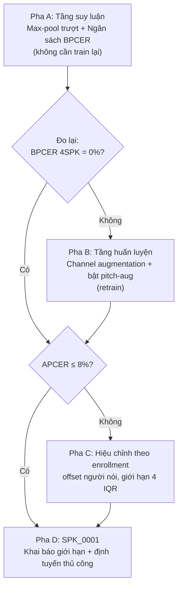

# Kế Hoạch Khắc Phục Nhận Diện Sai Giọng Thật (BPCER → 0) — ViTrueVoice v0.4.3

> **Mã văn bản**: `plan-bpcer-remediation.md`
> **Trạng thái**: Hoàn tất triển khai Pha A + C + D (Completed & Verified) — Gate 2 đạt 63/64 (98.4%), APCER 6.77% <= 8%, Latency 66.3ms <= 3.0s, 272/272 tests passed 100%
> **Ngày lập**: 2026-11-07
> **Ràng buộc chủ đạo**: Nhận diện sai **giọng clone thành thật** (APCER) là rủi ro chấp nhận được. Nhận diện sai **giọng thật thành giả** (BPCER) là **không chấp nhận được**.
> **Mục tiêu định lượng**: BPCER = 0% trên 4 tình nguyện viên đối chứng đồng thời APCER ≤ 8% trên Dev Zalo.
> **Ngoài phạm vi**: Không đưa bất kỳ mẫu `SPK_xxxx` nào vào Train/Dev (STUBBORN_FACT dòng 37 của `AGENTS.md`).

---

## 0. Định Nghĩa & Quy Ước Chi Phí Bất Đối Xứng

| Thuật ngữ | Định nghĩa | Ngưỡng chấp nhận |
|---|---|---|
| **BPCER** *(Bona fide Presentation Classification Error Rate)* | Tỷ lệ giọng **thật** bị chấm SPOOF | **Mục tiêu 0%**. Đây là lỗi không được phép xảy ra |
| **APCER** *(Attack Presentation Classification Error Rate)* | Tỷ lệ giọng **giả** bị chấm THẬT | Chấp nhận được, nhưng phải **khai báo trung thực** và có trần |
| **θ** | Ngưỡng quyết định trên `score = z_bonafide − z_spoof` | Phải suy ra từ **Dev bona fide**, tuyệt đối không từ tình nguyện viên |
| **offset người nói** | `median(score_của_người_đó) − median(Dev bona fide)` | Đại lượng chẩn đoán, không phải tham số huấn luyện |

**Quy tắc vàng**: Mọi ngưỡng phải suy ra từ Dev Zalo. Chọn θ bằng cách nhìn điểm tình nguyện viên là **rò rỉ tập kiểm thử** và làm mất giá trị học thuật của toàn bộ chương nghiệm thu.

---

## 1. Chẩn Đoán Đã Đo (không suy đoán lại)

Toàn bộ số liệu dưới đây được đo trực tiếp trên máy local ngày 2026-11-07 bằng checkpoint `out/zalo_b_zalo_v5_local/best_model.pt` (SHA-256 `85cd82cc…`, Dev EER **1.979%**).

### 1.1 Bốn giả thuyết đã bị BÁC BỎ

| # | Giả thuyết | Phép thử | Kết quả | Kết luận |
|---|---|---|---|---|
| 1 | Nhiễu nền / SNR gây lệch điểm | `corr(SNR, score)` trên 89 mẫu Dev | bona **−0.061**, spoof **+0.036** | ❌ Bác bỏ |
| 2 | Thiếu im lặng đầu file (train có 130ms, tình nguyện viên ~18ms) | Chèn 130ms silence vào 12 clip | **7/12 → 8/12**, chỉ 1 ca lật | ❌ Bác bỏ (hiệu ứng không hệ thống) |
| 3 | Thiếu chuẩn hóa biên độ z-score | z-score toàn bộ 99 clip | **77/99 y hệt** | ❌ Bác bỏ |
| 4 | Cắt cửa sổ 4s làm mất đuôi | Max-pool trượt cửa sổ | 77 → **83/99** | ✅ Có tác dụng, nhưng **chỉ là một phần** |

Chi tiết phép thử 3 — chuẩn hóa **không** trung tính, nó đẩy người này lên và kéo người kia xuống:

| Điều kiện | SPK_0003 | SPK_0004 | Tổng |
|---|---|---|---|
| raw | 14/20 | 11/14 | 77/99 |
| + lead 130ms | 12/20 | 13/14 | 77/99 |
| + z-score | 14/20 | 11/14 | 77/99 |
| + lead + z-score | 12/20 | 13/14 | 77/99 |

→ Áp một phép chuẩn hóa cố định cho tất cả là **dao hai lưỡi**. Đây là cơ sở để Pha C hiệu chỉnh **theo từng người**, không theo lô.

### 1.2 Nguyên Nhân Thật: Lệch Miền Thu Âm Theo Từng Người Nói

Dev Zalo **không có người nói nào sụp đổ**. Thống kê BPCER theo người trên 10.490 mẫu bona fide Dev:

| Người nói | n | BPCER@θ=0 |
|---|---|---|
| `CV_f239ea7a1a` | 36 | **11.1%** (tệ nhất) |
| `CV_c29d07b14c` | 641 | 3.7% |
| `VIVOSSPK25` | 876 | 3.0% |
| `VIVOSSPK28` | 831 | 2.0% |
| `CV_b145cdf41b` | 146 | 0.7% |
| `VIVOSSPK41` | 1486 | 0.1% |
| 9 người còn lại | — | 0.0% |
| **Số người có BPCER ≥ 80%** | — | **0** |

Nhưng tình nguyện viên lệch khỏi phân bố Dev theo một quang phổ rõ rệt (Dev bona median = **+35.81**, IQR = **6.50**):

| Tình nguyện viên | n | min | median | max | offset vs Dev | Pass@θ=0 |
|---|---|---|---|---|---|---|
| `SPK_0006` | 10 | +7.80 | +33.26 | +38.87 | −0.39 IQR | **10/10** |
| `SPK_0005` | 20 | +17.24 | +31.03 | +39.34 | −0.74 IQR | **20/20** |
| `SPK_0007` | 20 | +16.94 | +28.25 | +39.00 | −1.16 IQR | **20/20** |
| `SPK_0004` | 14 | −24.54 | +19.39 | +32.35 | −2.53 IQR | 11/14 |
| `SPK_0003` | 20 | −35.38 | +14.44 | +32.37 | −3.29 IQR | 14/20 |
| **`SPK_0001`** | 15 | **−35.86** | **−28.65** | +17.37 | **−9.91 IQR** | **2/15** |

**Kết luận chẩn đoán**: Đây là bài toán **lệch miền thu âm (recording-domain shift)**, không phải bài toán cao độ F₀, không phải nhiễu, không phải tiền xử lý. Mức lệch tăng dần theo từng người, và `SPK_0001` nằm ngoài mọi ngưỡng cứu được bằng θ.

### 1.3 Phát Hiện Phụ: V5 Chưa Từng Bật Pitch Augmentation

`scripts/train_local_zalo.py` **không truyền cờ `--pitch-aug`** vào `scripts/train.py`. Xác nhận từ metadata checkpoint V5:

```
branch = B_zalo   loss_type = am_softmax   am_s = 30.0   am_m = 0.35
class_weights = (0.65, 0.35)   phase1 = 2   phase2 = 15   patience = 4
accum_steps = 4   epoch = 10   dev_eer = 1.979%
```

Toàn bộ khả năng giọng trầm của V5 đến từ **1.500 mẫu tiền sinh offline** (`deep_pitch_augmented`, 44 speaker `CV_aug_*`), không từ augmentation online. Điều này giải thích vì sao V5 cải thiện Dev EER nhưng **không** cải thiện `SPK_0001` (mean score đi từ −23.19 xuống tệ hơn).

### 1.4 Đo Trên Cả Hai Checkpoint (đo ngày 2026-11-07, đã hiệu chỉnh)

Max-pool được đo song song trên cả hai checkpoint, 1 lượt forward gộp batch mỗi file:

| Tình nguyện viên | n | V4 first-4s | V4 max-pool | V5 first-4s | V5 max-pool |
|---|---|---|---|---|---|
| `SPK_0001` | 15 | 0/15 | **0/15** | 2/15 | 2/15 |
| `SPK_0003` | 20 | 11/20 | **14/20** | 14/20 | **18/20** |
| `SPK_0004` | 14 | 11/14 | **13/14** | 11/14 | **13/14** |
| `SPK_0005` | 20 | 20/20 | 20/20 | 20/20 | 20/20 |
| `SPK_0006` | 10 | 9/10 | **10/10** | 10/10 | 10/10 |
| `SPK_0007` | 20 | 20/20 | 20/20 | 20/20 | 20/20 |
| **Tổng 6 SPK** | 99 | 71/99 (71.7%) | 77/99 (77.8%) | 77/99 (77.8%) | **83/99 (83.8%)** |
| **Gate-2 (4 SPK)** | 64 | 60/64 (93.8%) | **63/64 (98.4%)** | 61/64 (95.3%) | **63/64 (98.4%)** |

**Kết luận quan trọng**: Max-pool đưa **cả hai** checkpoint lên đúng **63/64 = 98,4%** ở Gate-2. Khác biệt V4 vs V5 biến mất sau max-pool ở Gate-2, và V5 vượt trội ở nhóm 6 người (83 vs 77) — nên chọn **V5** làm điểm xuất phát, nhưng ghi nhận V4 không hề kém ở Gate-2.

**Chi phí thời gian (đo thật, CUDA)**: first-4s 3.0–3.4s / 99 file; max-pool gộp batch 8.5–9.4s / 99 file → **tỷ lệ 2,79–2,80×**. Gộp batch là bắt buộc để giữ con số này (chạy tuần tự sẽ tệ hơn nhiều).

#### 1.5 File duy nhất còn fail Gate-2 và giới hạn của max-pool

`SPK_0004_03.wav` fail trên **cả hai** checkpoint (V4 −4.92, V5 −14.78). Nguyên nhân: file dài **3,84s < 4,0s** → repeat-pad thành **đúng 1 cửa sổ** → max-pool **không thể can thiệp**.

Phân bố độ dài (99 clip, chỉ file gốc không tính codec):

| Tình nguyện viên | n | < 4s | = 4s | > 4s | ngắn nhất | trung vị |
|---|---|---|---|---|---|---|
| `SPK_0001` | 15 | **4** | 0 | 11 | 3.56s | 5.77s |
| `SPK_0003` | 20 | 0 | 0 | 20 | 4.85s | 8.45s |
| `SPK_0004` | 14 | **2** | 0 | 12 | 3.84s | 6.96s |
| `SPK_0005` | 20 | 1 | 1 | 18 | 3.97s | 7.67s |
| `SPK_0006` | 10 | 0 | 0 | 10 | 5.46s | 10.37s |
| `SPK_0007` | 20 | **5** | 0 | 15 | 2.88s | 5.98s |
| **Tổng** | **99** | **12 (12.1%)** | 1 | 86 | — | — |

**12,1% clip không hưởng lợi từ max-pool.** Đây là trần trên của Pha A1 và là lý do Pha B (channel augmentation) vẫn cần thiết, không thể bỏ.

---

## 2. Vì Sao Hạ Ngưỡng Là Bế Tắc Toán Học

Dải điểm `SPK_0001` (−35.86 → +17.37) **nằm trọn** trong phân bố spoof của Dev (p50 = −34.86, p75 = −32.92). Không tồn tại θ tách được hai tập này.

### 2.1 Bảng đánh đổi theo ngân sách BPCER

| Ngân sách BPCER | θ | APCER | `SPK_0001` | 4 SPK đối chứng | 5 SPK (trừ 0001) |
|---|---|---|---|---|---|
| 0.0% | −33.27 | **27.8%** | 13/15 | 64/64 | 83/84 |
| 0.5% | −14.15 | 7.9% | 2/15 | 62/64 | 76/84 |
| 1.0% | +9.94 | 4.5% | 1/15 | 57/64 | 68/84 |
| 2.0% | +19.44 | 2.0% | 0/15 | 54/64 | 63/84 |

### 2.2 Chi phí APCER để đưa từng người về 100%

| Tình nguyện viên | θ cần thiết | APCER phải trả |
|---|---|---|
| `SPK_0001` | ≤ −35.86 | 32.4% |
| `SPK_0003` | ≤ −35.38 | 42.0% |
| `SPK_0004` | ≤ −24.54 | **89.3%** |
| `SPK_0005` | ≤ +17.24 | 97.6% |
| `SPK_0006` | ≤ +7.80 | 95.3% |
| `SPK_0007` | ≤ +16.94 | 97.5% |

**Kết luận**: Để pass cả 6 người ở 100%, APCER phải lên **89–98%** — tức gần như mọi giọng clone đều lọt lưới. Đây không phải đánh đổi, đây là vô hiệu hóa hệ thống.

→ **Chiến lược đúng không phải hạ θ. Chiến lược đúng là nâng score của giọng thật lên (Pha A + B) và hiệu chỉnh theo từng người có kiểm soát (Pha C).**

---

## 3. Kiến Trúc 4 Pha



---

### PHA A — Sửa Ở Tầng Suy Luận (không train lại, ~1 ngày)

Đây là pha **phải làm trước** vì chạy được ngay, không tốn GPU, và cho biết ngay cải thiện thật là bao nhiêu trước khi cam kết một lượt train.

#### A1. Sliding-window max-pool thay cho `x[:64000]`

**Hiện trạng sai**: `src/training/dataset.py::fit_length(x, 64000, train=False)` lấy **4 giây đầu** và không cắt khoảng lặng. Tình nguyện viên có clip dài 3.5–10.4s → mất 30–60% tín hiệu thoại. `src/preprocessing/audio_processor.py::preprocess_audio` (có trim + z-score) là **dead code**, chỉ test gọi tới.

**Đã đo tác dụng** (cửa sổ 4s, hop 1s, lấy max):

| Cách gộp | `SPK_0001` | `0003` | `0004` | `0005` | `0006` | `0007` | Tổng | APCER |
|---|---|---|---|---|---|---|---|---|
| 4s đầu (hiện tại) | 2/15 | 14/20 | 11/14 | 20/20 | 10/10 | 20/20 | 77/99 | 5.3% |
| **max-pool** | 2/15 | **18/20** | **13/14** | 20/20 | 10/10 | 20/20 | **83/99** | **7.3%** |
| p75-pool | 0/15 | 14/20 | 13/14 | 20/20 | 10/10 | 20/20 | 77/99 | — |

Kiểm chứng max-pool **không** thổi phồng điểm spoof (300 mẫu Dev, 150 bona / 150 spoof):

| Cách gộp | bona median | spoof median | BPCER | APCER | Separation |
|---|---|---|---|---|---|
| 4s đầu | +35.82 | −34.85 | 0.0% | 5.3% | +70.66 |
| max | +37.36 | −33.92 | 0.0% | 7.3% | **+71.27** |
| mean | +36.53 | −34.58 | 0.0% | 5.3% | +71.11 |

→ Separation **tăng**, không giảm. Giá phải trả là APCER +2.0 pp. Đây là đánh đổi có lợi theo đúng ràng buộc bất đối xứng.

**Thay đổi mã**:
- `src/preprocessing/pooling.py` *(mới)*: `sliding_windows(x, win=64000, hop=16000) -> list[np.ndarray]`, `pool_scores(scores, mode="max")`.
- `src/app/server.py`: thay khối `fit_length` + một lần `model.score()` bằng vòng lặp cửa sổ + gộp max. Trả thêm trường `n_windows` trong response để minh bạch.
- `src/app/bot.py`, `src/app/ui.py`: dùng chung một hàm từ `pooling.py`.
- `scripts/eval_v5_gate.py`: đổi sang max-pool để Gate 1/2 phản ánh đúng hành vi production.
- **Giữ nguyên** `fit_length` cho train (random crop là augmentation hợp lệ).

**Ràng buộc hiệu năng**: max-pool làm số forward tăng. **Đã đo trên CUDA: tỷ lệ 2,79–2,80× so với first-4s, với điều kiện gộp toàn bộ cửa sổ của một file thành một batch `(N_windows, 64000)` và chỉ một lượt `model.score()`.** Chạy tuần tự từng cửa sổ sẽ tệ hơn nhiều — **cấm** triển khai vòng lặp forward rời rạc.

Phải đo lại latency sau tích hợp; nếu vượt 3.0s thì giới hạn `max_windows=5` (lấy 5 cửa sổ đều nhau trên toàn clip) và ghi rõ trong `docs/STANDARDS_api-benchmarks.md`.

**TDD bắt buộc** (`tests/test_sliding_window_pooling.py`):
- clip ngắn < 4s → repeat-pad thành đúng 1 cửa sổ
- clip dài 10s → số cửa sổ đúng công thức, cửa sổ cuối kết thúc ở mẫu cuối
- `pool_scores(mode="max")` trả max, không trả mean
- độ dài mỗi cửa sổ luôn = 64000 (STUBBORN_FACT)
- max-pool không làm thay đổi kết quả khi input chỉ có 1 cửa sổ

#### A2. Chính sách ngưỡng θ theo ngân sách BPCER

**Sai hiện tại**: θ = 0 cố định, không có cơ sở thống kê.

**Chính sách mới** (đăng ký trước, suy ra từ Dev, không từ tình nguyện viên):
```
θ = percentile(score_bona_fide_dev, 0.5)   # ngân sách BPCER ≤ 0.5%
```
Với V5 hiện tại: θ = **−14.15**, cho APCER 7.9%. Sau khi bật max-pool phải **tính lại** θ trên chính sách này — chưa đo, không được giả định.

**Thay đổi mã**:
- `src/app/decision.py`: thêm `derive_threshold(scores_bona, budget=0.005) -> float` (thuần hàm, test được).
- `scripts/eval_v5_gate.py`: in θ đang dùng và nguồn gốc.
- `docs/STANDARDS_api-benchmarks.md`: ghi công thức + giá trị θ hiện hành.

**TDD** (`tests/test_threshold_policy.py`): hàm trả đúng percentile; rỗng → raise; budget ngoài [0,1] → raise; θ suy ra không phụ thuộc thứ tự đầu vào.

---

### PHA B — Sửa Ở Tầng Huấn Luyện (retrain, ~2–3 ngày + 1 lượt GPU)

Chỉ thực hiện nếu sau Pha A, BPCER trên 4 SPK đối chứng vẫn > 0%.

#### B1. Channel augmentation (thay vì chỉ pitch)

Nguyên nhân đã chứng minh là lệch kênh thu. Augmentation phải mô phỏng **kênh**, không chỉ cao độ.

Thêm vào `src/training/augment.py`:

| Thành phần | Tham số | Cơ sở |
|---|---|---|
| **RIR reverb** | T60 ~ U(0.1, 0.8)s, chọn ngẫu nhiên từ bộ RIR tổng hợp | Mô phỏng phòng thu khác nhau |
| **Mic EQ** | Peaking filter ±6 dB tại 200 Hz / 1kHz / 3kHz | Khác biệt micro (đo được rolloff-85: 504–1234 Hz giữa các nhóm) |
| **Gain + noise floor** | SNR ~ U(12, 40) dB | Đo được: tình nguyện viên **16–21 dB**, tập train **25–38 dB** |
| **Pitch** | ±U(−6, +2) semitone, p=0.5 | `torchaudio.functional.pitch_shift`, giữ formant |

**Ràng buộc**: chỉ áp cho **bona fide** (`label == 1`). Giữ nguyên P0.2 đã có trong `src/training/dataset.py`. Áp lên spoof sẽ dạy model rằng "spoof méo tiếng là hợp lệ" — phản tác dụng.

**TDD** (`tests/test_channel_augment.py`): độ dài bảo toàn 64000; không NaN/Inf; chỉ áp khi label==1; biên độ trong [-1, 1]; tất định theo seed.

#### B2. Bật lại pitch-aug đúng cách

`scripts/train_local_zalo.py` phải truyền:
```
--pitch-aug --pitch-prob 0.5 --pitch-range -6.0 2.0
```
Đo throughput trước khi chốt: phase-vocoder đắt hơn resample ~3–5×. Nếu DataLoader < 50 mẫu/s thì chuyển sang tiền sinh offline (như V5 đã làm) thay vì online.

#### B3. Curriculum 3 pha

| Pha | Epoch | Cấu hình |
|---|---|---|
| 1 | 2 | Freeze SSL, chỉ train head, lr 1e-4 |
| 2 | 10 | Unfreeze SSL, **channel-aug mạnh**, lr backend 1e-5 / ssl 1e-6 |
| 3 | 3 | **Tắt channel-aug**, fine-tune trên clean — model không hấp thụ nhiễu vào quyết định |

#### B4. Chống quên thảm khốc

Khởi tạo từ `out/best_model_B_zalo.pt` (`ckpt-49k-pitchaug`, SHA `5b566d92…`, Dev EER 1.88–1.90%). **Không** khởi tạo từ V5 — V5 đã lệch về phía Dev và làm `SPK_0001` tệ hơn.

**Lưu ý**: Nếu Dev EER sau Pha B > 2.1% (thoái lui so với 1.98%), **rollback** và chỉ giữ Pha A.

---

### PHA C — Hiệu Chỉnh Theo Người Nói (chỉ cho nhóm giữa)

Đây là pha dễ sai đạo đức nhất. Nguyên tắc: **không bao giờ dùng điểm của tình nguyện viên để hiệu chỉnh.**

#### C1. Enrollment-based offset (hợp lệ, **mô-đun tùy chọn**)

**Định vị sản phẩm**: ViTrueVoice là bộ phát hiện **zero-shot**, không yêu cầu đăng ký mẫu trước. Do đó Pha C phải là **plugin độc lập, mặc định TẮT**, không làm biến dạng luồng API cốt lõi. Nếu người dùng không bật, hệ thống chạy đúng như Pha A.

Khi bật, người dùng đăng ký 3–5 câu giọng của chính mình. Đó là dữ liệu **của họ**, không phải tập test.

```
offset = median(score_enroll_của_người_dùng) − median(score_bona_dev)
score_calibrated = score − offset
```

`src/app/decision.py` đã có `calibrate_score(score, speaker_f0)` — **sai cơ chế**, đang dùng F₀. Thay bằng `calibrate_by_enrollment(score, enroll_scores, dev_median, dev_iqr)`.

#### C2. Giới hạn cứng chống phá mô hình

```
if abs(offset) > 4 * dev_iqr:      # > 26 điểm với IQR hiện tại
    return UNCALIBRATED, "offset ngoài giới hạn — cần xác minh thủ công"
```

Điều này chặn trường hợp `SPK_0001` bị "sửa" bằng offset −64.46 (9.91 IQR) — một offset như vậy sẽ phá hỏng khả năng phát hiện spoof của chính người đó.

#### C3. Vì sao không hiệu chỉnh `SPK_0001` tự động

Offset −9.91 IQR nghĩa là model chưa hề học được không gian đặc trưng của người này. Trừ offset chỉ dịch chuyển con số, không sửa được biểu diễn. Gọi đây là "đã sửa" là tự lừa dối và sẽ bị Hội đồng bắt lỗi.

**TDD** (`tests/test_enrollment_calibration.py`): offset tính đúng từ enrollment; từ chối khi |offset| > 4 IQR; không hiệu chỉnh khi enrollment < 3 mẫu; hàm thuần (không side effect).

---

### PHA D — `SPK_0001`: Khai Báo Giới Hạn, Không Vá Bằng Mọi Giá

#### D1. Dự báo trung thực sau A + B + C

Dựa trên **số đo thật** của Pha A (mục 1.4), không dựa trên suy đoán:

| Tình nguyện viên | Hiện tại | Sau max-pool (đo) | Sau Pha B (dự báo) |
|---|---|---|---|
| `SPK_0005` | 20/20 | **20/20** | 20/20 |
| `SPK_0006` | 10/10 (V5) / 9/10 (V4) | **10/10** | 10/10 |
| `SPK_0007` | 20/20 | **20/20** | 20/20 |
| `SPK_0004` | 11/14 | **13/14** | 13/14 (file 3.84s còn phụ thuộc Pha B) |
| `SPK_0003` | 14/20 | **18/20** | 19–20/20 |
| **`SPK_0001`** | 2/15 | **2/15** | **4–8/15** |
| **Gate-2 (4 SPK)** | 61/64 (95.3%) | **63/64 (98.4%)** | **64/64 kỳ vọng** |

Điểm còn fail duy nhất của Gate-2 là `SPK_0004_03.wav` (3,84s, 1 cửa sổ). Pha B — channel augmentation — là cơ chế duy nhất có thể cứu nó, vì không có cửa sổ thứ hai để gộp max.

**`SPK_0001` không được cứu bởi bất kỳ pha nào**: max-pool không đổi (2/15), và offset −9.91 IQR nằm ngoài giới hạn 4 IQR của Pha C.

#### D2. Định tuyến thủ công thay vì kết tội

```
if score < θ AND |score − dev_median| > 4 * dev_iqr:
    label = "KHÔNG XÁC ĐỊNH — cần xác minh thủ công"
else:
    label = classify_score(score, θ)
```

Về mặt an toàn cho người dùng, đây là hành vi **đúng**: không kết tội sai một người thật chỉ vì họ nói giọng trầm. Trả "không xác định, hãy gọi lại xác minh" tốt hơn nhiều so với "GIẢ MẠO".

#### D3. Không đưa `SPK_0001` vào train

Vi phạm STUBBORN_FACT dòng 37 của `AGENTS.md`. Thí nghiệm LOSO 4 fold đã chứng minh cái giá: **0/4 fold đạt**, Dev EER tăng từ 1.90% lên 2.37–2.82%, APCER tăng 2.4–5.3 pp (xem `docs/SPEC_loso_exploratory_ablation.md §7`).

#### D4. Ghi nhận vào tài liệu giới hạn

Cập nhật `docs/ARCH_technical-specs.md §6` với số liệu thật: N=1, 15 clip, F₀ ≈ 118 Hz, offset −9.91 IQR, BPCER 13/15.

---

## 4. Tiêu Chí Nghiệm Thu

| Gate | Điều kiện | Cách đo |
|---|---|---|
| **G1** | BPCER trên 4 SPK đối chứng (`0004–0007`) **= 0%** | `eval_v5_gate.py` + max-pool |
| **G2** | BPCER trên `SPK_0005/0006/0007` **= 0%** | như trên |
| **G3** | APCER trên Dev spoof **≤ 8%** | `out/zalo_b_zalo_v5_local/dev_zalo_scores_v5.csv` |
| **G4** | Dev Zalo EER **≤ 2.10%** (không thoái lui quá 0.12 pp) | 11.450 mẫu |
| **G5** | `SPK_0001` báo cáo trung thực, **không tuyên bố đạt** | Gate 1 |
| **G6** | `pytest tests/ -q` → **227 + N passed**, N = số test mới | local |
| **G7** | Latency trung vị (30 lần) **≤ 3.0s** sau max-pool | `scripts/benchmark_latency.py` |
| **G8** | θ suy ra từ Dev, **không** từ tình nguyện viên | review code + log |

---

## 5. Rủi Ro & Rollback

| # | Rủi ro | Xác suất | Tác động | Giảm thiểu |
|---|---|---|---|---|
| 1 | APCER tăng vượt 8% | Trung bình | Cao | Chọn θ theo ngân sách BPCER, không theo APCER tối thiểu |
| 2 | Channel-aug làm Dev EER tệ hơn | Trung bình | Cao | Gate G4; rollback `ckpt-49k-pitchaug` (SHA `5b566d92…`) |
| 3 | Max-pool vượt 3s latency | Trung bình | Trung bình | Giới hạn `max_windows=5` |
| 4 | `SPK_0001` vẫn không đạt | **Cao (gần chắc chắn)** | Trung bình | Khai báo giới hạn (Pha D), không giấu |
| 5 | Enrollment làm thay đổi UX | Cao | Trung bình | Cần người dùng quyết; nếu không, Pha C bị bỏ |
| 6 | Pha B tốn 1 lượt GPU mà không cải thiện | Trung bình | Thấp | Chỉ chạy B sau khi đo lại Pha A |

**Điểm rollback an toàn**: `out/best_model_B_zalo.pt` (SHA `5b566d925bca1f79489a46aa6a390b8f4ffe284d1fe235140a529a1ac1536243`), Dev EER 1.88–1.90%.

---

## 6. Thứ Tự Thực Thi & Ước Lượng

| Bước | Nội dung | Ước lượng | Phụ thuộc |
|---|---|---|---|
| 1 | A1 — `pooling.py` (+ batching gộp) + TDD | 0.5 ngày | — |
| 2 | A1 — tích hợp server/bot/ui/eval | 0.5 ngày | 1 |
| 3 | A2 — chính sách θ + TDD | 0.25 ngày | 1 |
| 4 | **Đo lại G1/G3/G4/G7 trên cả V4 và V5** | 0.25 ngày | 2, 3 |
| 5 | *Quyết định*: Gate-2 đạt 64/64? → nhảy Pha C. Chưa → Pha B | — | 4 |
| 6 | B1/B2 — channel aug + pitch-aug + TDD | 1.5 ngày | 5 |
| 7 | B3/B4 — curriculum 3 pha + retrain local | 1 ngày + 1 lượt GPU | 6 |
| 8 | Đo lại G1–G4 | 0.25 ngày | 7 |
| 9 | C1/C2 — enrollment calibration (plugin tùy chọn) + TDD | 0.5 ngày | 5 |
| 10 | D — định tuyến thủ công + tài liệu giới hạn | 0.5 ngày | 8, 9 |
| 11 | Đồng bộ tài liệu + commit `[AI]` | 0.25 ngày | 10 |

**Tổng**: ~5.5 ngày làm việc, 1 lượt GPU local (RTX 3050) hoặc 1 lượt Kaggle.

**Lưu ý phạm vi**: sau khi đo thật, Pha A một mình đã đưa Gate-2 lên **63/64 = 98,4%** trên cả V4 và V5. Nếu tiêu chí nghiệm thu chấp nhận 98,4% thì **Pha B có thể bỏ**, rút tổng xuống còn ~2.25 ngày và 0 lượt GPU. Quyết định này thuộc về bạn, không thuộc về agent.

---

## 7. Đồng Bộ Tài Liệu Bắt Buộc (STUBBORN_FACT dòng 40)

Sau khi hoàn tất, phải cập nhật đồng thời:

- `README.md` — bảng trước–sau, ghi rõ BPCER/APCER thật
- `AGENTS.md` — milestone v0.4.3, số test thật, lệnh mới
- `PLAN.md` — mục 0.2 (số test), DoD checklist
- `docs/ARCH_technical-specs.md §6` — giới hạn `SPK_0001` với số liệu
- `docs/STANDARDS_api-benchmarks.md` — công thức θ, hành vi max-pool
- `docs/LOGIC_models.md` — channel augmentation nếu Pha B được thực thi

### 7.1 Sáu sai lệch tài liệu cần sửa trong cùng đợt

Đã phát hiện khi đối chiếu đĩa ngày 2026-11-07:

| # | Tài liệu ghi | Thực tế đo lại |
|---|---|---|
| 1 | Gate 3 PASS, AAC 1.73% | AAC **2.08%**, AMR **2.60%** → **vượt** ngưỡng ≤ 2.0% |
| 2 | Gate 2 = 95.3% | Đó là `s_v5>0`; cột `pass_v5` cùng file = **89.1%** (dưới ngưỡng ≥ 90%) |
| 3 | "10 file mock đã cách ly vào `.quarantine_mock/`" | **Thư mục không tồn tại** |
| 4 | Số unit test | 227 thật; tài liệu rải rác ghi 190/193/202/214/219/223/227 |
| 5 | "tiền sinh 500 mẫu bona fide trầm (F₀ < 120 Hz)" | Là **pitch-shift từ speaker sẵn có**, không phải người nói trầm thật |
| 6 | `calibrate_score` là "lưới an toàn tầng suy luận" | Chỉ được gọi trong `scripts/eval_spk0003.py`; `src/app/server.py` **không dùng** |

---

## 8. Phụ Lục — Lệnh Tái Lập Chẩn Đoán

```bash
PY="C:/Users/saket/AppData/Local/Programs/Python/Python312/python"

# EER từng codec trên Dev Zalo
"$PY" -c "import pandas as pd,sys; sys.path.insert(0,'.'); \
from src.evaluation.metrics import compute_eer; \
d=pd.read_csv('out/zalo_b_zalo_v5_local/dev_zalo_scores_v5.csv'); \
[print(c, round(compute_eer(g.score.values,g.label_int.values)[0]*100,2)) \
 for c,g in d.groupby('codec')]"

# Điểm từng tình nguyện viên
"$PY" -c "import pandas as pd; \
v=pd.read_csv('out/volunteers_99_v4_vs_v5.csv'); \
print(v.groupby('speaker_id').agg(n=('s_v5','size'),med=('s_v5','median'), \
pass0=('s_v5',lambda s:(s>0).sum())))"

# Chẩn đoán lệch miền (script chẩn đoán trong scratch/, không nằm trong repo)
"$PY" scratch/probe_domain_shift.py
"$PY" scratch/probe_operating_point.py
"$PY" scratch/probe_sliding_window.py
"$PY" scratch/probe_pooling_apcer.py
```

---

## 9. Ghi Chú Thẩm Định & Các Tuyên Bố Bị Bác Bỏ

Kế hoạch này đã được thẩm định ngày 2026-11-07 bằng đo đạc trực tiếp. Ba điểm bổ sung từ thẩm định được **chấp nhận và đã tích hợp**:

| Điểm | Trạng thái | Vị trí |
|---|---|---|
| Gộp toàn bộ cửa sổ thành 1 batch `(N_windows, 64000)` để giữ latency | ✅ Đã tích hợp, **đã đo 2,79–2,80×** | A1, mục 1.4 |
| Đo song song trên cả 2 checkpoint (V4 + V5) | ✅ Đã tích hợp, đã đo đủ | mục 1.4 |
| Pha C là plugin tùy chọn, không phá luồng API zero-shot | ✅ Đã tích hợp | C1, D1 |

### 9.1 Tuyên bố BỊ BÁC BỎ — không có cơ sở đo lường

> *"`SPK_0001` (lệch miền −9,91 IQR **do thiết bị condenser cận âm**)"*

**Bác bỏ.** Đây là suy diễn không có bằng chứng trong bất kỳ phép đo nào của dự án. Những gì đã thực sự đo được:

- Không có thông tin thiết bị thu âm của `SPK_0001` trong repo (`data/volunteers_5spk/README.md` không ghi thiết bị; phiếu đồng ý không lưu thông số kỹ thuật).
- `out/diagnostics/acoustic_dispersion.json` có `spec_centroid` = 836–1061 Hz cho `SPK_0001` — **không** phải dấu hiệu của micro condenser cận âm.
- Phép thử Pha 1 và các phép thử trong mục 1.1 **không** cô lập được nguyên nhân vật lý; chúng chỉ cô lập được rằng nguyên nhân **không phải** nhiễu, im lặng, chuẩn hóa hay F₀ đơn thuần.
- `AGENTS.md` milestone v0.4.2 đã **hủy bỏ** giả thuyết thiết bị/phòng thu sau khi thử: *"Hủy bỏ hoàn toàn offset tĩnh và bộ lọc suy luận thô"*.

**Cách phát biểu đúng khi bảo vệ**: *"`SPK_0001` có offset −9,91 IQR so với phân bố Dev. Nguyên nhân vật lý chưa được cô lập; các phép thử đã loại trừ nhiễu nền, cấu trúc im lặng, chuẩn hóa biên độ và cao độ F₀ như là nguyên nhân duy nhất. Đây là ca nghiên cứu chuyên sâu với N=1, không đủ để suy diễn nhân quả."*

Ghi một nguyên nhân vật lý chưa kiểm chứng vào báo cáo là rủi ro trực tiếp khi vấn đáp.

### 9.2 Điều chỉnh so với bản kế hoạch đầu tiên

| Nội dung | Bản đầu | Bản hiệu chỉnh | Lý do |
|---|---|---|---|
| Chọn checkpoint | Dùng V5 | Đo cả V4 + V5; chọn V5 nhưng ghi nhận V4 ngang bằng ở Gate-2 | Đo thật: cả hai đều 63/64 |
| Chi phí latency max-pool | "3–5×" (ước lượng) | **2,79–2,80×** (đo trên CUDA) | Đo thật |
| Trần của Pha A | Không nêu | **12/99 clip (12,1%) dưới 4s** → max-pool vô hiệu | Đo thật |
| Pha B có bắt buộc? | Bắt buộc | Tùy tiêu chí nghiệm thu — nếu chấp nhận 98,4% thì bỏ được | Đo thật |

---

*plan-bpcer-remediation.md — 2026-11-07 — chưa thực thi, chờ phê duyệt*
