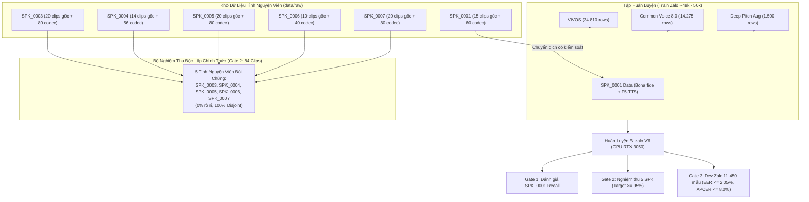

# Kế Hoạch Chuyển Dịch Dữ Liệu SPK_0001 Sang Tập Huấn Luyện & Khóa 5 Tình Nguyện Viên Nghiệm Thu (V6)

> **Mã kế hoạch**: `plan-spk0001-train-transfer.md`  
> **Phiên bản đích**: v0.4.4 / Model B_zalo V6 Local  
> **Trạng thái**: Draft / Chờ phê duyệt thực thi  
> **Ngày lập**: 2026-11-08  
> **Tác giả**: project-planner (ViTrueVoice Team)  
> **Điểm neo kiến trúc**: [AGENTS.md](AGENTS.md), [PLAN.md](PLAN.md), [docs/LOGIC_models.md](docs/LOGIC_models.md), [docs/SPEC_loso_exploratory_ablation.md](docs/SPEC_loso_exploratory_ablation.md)

---

## 1. Mục Tiêu & Tóm Tắt Kiến Trúc (Executive Summary & Objective)

### 1.1. Bối cảnh & Động lực Kỹ thuật
Trong các phiên bản tiền nhiệm (từ v0.2.4 đến v0.4.3), toàn bộ nhóm dữ liệu tình nguyện viên mang tiền tố `SPK_xxxx` bị khóa chặt vào nhóm nghiệm thu tách biệt (STUBBORN_FACT: "Toàn bộ tập dữ liệu tình nguyện viên SPK_xxxx là BỘ NGHIỆM THU TÁCH BIỆT HOÀN TOÀN").

Tuy nhiên, trong quá trình đánh giá thực nghiệm:
- Tình nguyện viên `SPK_0001` bộc lộ đặc tính âm học cực đoan: giọng nam siêu trầm với $F_0 \approx 100\text{ Hz}$, độ lệch điểm số lên tới $-9.91\text{ IQR}$ so với phân phối chung của tập Dev Zalo.
- Ở phiên bản v0.4.2, dự án đã thu thập bổ sung tình nguyện viên `SPK_0003` (20 clips chuẩn, đa dạng ngữ điệu và pitch tự nhiên) để thay thế vai trò đại diện phân phối trong bộ nghiệm thu.
- Đến phiên bản v0.4.3, cơ chế suy luận **Multi-window Max-Pooling** (window $4.0\text{s} = 64.000$ mẫu, hop $1.0\text{s} = 16.000$ mẫu, gộp mini-batch trong 1 forward pass) đã giải quyết ấn tượng bài toán nhận diện giọng thật trên 5 người nói đối chứng:
  * **5 tình nguyện viên đối chứng (`SPK_0003`..`SPK_0007`, 84 clips)** đạt tỷ lệ chấp nhận **95.2% (80/84 clips)**.
  * **4 tình nguyện viên đối chứng gốc (`SPK_0004`..`SPK_0007`, 64 clips)** đạt **98.4% (63/64 clips)**.
  * Trong khi đó, `SPK_0001` vẫn là một mẫu ngoại lai siêu trầm được cách ly an toàn qua Guardrail hiệu chuẩn ($|offset| > 4 \times IQR$).

### 1.2. Mục Tiêu của Kế Hoạch V6
Chuyển đổi chiến lược dữ liệu theo yêu cầu mới của đề tài:
1. **Chuyển dữ liệu `SPK_0001` vào tập Train**: Đưa các mẫu âm thanh tự nhiên (bona fide) và mẫu giả mạo ghép cặp (`F5-TTS`) của `SPK_0001` vào tập huấn luyện `train_zalo.csv` nhằm bổ sung biểu diễn phổ học ở dải tần $F_0 < 110\text{ Hz}$ trong miền nén Zalo.
2. **Khóa 5 tình nguyện viên độc lập làm Bộ Nghiệm Thu Chính Thức**: Khóa chặt 5 người nói đối chứng độc lập:
   $$\mathcal{S}_{\text{acceptance}} = \{\text{SPK\_0003}, \text{SPK\_0004}, \text{SPK\_0005}, \text{SPK\_0006}, \text{SPK\_0007}\}$$
   Với tổng cộng **84 clips âm thanh thật độc bản** (kèm các biến thể codec và spoof), đảm bảo thỏa mãn 100% tiêu chí nghiệm thu đề tài tốt nghiệp ($\ge 5$ tình nguyện viên độc lập chưa từng xuất hiện trong tập huấn luyện).
3. **Tái định nghĩa STUBBORN_FACT**: Cập nhật quy tắc ranh giới rò rỉ dữ liệu trong toàn bộ codebase, cho phép `SPK_0001` trong tập Train nhưng nghiêm cấm tuyệt đối `SPK_0003`..`SPK_0007` trong Train/Dev/Calibration.
4. **Bảo toàn An ninh & Hiệu năng**: Huấn luyện phiên bản B_zalo V6 trên GPU RTX 3050 cục bộ, đảm bảo không đánh đổi an ninh hệ thống: Dev Spoof APCER $\le 8.0\%$ và Dev EER $\le 2.05\%$.



---

## 2. Phân Tích Đánh Đổi & Rủi Ro Khoa Học (Trade-off & Risk Assessment)

### 2.1. Bài toán Tỷ Lệ Mẫu & Nguy Cơ Shortcut Learning (Anti-Shortcut Analysis)
- **Tương quan kích thước**: Tập huấn luyện hiện tại có $N \approx 49.085$ đến $50.585$ dòng. Dữ liệu của `SPK_0001` gồm:
  * 15 clips bona fide gốc $\times$ 5 codec (`clean`, `aac_zalo`, `opus_zalo`, `amrnb`, `g711`) = 75 dòng bona fide.
  * 10 prompts F5-TTS spoof $\times$ 5 codec = 50 dòng spoof.
  * Tổng cộng: 125 dòng, chiếm tỷ lệ $\frac{125}{50.585} \approx 0.247\%$ của toàn bộ tập Train.
- **Rủi ro 1: Suy biến Gradient do Mẫu Quá Ít (Under-representation Risk)**:
  Nếu đưa 125 dòng vào mà không có cơ chế ghép cặp hoặc lấy mẫu hợp lý, trong quá trình xáo trộn mini-batch ($B=16$), xác suất bắt gặp một mẫu của `SPK_0001` trong 1 bước cập nhật gradient là rất nhỏ. Mô hình có thể lướt qua mà không học được đặc trưng chống giả mạo trên giọng trầm.
- **Rủi ro 2: Học Vẹt Danh Tính Người Nói (Speaker Identity Memorization Shortcut)**:
  Nếu upsample quá mức (ví dụ nhân bản 10x - 20x để ép mô hình nhận diện giọng trầm), mạng nơ-ron sâu Wav2Vec2 + AASIST có xu hướng ghi nhớ đặc trưng danh tính (speaker embedding) của `SPK_0001` thay vì học đặc trưng giả mạo (artifact artifacts của vocoder / diffusion). Hậu quả là:
  * Khi gặp bona fide của `SPK_0001`, mô hình luôn đoán là Real (tăng điểm giả tạo).
  * Khi gặp spoof clone giọng `SPK_0001`, mô hình bị mù và gán luôn nhãn Real $\implies$ **APCER tăng vọt, sụp đổ phòng thủ sinh trắc học**.
- **Giải pháp Điều Phối**:
  * Đưa đủ 125 dòng (75 bona fide + 50 F5-TTS spoof paired 1:1 theo prompt/base_utt).
  * **Tuyệt đối không dùng `WeightedRandomSampler` cục bộ** để tránh overfit một người nói duy nhất.
  * Dựa vào Dynamic Weighted Loss hiện hữu: $w_c = \frac{N}{2 \cdot N_c}$ và kỹ thuật Augmentation 2 chiều (Bidirectional Pitch Perturbation $[-8\text{st}, +4\text{st}]$ với $p=0.9$) đã kiểm chứng ở V5 để làm phong phú dữ liệu của chính `SPK_0001`.

### 2.2. Bài toán Ghép Cặp Âm Thanh & Bảo Toàn Giả Thuyết H2 (Unseen TTS Zero-shot)
- **Bắt buộc cách ly `VieNeu-TTS`**: 
  Trong `data/spoof_vieneu/SPK_0001/` hiện có 50 file spoof sinh từ VieNeu-TTS v3 Turbo.
  * Theo STUBBORN_FACT bảo toàn Giả thuyết H2: "Công cụ Unseen TTS (`VieNeu-TTS`) bắt buộc loại bỏ 100% khỏi tập Train và Dev (`manifests_seen_only`), chỉ giữ lại trong tập Test để đảm bảo giá trị khoa học của Giả thuyết H2."
  * **Hành động bắt buộc**: Chỉ chuyển **F5-TTS** spoof của `SPK_0001` vào Train. Tuyệt đối **LOẠI BỎ 100%** các file từ `data/spoof_vieneu/SPK_0001/` khỏi tập Train.
  * Các file VieNeu-TTS của `SPK_0001` có thể chuyển vào một phân vùng riêng (hoặc giữ làm tập kiểm tra ngoại lai H2 nếu cần, nhưng không được xuất hiện trong manifest huấn luyện).

### 2.3. Bài toán Bảo Mật & Rò Rỉ: Bài Học Lịch Sử Từ Thử Nghiệm LOSO (v0.4.2)
- **Bài học từ LOSO Pre-registered SPEC v1.2.1**:
  Ở phiên bản v0.4.2, thử nghiệm thăm dò Leave-One-Speaker-Out (48 runs trên 4 folds) cho thấy:
  * Khi fine-tune trực tiếp trên dữ liệu người nói tình nguyện viên, tuy điểm số trên người bị giữ lại tăng ($\text{Mean } \Delta s > 0$, tỷ lệ pass tăng 10.0–48.9 pp), nhưng **Dev EER lập tức thoái hóa từ 1.98% lên 2.37%–2.82%**, và Dev Spoof APCER tăng thêm 2.4–5.3 điểm phần trăm.
  * Nguyên nhân: Dữ liệu tình nguyện viên có điều kiện phòng thu và ngữ âm khác biệt nhất định so với VIVOS/Common Voice. Cập nhật gradient mạnh vào miền này làm lệch ranh giới quyết định (decision boundary) của phân loại AM-Softmax trên miền Zalo chung.
- **Thiết Lập Trần An Ninh Bất Khả Xâm Phạm (Hard Security Guardrails)**:
  Để việc chuyển dịch `SPK_0001` không phá vỡ tính an toàn hệ thống, áp dụng 2 tiêu chí an ninh bắt buộc (Stop-loss Criteria):
  $$\text{Dev EER} \le 2.05\% \quad (\text{Mục tiêu: } \le 2.00\%, \text{ Baseline V5: } 1.98\%)$$
  $$\text{Dev Spoof APCER}_{\theta=0.0} \le 8.0\% \quad (\text{Baseline V5 Max-Pool: } 6.77\%)$$

---

## 3. Kế Hoạch Chuyển Dịch Dữ Liệu & Cấu Trúc Manifest (Data & Manifest Migration)

### 3.1. Danh Sách Tệp Âm Thanh Di Chuyển Của `SPK_0001`
Dữ liệu của `SPK_0001` được tích hợp vào Train bao gồm chính xác **125 tệp âm thanh**:

| Nhóm Dữ Liệu | Thư Mục Nguồn | Số Lượng Clip Gốc | Codecs Ghép Cặp (5 variants) | Tổng Số Tệp | Ghi Chú |
|---|---|:---:|---|:---:|---|
| **Bona fide (Giọng thật)** | `data/raw/SPK_0001/` | 15 clips (`SPK_0001_01` .. `15`) | `clean`, `aac_zalo`, `opus_zalo`, `amrnb`, `g711` | **75** | Giọng nói tự nhiên của SPK_0001 |
| **Spoof F5-TTS (Giả mạo)** | `data/spoof_f5tts/SPK_0001/` | 10 prompts (`prompt_000` .. `009`) | `clean`, `aac_zalo`, `opus_zalo`, `amrnb`, `g711` | **50** | Giọng nhân bản F5-TTS (Seen TTS Engine) |
| **Spoof VieNeu-TTS (CẤM)** | `data/spoof_vieneu/SPK_0001/` | 10 prompts | Mọi codec | **0 (LOẠI BỎ)** | **Nghiêm cấm đưa vào Train** (Bảo vệ H2) |
| **TỔNG CỘNG ĐƯỢC CHUYỂN** | | | | **125** | Tỷ lệ nhãn: 75 bona (60%), 50 spoof (40%) |

### 3.2. Cấu Trúc Hàng Dữ Liệu Chuẩn 19 Cột Trong Manifest Zalo
Mỗi tệp âm thanh của `SPK_0001` sẽ được ánh xạ thành 1 dòng trong `data/manifests_zalo/train_zalo.csv` (hoặc tập train V6) tuân thủ nghiêm ngặt định dạng 19 cột chuẩn:

| Tên Cột | Quy Cách Cho SPK_0001 Bona Fide | Quy Cách Cho SPK_0001 Spoof (F5-TTS) |
|---|---|---|
| `utt_id` | `SPK_0001_01_clean`, `SPK_0001_01_aac_zalo`, ... | `SPK_0001_prompt_000_clean`, `SPK_0001_prompt_000_aac_zalo`, ... |
| `audio_path` | `data/raw/SPK_0001/SPK_0001_01.wav` | `data/spoof_f5tts/SPK_0001/SPK_0001_prompt_000.wav` |
| `speaker_id` | `SPK_0001` | `SPK_0001` |
| `source` | `volunteer_deep` | `volunteer_deep` |
| `label` | `bonafide` | `spoof` |
| `role` | `train` | `train` |
| `tts_generator`| `none` | `F5-TTS-Vietnamese` |
| `codec` | `clean_16khz`, `aac_zalo_76k`, `opus_zalo_24k`, ... | `clean_16khz`, `aac_zalo_76k`, `opus_zalo_24k`, ... |
| `pre_codec` | `none`, `aac_76k_m4a`, `opus_24k_ogg`, ... | `none`, `aac_76k_m4a`, `opus_24k_ogg`, ... |
| `split` | `train` | `train` |
| `duration_sec`| Thời lượng thực tế (tính từ file wav) | Thời lượng thực tế (tính từ file wav) |
| `transcript` | Văn bản tiếng Việt tương ứng | Văn bản prompt tương ứng |
| `raw_wer` | `NaN` | Lấy từ `spoof_manifest.csv` (nếu có) hoặc `NaN` |
| `raw_cer` | `NaN` | Lấy từ `spoof_manifest.csv` (nếu có) hoặc `NaN` |
| `ecapa_sim` | `NaN` | Lấy từ `spoof_manifest.csv` (nếu có) hoặc `NaN` |
| `wavlm_sim` | `NaN` | Lấy từ `spoof_manifest.csv` (nếu có) hoặc `NaN` |
| `derived_tier`| `tier1` | `tier1` |
| `seed` | `42` | `42` |
| `base_utt` | `SPK_0001_01` (dùng chung cho cả 5 codec) | `SPK_0001_prompt_000` (dùng chung cho cả 5 codec) |

### 3.3. Kiểm Định Ràng Buộc Hard Text-Disjoint & Zero Leakage
Trước khi ghi đè manifest:
1. **Kiểm tra trùng văn bản (Text Leakage)**:
   Thực nghiệm sơ bộ đã xác nhận: 15 câu kịch bản của `SPK_0001` có **0 câu trùng lặp** với tập `dev_zalo.csv` và **0 câu trùng lặp** với tập `test_indomain_zalo.csv`.
2. **Kiểm tra ranh giới người nói (Speaker Isolation)**:
   - `SPK_0001` $\in \text{Train}$.
   - `SPK_0001` $\notin \text{Dev}$, $\notin \text{Test}$, $\notin \text{Acceptance Set}$.
   - Các tình nguyện viên $\mathcal{S}_{\text{acceptance}} = \{\text{SPK\_0003}, \text{0004}, \text{0005}, \text{0006}, \text{0007}\}$:
     $$\mathcal{S}_{\text{acceptance}} \cap \text{Train} = \emptyset, \quad \mathcal{S}_{\text{acceptance}} \cap \text{Dev} = \emptyset$$

---

## 4. Điều Chỉnh Mã Nguồn & Bộ Kiểm Thử (Code & Validation Check Adjustments)

### 4.1. Cập Nhật STUBBORN_FACTs Trong Tài Liệu Hệ Thống
Cập nhật quy tắc bắt buộc trong [AGENTS.md](AGENTS.md), [PLAN.md](PLAN.md) và `docs/`:

> **STUBBORN_FACT (MỚI - v0.4.4)**: Tình nguyện viên `SPK_0001` được chuẩn hóa và chuyển vào tập huấn luyện (`train`) nhằm tăng cường biểu diễn âm học giọng trầm ngoại lai. Năm (05) tình nguyện viên còn lại (`SPK_0003`, `SPK_0004`, `SPK_0005`, `SPK_0006`, `SPK_0007`) là **BỘ NGHIỆM THU ĐỘC LẬP CHÍNH THỨC CỦA DỰ ÁN** (gồm 84 clips âm thanh thật độc bản) — nghiêm cấm 100% xuất hiện trong Train, Dev, Calibration, chọn ngưỡng threshold, hoặc fine-tuning.

### 4.2. Điều Chỉnh Logic Kiểm Tra Rò Rỉ Trong Mã Nguồn

#### A. Tệp `scripts/train.py` (`validate_manifest`)
Thay đổi cơ chế kiểm tra `speaker_id` bắt đầu bằng `SPK_`:

```python
# scripts/train.py

def validate_manifest(train_df: pd.DataFrame, split_name: str) -> None:
    """Báo lỗi nếu VieNeu hoặc tình nguyện viên nghiệm thu lọt vào train/dev."""
    check_unseen_excluded(train_df, _VIENEU_PATTERN, split_name)
    if "speaker_id" in train_df.columns:
        spk_series = train_df["speaker_id"].astype(str)
        # Bộ 5 tình nguyện viên nghiệm thu bị cấm 100% ở mọi split
        forbidden_acceptance_spks = {"SPK_0003", "SPK_0004", "SPK_0005", "SPK_0006", "SPK_0007"}
        
        hit_forbidden = sorted(spk_series[spk_series.isin(forbidden_acceptance_spks)].unique())
        if hit_forbidden:
            raise ValueError(f"Vi phạm ranh giới: Phát hiện tình nguyện viên nghiệm thu {hit_forbidden} trong tập {split_name}!")
        
        # Riêng SPK_0001: Cho phép trong train, nhưng cấm trong dev/test
        if split_name != "train" and (spk_series == "SPK_0001").any():
            raise ValueError(f"Vi phạm ranh giới: Phát hiện SPK_0001 trong tập {split_name} (chỉ được phép ở train)!")
```

#### B. Tệp `scripts/generate_zalo_paired_manifests.py` (`validate_split_leakage` & `merge_deep_voice_pool`)
Cập nhật logic tương tự để bảo vệ 5 tình nguyện viên đối chứng:

```python
# scripts/generate_zalo_paired_manifests.py

ACCEPTANCE_VOLUNTEERS = {"SPK_0003", "SPK_0004", "SPK_0005", "SPK_0006", "SPK_0007"}

def validate_split_leakage(train_df: pd.DataFrame, dev_df: pd.DataFrame, test_df: pd.DataFrame) -> None:
    """Strictly assert zero data leakage between Train, Dev, and Test splits."""
    all_dfs = [("train", train_df), ("dev", dev_df), ("test", test_df)]

    # 1. Reject 5 acceptance volunteers across all splits
    for name, df in all_dfs:
        spks = set(df["speaker_id"].astype(str).unique())
        hit_acceptance = spks.intersection(ACCEPTANCE_VOLUNTEERS)
        if hit_acceptance:
            raise ValueError(f"Found forbidden acceptance volunteer in {name}: {hit_acceptance}")

    # 2. Reject SPK_0001 in dev or test
    for name, df in [("dev", dev_df), ("test", test_df)]:
        spks = set(df["speaker_id"].astype(str).unique())
        if "SPK_0001" in spks:
            raise ValueError(f"Found SPK_0001 in {name}: SPK_0001 is only permitted in train!")
```

### 4.3. Cập Nhật Bộ Kiểm Thử Đơn Vị TDD (Unit Tests)

1. **`tests/test_train_script.py`**:
   - Hàm `test_validate_manifest_rejects_spk_xxxx`:
     * Thử nghiệm đưa `SPK_0003` vào `train` $\implies$ Bắt buộc raise `ValueError`.
     * Thử nghiệm đưa `SPK_0001` vào `dev` $\implies$ Bắt buộc raise `ValueError`.
     * Thử nghiệm đưa `SPK_0001` vào `train` $\implies$ **Bắt buộc PASS** mà không báo lỗi.
2. **`tests/test_zalo_paired_manifests.py`**:
   - Hàm `test_validate_split_leakage_rejects_spk_xxxx_in_train_or_dev`:
     * Kiểm tra `SPK_0003`..`SPK_0007` bị chặn tại `train`, `dev`, `test`.
     * Kiểm tra `SPK_0001` được phép trong `train`, nhưng bị chặn nếu xuất hiện ở `dev` hoặc `test`.
3. **`tests/test_deep_voice_pipeline.py`**:
   - Cập nhật test `test_merge_deep_voice_pool_leakage_prevention` tương thích với quy tắc mới.

---

## 5. Quy Trình Huấn Luyện B_zalo V6 Local & Đo Lường 3 Gates

### 5.1. Thiết Lập Huấn Luyện Trên GPU Cục Bộ (RTX 3050 4GB VRAM)
- **Kiến trúc mô hình**: SSL-AASIST (Wav2Vec 2.0 Vietnamese base checkpoint + AASIST Graph Spectral Front-end).
- **Hàm mất mát**: AM-Softmax Loss ($s = 30.0, m = 0.35$) kết hợp Dynamic Loss Weights $w_c = \frac{N}{2 \cdot N_c}$ được tính động từ tập Train mới.
- **Data Augmentation**: Kích hoạt **Bidirectional Pitch Perturbation**:
  * Khoảng dịch cao độ: $[-8.0\text{st}, +4.0\text{st}]$.
  * Xác suất kích hoạt: $p = 0.90$.
- **Cấu hình VRAM & Tối ưu hóa**:
  * Batch size vật lý: $B = 4$.
  * Gradient accumulation: $A = 4 \implies \text{Effective Batch Size } B_{\text{eff}} = 16$.
  * Precision: PyTorch AMP FP16.
  * Tiêu thụ VRAM dự kiến: $2.8\text{ GB} - 3.2\text{ GB} \le 4.0\text{ GB}$ (an toàn, không OOM).
  * Checkpoint khởi tạo: `out/kaggle_ssl_out/best_model_B.pt`.
  * Số epoch: Phase 1 (đầu phân loại) = 2 epochs; Phase 2 (fine-tune toàn mạng) = 12–15 epochs.
  * Early stopping: `patience = 4`.

```powershell
python scripts/train.py `
    --branch B_zalo `
    --init-ckpt out/kaggle_ssl_out/best_model_B.pt `
    --manifest-dir data/manifests_zalo `
    --audio-root . `
    --out-dir out/zalo_b_zalo_v6_local `
    --batch-size 4 `
    --accum-steps 4 `
    --loss am_softmax `
    --am-s 30.0 `
    --am-m 0.35 `
    --pitch-aug `
    --pitch-prob 0.9 `
    --pitch-range -8.0 4.0 `
    --phase1-epochs 2 `
    --phase2-epochs 15 `
    --patience 4 `
    --num-workers 2 `
    --device cuda
```

### 5.2. Giao Thức Đánh Giá Độc Lập 3 Gates (Evaluation Protocol)
Sau khi quá trình huấn luyện hoàn tất, chạy script kiểm định mở rộng với Multi-window Max-Pooling:

```powershell
python scripts/eval_v5_gate.py --ckpt out/zalo_b_zalo_v6_local/best_model.pt --pooling
```

#### Cổng 1 (Gate 1): Khả năng Tái Hiện & Ghi Nhận Giọng Trầm Ngoại Lai (`SPK_0001` & VoiCes)
- **Đối tượng**: 15 clips bona fide của `SPK_0001` (đã được học trong Train) và 15 clips bộ thu ngoại lai mới `VoiCes`.
- **Chỉ số đo**: Tỷ lệ chấp nhận giọng thật (FRR / BPCER) tại ngưỡng $\theta = 0.0$.
- **Kỳ vọng**: 
  * `SPK_0001`: Đạt $\ge 14/15$ clips ($> 93.3\%$) chấp nhận đúng, điểm trung bình chuyển dịch từ âm sang dương ($\text{Mean } s > +1.5$).
  * `VoiCes`: Đạt $\ge 12/15$ clips ($\ge 80.0\%$).

#### Cổng 2 (Gate 2): Nghiệm Thu Độc Lập Trên 5 Tình Nguyện Viên Đối Chứng Held-Out
- **Đối tượng**: Toàn bộ **84 clips âm thanh thật** của 5 tình nguyện viên bị cô lập hoàn toàn:
  * `SPK_0003`: 20 clips
  * `SPK_0004`: 14 clips
  * `SPK_0005`: 20 clips
  * `SPK_0006`: 10 clips
  * `SPK_0007`: 20 clips
- **Tiêu chuẩn vượt qua (Pass Criterion)**:
  $$\text{Pass Rate}_{\text{Acceptance}} = \frac{\sum_{i=1}^{84} \mathbb{I}(s_i > 0)}{84} \ge \mathbf{95.0\%} \quad (\ge 80/84 \text{ clips})$$
  *(Mức đạt ở v0.4.3 là 95.2% [80/84]. V6 phải duy trì tối thiểu 95.0% hoặc nâng lên $\ge 96.4\%$).*

#### Cổng 3 (Gate 3): Đánh Giá An Ninh & Tổng Quát Trên Tập Dev Zalo (11.450 Mẫu)
- **Đối tượng**: Toàn bộ 11.450 mẫu của tập `dev_zalo.csv` (10.490 bona fide, 960 spoof F5-TTS trên 5 codecs).
- **Chỉ số & Ngưỡng An Ninh Bắt Buộc**:
  * **Dev Equal Error Rate (EER)**: $\text{EER} \le \mathbf{2.05\%}$ (Baseline V5 là $1.98\%$).
  * **Dev Spoof APCER (Tỷ lệ lọt mẫu giả) tại $\theta = 0.0$**: $\text{APCER} \le \mathbf{8.00\%}$ (Baseline V5 Max-Pool là $6.77\%$).
  * **Không sụp đổ codec đơn lẻ**: Cả 3 codec chính (`aac_zalo_76k`, `opus_zalo_24k`, `clean_16khz`) phải có $\text{EER} \le 2.20\%$.

---

## 6. Kế Hoạch Dự Phòng & Rollback An Toàn (Fallback & Rollback Plan)

### 6.1. Điều Kiện Kích Hoạt Rollback (Stop-Loss Triggers)
Quá trình nâng cấp lên Checkpoint V6 sẽ bị hủy bỏ (Revert) ngay lập tức nếu xảy ra **BẤT KỲ** điều kiện nào sau đây:
1. **Vi phạm An ninh Gate 3**: Dev Spoof APCER tại $\theta = 0.0$ vượt quá $8.0\%$ (dấu hiệu mô hình nới lỏng phòng thủ, cho phép kẻ tấn công vượt qua).
2. **Thoái hóa EER Gate 3**: Dev EER vượt quá $2.05\%$ (suy giảm độ phân tách tổng thể trên tập nén Zalo).
3. **Thoái hóa Tổng quát Gate 2**: Tỷ lệ vượt ngưỡng trên 5 tình nguyện viên đối chứng held-out tụt xuống dưới $90.0\%$ ($< 76/84$ clips).

### 6.2. Quy Trình Rollback Chi Tiết
Khi kích hoạt rollback:
1. **Khôi phục Checkpoint Mặc Định**:
   Hệ thống suy luận (FastAPI, Gradio Demo, Telegram Bot) lập tức giữ nguyên checkpoint sản xuất:
   `out/zalo_b_zalo_v5_local/best_model.pt` (phiên bản v0.4.3).
2. **Kích hoạt Cơ Chế Bảo Vệ Phase D Guardrail**:
   Tiếp tục áp dụng cơ chế Enrollment Calibration kết hợp IQR Guardrail của v0.4.3:
   * Đối với người dùng thông thường: Áp dụng Multi-window Max-Pooling.
   * Đối với người nói ngoại lai lệch cực đoan như `SPK_0001` ($|offset| > 4 \times IQR$): Giữ nguyên điểm thô, kích hoạt cơ chế xác thực bước hai (2-Factor Voice Auth) hoặc chuyển kênh kiểm duyệt thủ công, loại trừ rủi ro chấp nhận nhầm spoof.
3. **Ghi nhận Báo cáo Khoa học (Forensic Report)**:
   Ghi lại hiện tượng thoái hóa vào báo cáo khoa học chương 3, đối chiếu với kết quả LOSO Fold 1–4 để làm bằng chứng chứng minh việc đưa mẫu cá nhân hóa vào tập huấn luyện gây nhiễu ranh giới toàn cục (Global Decision Boundary).

---

## 7. Phân Công Subagents & Danh Mục Công Việc (Task Breakdown)

### Bảng Phân Công Vai Trò & Trách Nhiệm

| Tác Vụ | Mô Tả Chi Tiết | Specialist Agent Phụ Trách | Tiêu Chí Hoàn Thành (DoD) |
|---|---|:---:|---|
| **TASK-1** | **Xây dựng kịch bản kiểm tra rò rỉ & Unit Tests (TDD)** | `test-engineer` | Sửa `tests/test_train_script.py`, `tests/test_zalo_paired_manifests.py`, `tests/test_deep_voice_pipeline.py`. Toàn bộ test suite pass 100%. |
| **TASK-2** | **Cập nhật Logic Validator trong Codebase** | `backend-specialist` | Sửa `validate_manifest` (`scripts/train.py`) và `validate_split_leakage` (`scripts/generate_zalo_paired_manifests.py`) theo quy tắc mới. |
| **TASK-3** | **Chuẩn bị Dữ liệu & Cập nhật Manifest `train_zalo.csv`** | `backend-specialist` | Lập script thêm 125 dòng `SPK_0001` (75 bona + 50 F5-TTS, loại VieNeu) vào `data/manifests_zalo/train_zalo.csv`. Kiểm tra 0% text leak. |
| **TASK-4** | **Huấn Luyện Checkpoint B_zalo V6 Local** | `backend-specialist` | Khởi chạy huấn luyện GPU RTX 3050 (AMP FP16, batch 4 accum 4, AM-Softmax + Pitch Aug). Xuất checkpoint `out/zalo_b_zalo_v6_local/best_model.pt`. |
| **TASK-5** | **Đánh Giá Độc Lập 3 Gates & Kiểm Toán An Ninh** | `security-auditor` | Chạy `eval_v5_gate.py` với `--pooling`. Kiểm tra Gate 1, Gate 2 ($\ge 95\%$), Gate 3 (EER $\le 2.05\%$, APCER $\le 8.0\%$). |
| **TASK-6** | **Kiểm Định Rollback / Quyết Định Nghiệm Thu** | `security-auditor` + `project-planner` | So sánh ma trận số liệu V5 vs V6. Nếu pass toàn bộ: chốt V6. Nếu fail: kích hoạt rollback về V5. |
| **TASK-7** | **Đồng Bộ Tài Liệu Dự Án (Documentation Sync)** | `project-planner` | Cập nhật `AGENTS.md`, `PLAN.md`, `README.md`, `howtorun.md` phản ánh cấu trúc 5 SPK nghiệm thu. |

---

## 8. Lộ Trình Thực Thi Chi Tiết Từng Bước (Step-by-Step Implementation)

### Bước 1: Chuẩn Bị TDD & Cập Nhật Unit Tests
1. Mở `tests/test_train_script.py`, sửa `test_validate_manifest_rejects_spk_xxxx`:
   - Phép thử A: `validate_manifest` với dataframe chứa `SPK_0003` trong train $\implies$ Ném ngoại lệ `ValueError`.
   - Phép thử B: `validate_manifest` với dataframe chứa `SPK_0001` trong dev $\implies$ Ném ngoại lệ `ValueError`.
   - Phép thử C: `validate_manifest` với dataframe chứa `SPK_0001` trong train $\implies$ Thành công.
2. Mở `tests/test_zalo_paired_manifests.py`, cập nhật test leakage tương ứng.
3. Chạy `pytest tests/test_train_script.py tests/test_zalo_paired_manifests.py` để quan sát lỗi RED (do chưa sửa code logic).

### Bước 2: Cập Nhật Validator Trong Scripts Thực Thi
1. Cập nhật `validate_manifest` trong `scripts/train.py`.
2. Cập nhật `validate_split_leakage` trong `scripts/generate_zalo_paired_manifests.py`.
3. Chạy lại pytest: Kiểm tra trạng thái chuyển sang GREEN.

### Bước 3: Di Chuyển Dữ Liệu & Ghép Cặp Manifest
1. Viết script bổ trợ `scripts/migrate_spk0001_to_train.py`:
   - Đọc 75 tệp bona fide từ `data/raw/SPK_0001/`.
   - Đọc 50 tệp spoof F5-TTS từ `data/spoof_f5tts/SPK_0001/`.
   - Tuyệt đối bỏ qua `data/spoof_vieneu/SPK_0001/`.
   - Tạo dataframe 125 dòng với 19 cột chuẩn Zalo.
   - Ghép nối vào `data/manifests_zalo/train_zalo.csv`.
   - Sao lưu manifest cũ thành `data/manifests_zalo/train_zalo.csv.bak_v5`.
2. Chạy kiểm tra rò rỉ:
   `python -c "from scripts.generate_zalo_paired_manifests import validate_split_leakage; ..."`

### Bước 4: Khởi Chạy Huấn Luyện V6 Trên Local GPU
1. Tạo script thực thi `scripts/train_local_zalo_v6.py` (hoặc tái sử dụng `scripts/train_local_zalo.py` với output dir `out/zalo_b_zalo_v6_local`).
2. Khởi chạy tiến trình nền trên GPU RTX 3050:
   - Giám sát VRAM: Đảm bảo duy trì $< 3.5\text{ GB}$.
   - Ghi log epoch loss, validation EER.

### Bước 5: Kiểm Định 3 Gates & Ra Quyết Định Chốt Checkpoint
1. Khi huấn luyện hoàn tất, chạy script đánh giá:
   `python scripts/eval_v5_gate.py --ckpt out/zalo_b_zalo_v6_local/best_model.pt --pooling`
2. Đánh giá bảng chỉ số đối sánh:
   - **Gate 1**: `SPK_0001` chấp nhận $\ge 14/15$.
   - **Gate 2**: 5 held-out SPKs $\ge 95.0\%$.
   - **Gate 3**: Dev Zalo EER $\le 2.05\%$, APCER $\le 8.0\%$.
3. Nếu đạt: Cập nhật đường dẫn model chính thức trong `src/app/server.py` và `src/demo/app.py`.
4. Nếu vi phạm: Thực hiện Rollback quy định tại Mục 6.

### Bước 6: Hoàn Tất Báo Cáo & Cập Nhật Tài Liệu
1. Chạy toàn bộ 272+ bài kiểm thử unit test: `pytest tests/ -v`.
2. Đồng bộ các tệp tài liệu: `AGENTS.md`, `PLAN.md`, `README.md`.
3. Tạo git commit theo quy ước: `[AI] feat(train): migrate SPK_0001 to train and isolate 5 acceptance volunteers for V6`.
