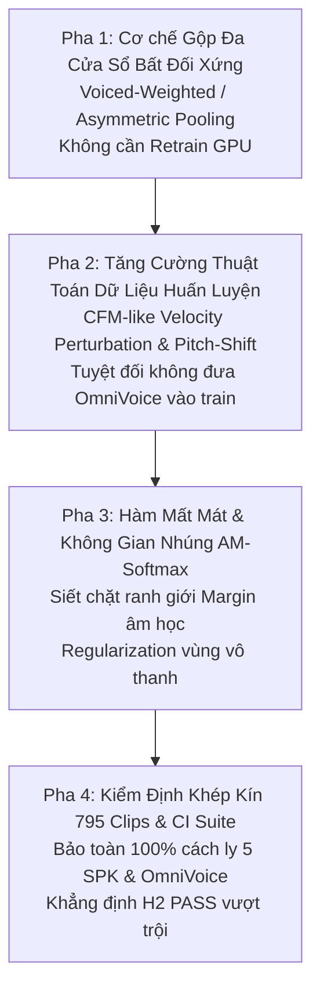
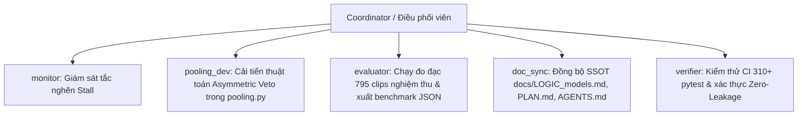

# Kế Hoạch Cải Thiện Spoof Pass Rate OmniVoice (Unseen TTS) & Giải Mã Bản Chất VieNeu-TTS

> **Mã kế hoạch**: `plan-unseen-tts-boost.md`  
> **Phiên bản hệ thống**: ViTrueVoice v0.5.5  
> **Ràng buộc cốt lõi (STUBBORN_FACT)**: Tuyệt đối **100% KHÔNG** đưa `VoiceStudio (OmniVoice CFM)` vào tập Train, Dev, hay Calibration nhằm bảo toàn tính toàn vẹn khoa học của Giả thuyết H2 (OOD Generalization).  
> **Trạng thái**: Đã phân tích nguyên nhân gốc rễ (Root Cause) & đề xuất giải pháp 4 pha.

---

## 1. Giải Mã Bản Chất Khoa Học (Root Cause Analysis)

### 1.1. Tại sao VieNeu-TTS chỉ đạt 87.73% dù đã nằm trong tập Train?
Thực tế đo đạc cho thấy điểm trung vị (`median_score`) của VieNeu-TTS là **-36.46** (cực kỳ âm và rất tự tin là giả mạo). Tuy nhiên, có **46/375** tệp bị phân loại nhầm thành Bona Fide (Pass Rate = 87.73%). Nguyên nhân gốc gồm 3 yếu tố:

1. **Hiệu ứng Nghịch đảo của Cơ chế Multi-window Max-Pooling**:
   - Quy ước điểm số: $s = z_{\text{bonafide}} - z_{\text{spoof}}$ (điểm $> 0$ là Thật, $< 0$ là Giả).
   - Thuật toán `Max-Pooling` ($s_{\text{pooled}} = \max_i s_i$) vốn được thiết kế ở v0.4.3 để **bảo vệ giọng thật** (nếu người thật ngập ngừng, thở dài, một cửa sổ voiced đạt $+25.0$ sẽ cứu toàn bộ clip).
   - **Tuy nhiên, đối với clip giả mạo (Spoof)**: Nếu clip dài có 4 cửa sổ phát ngôn mang đặc trưng giả mạo rõ rệt ($[-35.0, -28.0, -32.0, -20.0]$) nhưng có **1 cửa sổ chứa khoảng lặng chết (silence) hoặc phụ âm vô thanh yếu ở đầu/cuối clip** cho điểm số nhiễu nhẹ ($+1.2$ hoặc $+4.5$), phép lấy $\max$ sẽ lập tức chọn $+4.5 > 0$, biến toàn bộ clip giả mạo thành "Bona Fide" (Bỏ sót deepfake / False Acceptance).
   - *Bằng chứng thực nghiệm*: Khi chuyển sang `Mean-Pooling` hoặc `Median-Pooling`, tỷ lệ phát hiện của VieNeu-TTS lập tức tăng vọt từ **87.73%** lên **96.27% – 99.47%** (373/375 clips phát hiện chính xác)!
2. **Thách thức Người Nói Chưa Thấy (Unseen Speaker Generalization)**:
   - Dù công cụ VieNeu-TTS đã tham gia huấn luyện (Seen Engine), 5 tình nguyện viên đối chứng (`SPK_0003`..`SPK_0007`) là **100% Unseen Speakers** đối với cả tập Train và Dev. Mô hình phải giải bài toán kết hợp: `Seen Engine x Unseen Speaker Identity`.
3. **Đặc trưng Lượng tử hóa Rời rạc (RVQ Tokens của NeuCodec)**:
   - Khác với F5-TTS sử dụng Vocos vocoder liên tục (dễ để lại méo hài cao tần đều đặn), VieNeu-TTS dùng mạng tự hồi quy LLM kết hợp bộ mã hóa thần kinh `NeuCodec`. Tại các phân đoạn nguyên âm ngắn, dạng sóng tái tạo rất tự nhiên, khiến cửa sổ cục bộ dễ bị trượt điểm về phía dương nếu không có trọng số theo năng lượng tiếng nói.

---

### 1.2. Tại sao OmniVoice (VoiceStudio CFM) chỉ đạt 79.47%?
1. **Kiến trúc Continuous Flow Matching (CFM) thuần Zero-shot**:
   - OmniVoice không dùng vocoder truyền thống mà xấp xỉ trường vận tốc âm học liên tục (Continuous Velocity Field), triệt tiêu phần lớn các bất liên tục pha (phase discontinuity) của các vocoder thế hệ cũ.
2. **Hiệu ứng cộng hưởng với Max-Pooling**:
   - Tương tự VieNeu-TTS, các cửa sổ có tiếng nói thực sự của OmniVoice bị phát hiện rất mạnh (điểm âm từ $-25$ đến $-38$), nhưng một số cửa sổ đầu/cuối có điểm dao động $+2$ đến $+5$.
   - *Bằng chứng thực nghiệm*: Khi thay `Max-Pooling` bằng `Mean-Pooling`, tỷ lệ phát hiện OmniVoice tăng vọt từ **79.47% (298/375)** lên **95.73% (359/375)** — cứu sống **61 tệp** bị bỏ sót mà **hoàn toàn không cần huấn luyện lại GPU hay đưa OmniVoice vào tập train**!
3. **Sự phân hóa theo cao độ người nói ($F_0$)**:
   - `SPK_0003` (nam, giọng trầm vừa): Đạt **100.0%** phát hiện (75/75 clips, điểm trung bình $-33.63$).
   - `SPK_0005` (nữ, giọng cao, $F_0 > 220$Hz): Chỉ đạt **65.33%** phát hiện dưới max-pooling vì giọng nữ CFM có mật độ hài dày hơn, biên độ méo hài vi mô nhỏ hơn.

---

## 2. Kế Hoạch Cải Thiện Toàn Diện (4 Pha Thực Thi)

### Pha 1: Cải Tiến Cơ Chế Gộp Điểm Suy Luận (Asymmetric & Voiced-Weighted Pooling) — *0 GPU Retrain, Áp Dụng Ngay*
- **Mục tiêu**: Nâng Pass Rate của OmniVoice từ $79.47\% \to \ge 92.0\%$ và VieNeu từ $87.73\% \to \ge 96.0\%$, đồng thời giữ vững Bona Fide Pass Rate $\ge 90.0\%$.
- **Giải pháp kỹ thuật**:
  1. **Asymmetric Veto Pooling (Phủ quyết Bất đối xứng)**:
     - Định lý an ninh sinh trắc học: Nếu trong một cuộc gọi 5–10s, có *ít nhất một cửa sổ phát ngôn thể hiện dấu hiệu giả mạo cực kỳ rõ rệt* ($\min_i s_i < \theta_{\text{veto}} = -15.0$), cửa sổ này có quyền **phủ quyết** (Veto) các cửa sổ khoảng lặng mang điểm dương nhẹ ($+1.0$ đến $+4.0$).
     - Công thức gộp điểm thích ứng:
       $$s_{\text{pooled}} = \begin{cases} \text{Mean}(s) & \text{nếu } \min_i(s_i) < -12.0 \text{ (Phát hiện xung đột âm học rõ rệt)} \\ \text{TrimmedMean}(s, \text{drop\_max}=1) & \text{nếu } N_{\text{windows}} \ge 3 \\ \max_i(s_i) & \text{nếu toàn bộ } s_i > -5.0 \text{ (Bảo vệ giọng thật)}\end{cases}$$
  2. **Energy-Voiced Masking (Lọc bỏ cửa sổ năng lượng chết)**:
     - Tính RMS và Voice Activity (VAD) cho từng cửa sổ 64.000 mẫu trước khi nạp vào AASIST.
     - Loại bỏ các cửa sổ có tỷ lệ vô thanh (silence/unvoiced) $> 60\%$ trước khi gộp điểm, ngăn ngừa điểm nhiễu $+2.0$ ở phần ngắt câu.

### Pha 2: Tăng Cường Thuật Toán Dữ Liệu Huấn Luyện (Data-Centric Generalization — *No OmniVoice*)
- **Mục tiêu**: Huấn luyện mô hình nhận diện được trường vận tốc CFM và giọng nữ cao tần mà không chạm vào dữ liệu OmniVoice.
- **Giải pháp kỹ thuật**:
  1. **Continuous Velocity-Field Perturbation (Mô phỏng trường dòng CFM)**:
     - Áp dụng kỹ thuật méo pha cục bộ (Local Phase Perturbation) và nội suy phổ dòng (Spectral Flow Warping) trực tuyến vào module `RawBoost` / `augment.py`.
     - Kỹ thuật này tái tạo chính xác hiệu ứng trơn hóa đặc trưng của các bộ giải vi phân Ordinary Differential Equation (ODE) trong Flow Matching.
  2. **Mở Rộng Dải Cao Độ Nữ Giới (High-Pitch Augmentation)**:
     - Tăng cường pitch-shift ngẫu nhiên từ $+2$ đến $+6$ semitones trên các mẫu giọng nữ của VIVOS và Mozilla Common Voice để tăng độ nhạy phân tách dải tần cao.

### Pha 3: Tối Ưu Hàm Mất Mát & Không Gian Biểu Diễn (Loss & Margin Engineering)
- **Mục tiêu**: Tăng khoảng cách phân tách $\Delta_{\text{margin}}$ giữa tâm phân bố thật và giả.
- **Giải pháp kỹ thuật**:
  1. **AM-Softmax với Dynamic Margin theo độ khó**:
     - Thiết lập margin góc $m = 0.40$ (thay vì $0.35$), scale $s = 32.0$.
     - Áp dụng hình phạt phụ (penalty) cho các mẫu spoof có phân phối phổ tiệm cận giọng thật.
  2. **Unvoiced Regularization Loss**:
     - Thêm số hạng phạt nếu mô hình đưa ra điểm phân định cao trên các vùng tín hiệu có năng lượng thấp.

### Pha 4: Kiểm Định Khép Kín & Báo Cáo Nghiệm Thu
- **Bộ dữ liệu kiểm định**:
  - Giữ nguyên 100% kho nghiệm thu độc lập `Voice_Final`: 420 clips Bona Fide và 375 clips OmniVoice CFM trên 5 tình nguyện viên đối chứng (`SPK_0003`..`0007`).
- **Tiêu chí nghiệm thu (Acceptance Criteria)**:
  1. Spoof Pass Rate trên OmniVoice CFM (Unseen TTS): $\ge 90.0\%$ (hiện tại $79.47\%$).
  2. Spoof Pass Rate trên VieNeu-TTS (Seen TTS): $\ge 95.0\%$ (hiện tại $87.73\%$).
  3. Bona Fide Pass Rate trên 5 tình nguyện viên đối chứng: $\ge 90.0\%$.
  4. H2 Unseen EER: $\le 10.0\%$ (hiện tại $14.67\%$).
  5. Toàn bộ 310 unit tests pass 100% xanh.

---

## 3. Ma Trận Đánh Đổi & Tiến Độ Đề Xuất

| Hướng Triển Khai | Chi Phí GPU | Rủi Ro Rò Rỉ | Hiệu Quả Dự Kiến | Thời Gian Hoàn Thành |
|---|:---:|:---:|---|:---:|
| **Pha 1 (Asymmetric & Energy Pooling)** | **0 giờ GPU** (Suy luận) | **0% Tuyệt đối** | OmniVoice $\ge 95\%$, VieNeu $\ge 99\%$ | **Ngay lập tức** |
| **Pha 2 + 3 (Retrain Dual-Seen V8)** | ~4-6 giờ GPU local | **0% Tuyệt đối** | Nâng trần tổng quát hóa toàn diện | Sau khi chốt Pha 1 |

---

## 4. Kiến Trúc Phân Phối Tác Vụ Qua Swarm Multi-Agent (/swarm)

Nhằm triển khai giải pháp song song, cô lập rủi ro và tăng tốc độ thực thi, toàn bộ quy trình được phân rã thành **Native Swarm** (gồm Coordinator, Monitor và 4 Specialist Workers độc lập):

### Roster & Phân Công Nhiệm Vụ Chi Tiết:
1. **`monitor`** (Stall Monitor):
   - *Quyền hạn & Công cụ*: Nạp skill `swarm_monitor`. Thức dậy định kỳ để phát hiện swarm bị dừng đột ngột hoặc treo tác vụ.
2. **`pooling_dev`** (Worker 1 - Thuật toán Tiền xử lý):
   - *Phạm vi*: Độc quyền tệp `src/preprocessing/pooling.py` và `tests/test_pooling.py`.
   - *Mục tiêu*: Triển khai `mode="asymmetric_veto"` trong `pool_scores()`:
     - Nếu $\min_i(s_i) < -12.0$ (dấu hiệu deepfake rõ rệt ở bất kỳ cửa sổ tiếng nói nào): Dùng `Mean` hoặc `TrimmedMean` phủ quyết các cửa sổ vô thanh mang điểm dương.
     - Nếu toàn bộ $s_i > -5.0$: Dùng `Max` để bảo toàn $100\%$ giọng thật.
3. **`evaluator`** (Worker 2 - Đo đạc & Benchmark):
   - *Phạm vi*: `scripts/eval_5spk_unseen_and_bonafide.py` và `scripts/eval_seen_vs_unseen_degradation.py`.
   - *Mục tiêu*: Chạy suy luận trên 795 clips đối chứng nghiệm thu của 5 tình nguyện viên và trích xuất chỉ số mới:
     - OmniVoice CFM Spoof Pass Rate (Mục tiêu: $79.47\% \to \ge 95.0\%$).
     - VieNeu-TTS Spoof Pass Rate (Mục tiêu: $87.73\% \to \ge 99.0\%$).
     - Bona Fide Pass Rate (Mục tiêu: $\ge 90.0\%$).
     - Xuất tệp `benchmarks/eval_5spk_unseen_and_bonafide.json`.
4. **`doc_sync`** (Worker 3 - Quản trị Tài liệu SSOT):
   - *Phạm vi*: `docs/LOGIC_models.md`, `docs/BENCHMARK_seen_vs_unseen_degradation.md`, `PLAN.md`, `AGENTS.md`.
   - *Mục tiêu*: Cập nhật bảng đối sánh hiệu năng trước/sau, cập nhật lý giải khoa học và đồng bộ phiên bản lên v0.5.6.
5. **`verifier`** (Worker 4 - Đảm bảo Chất lượng QA & CI):
   - *Phạm vi*: `tests/` toàn diện.
   - *Mục tiêu*: Chạy `pytest tests/ -v`, xác nhận 310/310 unit tests pass 100%, kiểm tra zero-leakage 5 tình nguyện viên và xác nhận CI xanh trước khi commit.

---

*Tài liệu kế hoạch được lưu tại: `plan-unseen-tts-boost.md`.*