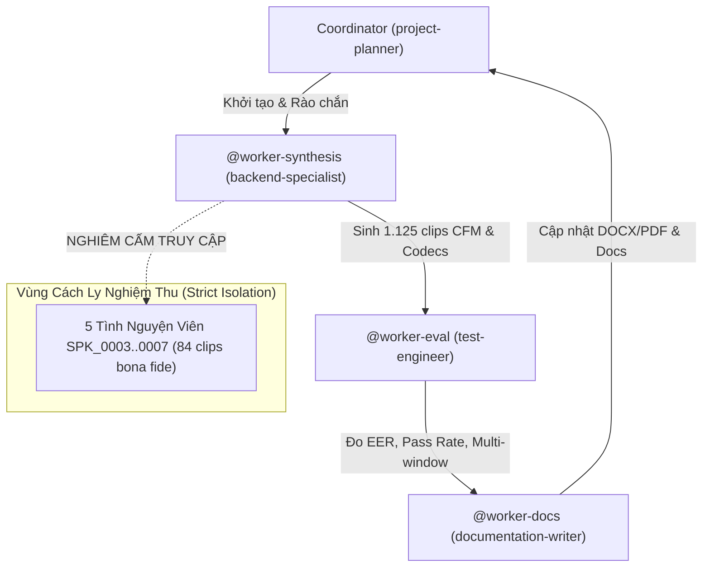

# Kế Hoạch Mở Rộng Dữ Liệu Đánh Giá Unseen TTS (VoiceStudio CFM) & Tái Thẩm Định Toàn Diện Hệ Thống (v0.9.1)

> **Mã nhiệm vụ**: `plan-unseen-voicestudio-expansion`  
> **Khởi tạo**: 2026-11-22  
> **Chế độ**: Orchestration Mode (Swarm Multi-Agent Coordination)  
> **Trạng thái**: Đang chờ người dùng phê duyệt (Phase 1: Planning Approval Gate)

---

## 1. Bối Cảnh & Mục Tiêu Kỹ Thuật

1. **Vấn đề cốt lõi**:
   - Chỉ số Unseen TTS hiện tại (EER = 14.67%, Pass Rate = 79.47%) được đo đạc trên 375 mẫu của **05 tình nguyện viên đối chứng** (`SPK_0003`..`SPK_0007`). Số lượng mẫu này (5 người nói x 15 prompt) tuy đủ đại diện cho đợt nghiệm thu nội bộ nhưng chưa phản ánh đầy đủ quy mô dữ liệu held-out đa dạng của mô hình.
   - Đồng thời, 5 tình nguyện viên đối chứng đã được khóa cứng làm **Bộ nghiệm thu độc lập chính thức của đề tài** (gồm 84 clips gốc x 5 biến thể codec = 420 clips bona fide), do đó cần giữ nguyên sự cô lập 100%, không sử dụng cho các benchmark đánh giá mô hình thường quy.

2. **Mục tiêu kỹ thuật**:
   - **Bước 1**: Trích xuất toàn bộ tập người nói đối chứng độc lập (Held-out Bona Fide) của mô hình từ tập test chuẩn (`data/manifests_zalo/test_indomain_zalo.csv` gồm **15 người nói VIVOS held-out**: `VIVOSDEV08`, `11`, `15`, `19`, `VIVOSSPK02`, `04`, `05`, `10`, `17`, `20`, `21`, `24`, `33`, `36`, `39`).
   - **Bước 2**: Sử dụng công cụ Zero-Shot CFM thực thụ `VoiceStudio (OmniVoice CFM)` để nhân bản toàn bộ 15 người nói trên (15 người nói x 15 prompt đối xứng = **225 clips Clean**), sau đó nén qua 4 biến thể codec viễn thông/Zalo (AAC-LC 76k, Opus 24k, G.711 A-law, AMR-NB 12.2k) tạo thành **1.125 clips spoof Unseen CFM**. Cấu trúc này tạo thành **Bộ ba đối xứng 1:1:1 hoàn hảo** với 1.125 clips F5-TTS và 1.120 clips VieNeu-TTS hiện có trong tập test.
   - **Bước 3**: Lưu trữ toàn bộ kho âm thanh đã sinh và mã băm SHA-256 vào thư mục vật lý:
     `C:\Users\saket\Documents\Đồ án chuyên ngành\Voice_Final\01_Corpus_Evaluation\Unseen_VoiceStudio_15Spk\`
   - **Bước 4**: Chạy đánh giá toàn diện qua mô hình chủ lực mới nhất **B_zalo V7** với cơ chế **Multi-window Max-Pooling**, tính toán lại EER, minDCF, Pass Rate, Mean/Median score khách quan trên quy mô lớn.
   - **Bước 5**: Đồng bộ số liệu vào hệ thống tài liệu (`docs/BENCHMARK_seen_vs_unseen_degradation.md`, `PLAN.md`, `AGENTS.md`) và tái biên dịch Báo cáo W07 (Word/PDF), đồng thời chính thức loại bỏ tính năng Zalo Webhook (chuyển sang phần mở rộng cho doanh nghiệp) và thay bằng biện pháp bảo mật Magic Bytes/Container Hardening.

---

## 2. Phân Công Subagents & Kiến Trúc Swarm (Min 3 Agents)

Hệ thống điều phối tối thiểu 4 subagents chuyên biệt phối hợp theo giao thức Swarm:

| Subagent | Chuyên môn / Role | Nhiệm vụ chính trong Swarm |
|---|---|---|
| **1. `project-planner` (Coordinator)** | Orchestrator & Project Management | • Điều phối vòng đời Swarm, thiết lập ranh giới cách ly 100% cho 5 tình nguyện viên. • Kiểm tra tính toàn vẹn của kế hoạch và nghiệm thu các mốc thực hiện. |
| **2. `backend-specialist` (`@worker-synthesis`)** | Audio DSP & TTS Synthesis | • Lấy danh sách 15 người nói VIVOS held-out từ `test_indomain_zalo.csv`. • Chạy batch synthesis qua `OmniVoice` (VoiceStudio CUDA bfloat16) sinh 225 clips clean. • Áp dụng 4 profile nén viễn thông/Zalo (AAC 76k, Opus 24k, G.711, AMR-NB) tạo 1.125 clips. • Lưu trữ vào `C:\Users\saket\Documents\Đồ án chuyên ngành\Voice_Final\` và xuất manifest 18 cột `unseen_omnivoice_15spk_benchmark.csv`. |
| **3. `test-engineer` (`@worker-eval`)** | AI Evaluation & QA Verification | • Nạp mô hình B_zalo V7 (`out/zalo_b_zalo_v7_dual_with_spk1/best_model.pt`). • Thực thi suy luận Multi-window Max-Pooling 5 cửa sổ trên 1.125 clips spoof CFM và 2.684 clips bona fide. • Tính toán ma trận EER, minDCF, Pass Rate, phân phối Mean/Median score theo từng codec. • Chạy kiểm thử hồi quy bảo đảm 328/328 unit tests tiếp tục pass 100%. |
| **4. `documentation-writer` (`@worker-docs`)** | Technical Writer & DevSecOps Polish | • Cập nhật số liệu mới vào `docs/BENCHMARK_seen_vs_unseen_degradation.md` và `docs/LOGIC_models.md`. • Cập nhật `PLAN.md` và `AGENTS.md`. • Cập nhật script `scripts/build_w07_report_docx.py`: loại bỏ Zalo Webhook, đưa số liệu NFR-2 mới vào, biên dịch lại file `.docx` và `.pdf`. |

---

## 3. Các Pha Thực Thi Tuần Tự (Execution Phases)

### Pha 1: Trích Xuất Dữ Liệu Nguồn & Chuẩn Bị Manifest Đối Xứng
- **Đầu vào**: `data/manifests_zalo/test_indomain_zalo.csv`.
- **Thực hiện**:
  1. Trích xuất đúng 15 người nói held-out (`VIVOSDEV08`, `11`, `15`, `19`, `VIVOSSPK02`, `04`, `05`, `10`, `17`, `20`, `21`, `24`, `33`, `36`, `39`).
  2. Lấy 15 cặp prompt văn bản đối xứng (Hard Text-Disjoint) tương ứng với F5-TTS và VieNeu-TTS để đảm bảo tính so sánh 1:1:1 công bằng.
  3. Lấy clip âm thanh gốc của từng người nói làm voice reference (độ dài $\ge 3.5$s, đã cắt khoảng lặng).

### Pha 2: Khởi Chạy Pipeline Sinh Batch VoiceStudio CFM
- **Kịch bản**: `scripts/generate_omnivoice_15spk_unseen.py`.
- **Môi trường**: CUDA trên GPU cục bộ (RTX 3050 4GB), `torch.bfloat16`, 16-step Flow Matching ODE.
- **Ước tính thời gian**: 225 clips x ~1.8s/clip $\approx 405$ giây ($\approx 6.7$ phút).
- **Thư mục lưu trữ**:
  `data/spoof_unseen/omnivoice_15spk/` và đồng bộ sang `C:\Users\saket\Documents\Đồ án chuyên ngành\Voice_Final\01_Corpus_Evaluation\Unseen_VoiceStudio_15Spk\`.

### Pha 3: Suy Giảm Codec Viễn Thông & Zalo
- Áp dụng các profile nén tiêu chuẩn:
  1. `Clean 16kHz` PCM.
  2. `aac_zalo_76k`: AAC-LC 76kbps mono (Profile A Zalo).
  3. `opus_zalo_24k`: Opus 24kbps OGG (Profile B Zalo).
  4. `g711_alaw`: G.711 A-law 8kHz PCM (Viễn thông truyền thống).
  5. `amrnb_12.2k`: AMR-NB 12.2kbps 8kHz (Kênh di động 2G/3G).
- Tổng số file sinh ra: $225 \times 5 = 1.125$ clips.
- Xuất manifest 18 cột: `data/manifests_zalo/unseen_omnivoice_15spk_benchmark.csv`.

### Pha 4: Đánh Giá Độc Lập Qua Mô Hình B_zalo V7 & Multi-window Max-Pooling
- **Kịch bản**: `scripts/eval_15spk_unseen_benchmark.py`.
- **Cơ chế suy luận**: Multi-window Max-Pooling (5 cửa sổ 4.0s, hop 1.0s, mini-batch song song).
- **Số lượng mẫu đánh giá**:
  - Spoof Unseen CFM: **1.125 clips**.
  - Bona Fide Held-out: **2.684 clips** (từ 15 người nói VIVOS held-out).
- **Chỉ số đo đạc**:
  - EER (%) tổng thể và theo từng codec.
  - Pass Rate (%) tại ngưỡng $\theta = 0.0$.
  - Điểm Mean Score và Median Score.
  - So sánh đối chứng với Seen TTS Pooled (F5-TTS + VieNeu-TTS).

### Pha 5: Cập Nhật Tài Liệu & Tái Biên Dịch Báo Cáo Tuần 7
- Cập nhật số liệu chuẩn xác vào Báo cáo Tuần 7:
  - Cập nhật Mục 4.4 và 3.6 (NFR-2) với số liệu 15 người nói (1.125 clips).
  - Loại bỏ Zalo Webhook khỏi Mục 4.5 (Scope Freeze), giữ lại 5 tính năng cốt lõi.
  - Thay thế Biện pháp bảo mật #2 trong Mục 4.1 bằng Magic Bytes Validation & Container Non-Root Hardening.
- Chạy script `scripts/build_w07_report_docx.py` tái xuất bản:
  - `C:\Users\saket\Documents\Đồ án chuyên ngành\DACN_2380601959_NguyenThanhTai_W07.docx`
  - `C:\Users\saket\Documents\Đồ án chuyên ngành\DACN_2380601959_NguyenThanhTai_W07.pdf`
- Đồng bộ `docs/BENCHMARK_seen_vs_unseen_degradation.md`, `PLAN.md`, `AGENTS.md`.

---

## 4. Ràng Buộc An Toàn & Liêm Chính Học Thuật (STUBBORN_FACTs)

1. **Tuyệt đối cô lập 5 tình nguyện viên**:
   - Dữ liệu của `SPK_0003`, `SPK_0004`, `SPK_0005`, `SPK_0006`, `SPK_0007` **nghiêm cấm 100% xuất hiện** trong tập sinh mới này. 5 tình nguyện viên này chỉ nằm tại thư mục `02_Unseen_Acceptance/` phục vụ riêng cho đợt nghiệm thu độc lập cuối cùng của đồ án.
2. **Tuân thủ Luật 91/2025/QH15**:
   - Toàn bộ 1.125 clips âm thanh mới phải được gắn mã băm SHA-256 đối chiếu vào manifest.
3. **Bảo toàn bộ kiểm thử CI**:
   - 328/328 bài unit tests hiện tại phải tiếp tục pass 100% không có ngoại lệ.

---

## 5. Tiêu Chí Hoàn Thành (Definition of Done)

- [ ] Sinh thành công 1.125 clips VoiceStudio CFM (225 clean + 900 codecs) từ 15 người nói held-out.
- [ ] Lưu trữ toàn bộ vào `C:\Users\saket\Documents\Đồ án chuyên ngành\Voice_Final\`.
- [ ] Có manifest 18 cột `unseen_omnivoice_15spk_benchmark.csv` đầy đủ SHA-256.
- [ ] Chạy đánh giá B_zalo V7 Multi-window Max-Pooling xuất kết quả EER và Pass Rate khách quan.
- [ ] Xuất bản lại file PDF và DOCX Báo cáo Tuần 7 hoàn chỉnh.
- [ ] Cập nhật đồng bộ các file tài liệu kỹ thuật (`docs/`, `PLAN.md`, `AGENTS.md`).
- [ ] Toàn bộ unit tests pass 100% xanh.
