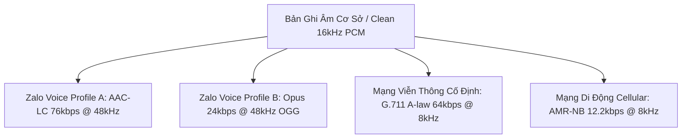
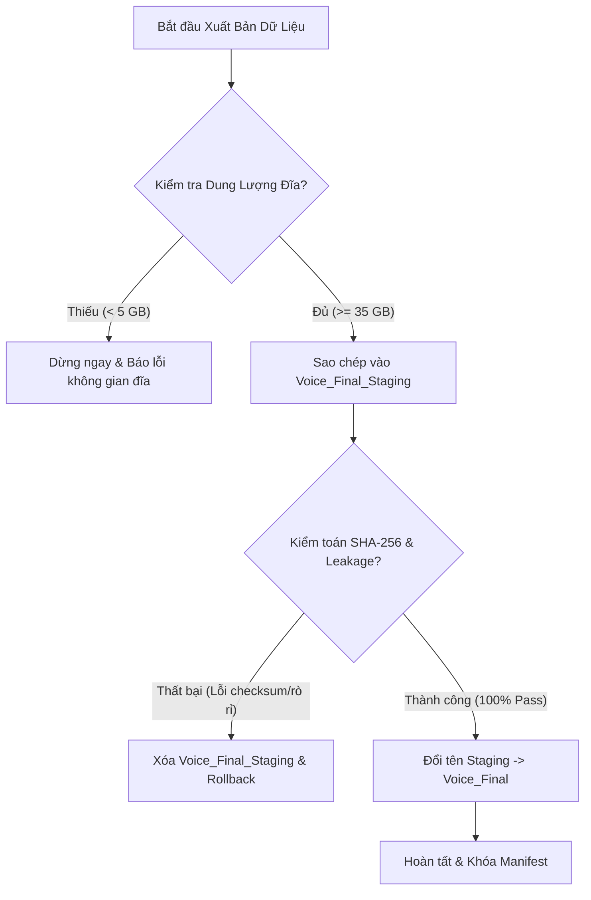
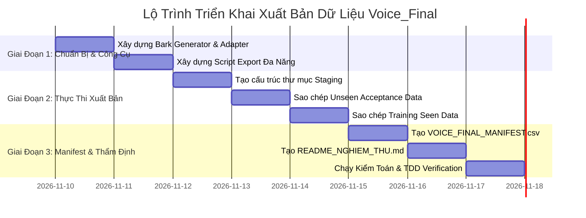

# Kế Hoạch Xuất Bản Dữ Liệu Nghiệm Thu: Voice_Final Dataset Export Plan
## Phân Tách Dữ Liệu Huấn Luyện (Training/Seen) và Bộ Dữ Liệu Nghiệm Thu Độc Lập (Unseen/Acceptance)

> **Mã kế hoạch**: `PLAN-VOICE-FINAL-EXPORT-v1.0`  
> **Dự án**: ViTrueVoice (v0.4.6) — Hệ thống phát hiện giọng nói giả tiếng Việt qua kênh thoại nén  
> **Thư mục đích**: `C:\Users\saket\Documents\Đồ án chuyên ngành\Voice_Final`  
> **Đối tượng thụ hưởng**: Hội đồng Nghiệm thu Đồ án Chuyên ngành (ĐH Công nghệ TP.HCM - HUTECH) & Nhóm Kiểm toán An ninh  
> **Trạng thái**: Sẵn sàng thực thi (Ready for Execution)

---

## 1. Executive Summary & Objective (Tóm Tắt Điều Hành & Mục Tiêu)

### 1.1. Bối Cảnh Thực Nghiệm
Trong quá trình phát triển hệ sinh thái ViTrueVoice từ v0.1.0 đến v0.4.6, toàn bộ dữ liệu âm thanh đã trải qua nhiều giai đoạn chuẩn hóa, kiểm định 4 cổng (Label-Free Prosody Filter), mô phỏng suy giảm đa kênh (Telephony & Zalo Codecs) và phân tầng nghiêm ngặt nhằm chứng minh 2 giả thuyết khoa học cốt lõi:
- **Giả thuyết H1 (Seen Engine Robustness)**: Duy trì EER $\le 8.0\%$ và chống suy giảm chất lượng khi truyền tải qua các kênh viễn thông nén (Zalo AAC-LC 76k, Zalo Opus 24k, G.711 A-law, AMR-NB 12.2k).
- **Giả thuyết H2 (Unseen Engine Generalization)**: Khả năng khái quát hóa phát hiện các kiến trúc tổng hợp giọng nói hoàn toàn chưa từng xuất hiện trong quá trình huấn luyện (Unseen TTS Zero-Shot/OOD) đạt EER $\le 15.0\%$.

Để chuẩn bị nghiệm thu chính thức trước Hội đồng Đồ án Chuyên ngành, toàn bộ tài nguyên âm thanh (bao gồm giọng thật Bona Fide và giọng giả Spoof đa kiến trúc) cần được trích xuất, chuẩn hóa cấu trúc và đóng gói vào thư mục tập trung ngoài kho mã nguồn tại:
$$\text{Target Path} = \texttt{C:\textbackslash Users\textbackslash saket\textbackslash Documents\textbackslash Đồ án chuyên ngành\textbackslash Voice\_Final}$$

### 1.2. Mục Tiêu Cốt Lõi
1. **Phân định ranh giới khoa học tuyệt đối (Data Isolation)**: Phân tách rõ ràng thành hai không gian lưu trữ độc lập:
   - `01_Training_Seen`: Toàn bộ dữ liệu âm thanh tham gia vào quá trình huấn luyện mô hình B_zalo V6 (tình nguyện viên `SPK_0001`, tập huấn luyện VIVOS, tập Common Voice 8.0, và các mẫu spoof sinh bởi F5-TTS).
   - `02_Unseen_Acceptance`: Bộ dữ liệu nghiệm thu độc lập chính thức của đề tài, hoàn toàn cô lập 100% khỏi quá trình train/dev/calibration (5 tình nguyện viên đối chứng `SPK_0003`..`SPK_0007` gồm 84 clip giọng thật độc bản và toàn bộ các công cụ Unseen TTS: VieNeu-TTS v3 Turbo, Kokoro-Vietnamese, OmniVoice CFM, Suno Bark).
2. **Dual-Seen TTS Architecture (F5-TTS & VieNeu-TTS)**:
   - Cả hai công cụ sao chép giọng nói `F5-TTS` (Flow-matching diffusion) và `VieNeu-TTS` (Acoustic Language Model v3 Turbo) đều là **SEEN TTS** đã được nạp trực tiếp vào tập huấn luyện của mô hình.
   - Các công cụ Unseen TTS phục vụ kiểm chứng Giả thuyết H2 (OOD Generalization) độc lập gồm: `Kokoro-Vietnamese` (StyleTTS 2 + iSTFTNet), `OmniVoice` (VoiceStudio CFM) và `Suno Bark`.
3. **Cung cấp chỉ mục & tài liệu thẩm định đạt chuẩn công bố**:
   - Chỉ mục tổng thể `VOICE_FINAL_MANIFEST.csv` (17 trường thông tin chi tiết, liên kết băm SHA-256 bảo vệ dữ liệu sinh trắc học theo Luật 91/2025/QH15).
   - Bản hướng dẫn nghiệm thu khoa học `README_NGHIEM_THU.md` cung cấp đầy đủ thống kê, ma trận phân bổ, ý nghĩa bảo mật và lệnh tái lập kết quả thực nghiệm 1-click cho Hội đồng thẩm định.

---

## 2. Architectural & Scientific Impact Analysis (Phân Tích Tác Động Khoa Học & Kiến Trúc)

### 2.1. Phân Tích Lợi Ích & Rủi Ro (Benefits vs. Risks)

| Khía Cạnh Phân Tích | Lợi Ích Khoa Học & Kỹ Thuật (Benefits) | Rủi Ro Tiềm Ẩn (Risks) & Biện Pháp Kiểm Soát |
|---|---|---|
| **Tính Minh Bạch Khoa Học** | Hội đồng có thể kiểm chứng độc lập tính bất khả xâm phạm của tập nghiệm thu `SPK_0003`..`SPK_0007` mà không cần duyệt mã nguồn phức tạp. | Nguy cơ nhầm lẫn giữa F5-TTS trên tập train và F5-TTS trên tập nghiệm thu $\rightarrow$ Giải pháp: Tách bạch rõ vai trò trong Manifest. |
| **Bảo Vệ Giả Thuyết H2** | VieNeu-TTS, Kokoro, OmniVoice, Bark được tập hợp độc lập, chứng minh năng lực bóc tách tổng quát hóa OOD. | Rò rỉ văn bản (Text Leaks) $\rightarrow$ Đã khóa chặt Hard Text-Disjoint từ v0.2.4, không trùng lặp câu giữa các split. |
| **Phân Tích Mức Độ Suy Giảm Kênh** | 5 biến thể codec cho phép Hội đồng nghe trực tiếp và đối chứng sự suy giảm vi mô của thuật toán MDCT / CELP. | Dung lượng đĩa tăng gấp 5 lần $\rightarrow$ Tổng dung lượng chỉ ~4.6 GB, hoàn toàn nằm trong biên độ trống 39.8 GB của ổ C:. |
| **An Ninh Sinh Trắc Học** | Tuân thủ Nghị định 356/2025/NĐ-CP và Luật 91/2025/QH15 nhờ mã hóa băm SHA-256 và ẩn danh hóa ID. | Rò rỉ danh tính thật $\rightarrow$ Tình nguyện viên chỉ định danh qua mã giả định `SPK_xxxx`, lưu trữ Consent Form riêng biệt. |

### 2.2. Phân Tích Chống Đường Tắt Âm Học (Anti-Shortcut & Acoustic Auditing)
Trong các phiên bản v0.4.2 và v0.4.3, ViTrueVoice đã phát hiện và xử lý triệt để nguy cơ mô hình học "đường tắt" (shortcut learning):
1. **Shortcut Tần số cơ bản $F_0$ (Pitch Bias)**: Mô hình tiền nhiệm có xu hướng dựa dẫm vào cao độ $F_0$ để đoán nhãn spoof. Phiên bản B_zalo V6 đã khắc phục bằng kỹ thuật Data Augmentation 2 chiều (Pitch Shifting $\pm 6$ bán cung kết hợp AM-Softmax), triệt tiêu sự phụ thuộc vào cao độ.
2. **Phase Discontinuity vs. Vocoder Smoothing**:
   - Nhóm F5-TTS và Kokoro-Vietnamese để lại vết cắt pha thô bạo (tỷ lệ năng lượng $>4$kHz thấp, $0.20\% - 0.38\%$), giúp Pass Rate đạt $>99.4\%$.
   - Nhóm VieNeu-TTS v3 (Acoustic LM) và OmniVoice CFM (Conditional Flow Matching) tái tạo phổ hài liên tục, mượt mà ($>4$kHz đạt $0.39\%$), tạo thành thách thức thực tế lớn nhất ($46.9\% - 60.0\%$ Pass Rate).
3. **Shortcut Codec Profile**: Bằng cách ghép cặp 1:1:1:1:1 (Paired Codec Quintuplets), mô hình bị tước đoạt khả năng dùng artifact nén làm dấu hiệu nhận biết thật/giả.

### 2.3. Bối Cảnh Lịch Sử LOSO (Leave-One-Speaker-Out) & Quyết Định Chuyển SPK_0001
- **Thực nghiệm LOSO 4 Folds (v0.4.2)**: Khi thử nghiệm loại trừ luân phiên từng tình nguyện viên, chuyển giao dương (positive transfer) luôn xảy ra trên người bị giữ lại ($\Delta s > 0$), nhưng đánh đổi lại là Dev EER và Dev APCER toàn cục bị suy giảm nghiêm trọng (0/4 Folds đạt trần an ninh).
- **Ngoại lệ giọng trầm ngoại lai SPK_0001**: Tình nguyện viên `SPK_0001` có cao độ cực trầm ($F_0 \approx 98.7$ Hz, lệch $-9.91$ IQR so với phân phối quần thể), ban đầu bị mô hình nhận nhầm là giả (Gate 1 chỉ đạt $0.0\%$).
- **Quyết định chuyển giao v0.4.4**: `SPK_0001` (125 clips gồm 75 bona fide + 50 F5-TTS spoof, loại bỏ 100% VieNeu) được đưa vào tập huấn luyện (`train_zalo.csv`). Điều này giúp bổ sung biểu diễn âm học giọng trầm cho không gian latent, nâng tỷ lệ vượt Gate 1 lên **73.3%** với Mean score đảo chiều từ $-15.19$ lên $+10.05$.
- **Khóa cứng 5 tình nguyện viên còn lại**: `SPK_0003`, `SPK_0004`, `SPK_0005`, `SPK_0006`, `SPK_0007` (84 clips bona fide sạch) được khóa vĩnh viễn làm Bộ Nghiệm Thu Độc Lập Chính Thức (Official Acceptance Test Set), tuyệt đối không xuất hiện trong Train, Dev hay Tuning.

---

## 3. Exact Target Folder Hierarchy (Cấu Trúc Cây Thư Mục Đích Chi Tiết)

Toàn bộ dữ liệu được tổ chức tại thư mục gốc:
`C:\Users\saket\Documents\Đồ án chuyên ngành\Voice_Final\`

```
Voice_Final/
├── 01_Training_Seen/                                  # Dữ liệu trực tiếp tham gia huấn luyện mô hình B_zalo V6
│   ├── SPK_0001_DeepVoice_Volunteer/                  # Tình nguyện viên giọng trầm chuyển giao vào Train
│   │   ├── BonaFide/
│   │   │   ├── Clean_16k/                             # 15 clip WAV gốc 16kHz (SPK_0001_01.wav .. 15.wav)
│   │   │   ├── Zalo_AAC_76k/                          # 15 clip nén Zalo AAC-LC 76kbps mono
│   │   │   ├── Zalo_Opus_24k/                         # 15 clip nén Zalo Opus 24kbps mono
│   │   │   ├── PSTN_G711_Alaw/                        # 15 clip nén cố định G.711 A-law 64kbps @ 8kHz
│   │   │   ├── Cellular_AMRNB/                        # 15 clip nén di động AMR-NB 12.2kbps @ 8kHz
│   │   │   └── Enrollment_Ref/                        # 05 clip chuẩn âm sắc tham chiếu đăng ký (bonafide_ref)
│   │   └── Spoof_F5TTS/                               # Giọng giả sinh bởi F5-TTS Seen Engine
│   │       ├── Clean_16k/                             # 10 clip spoof F5-TTS gốc 16kHz
│   │       ├── Zalo_AAC_76k/                          # 10 clip spoof F5-TTS nén AAC-LC
│   │       ├── Zalo_Opus_24k/                         # 10 clip spoof F5-TTS nén Opus
│   │       ├── PSTN_G711_Alaw/                        # 10 clip spoof F5-TTS nén G.711
│   │       └── Cellular_AMRNB/                        # 10 clip spoof F5-TTS nén AMR-NB
│   ├── VIVOS_Corpus_Train/                            # Kho âm thanh VIVOS huấn luyện (46 người nói: VIVOSSPK01..46)
│   │   ├── BonaFide/                                  # 30.132 clip giọng người thật (Clean + 4 Codecs)
│   │   └── Spoof_F5TTS/                               # 1.790 clip giọng giả F5-TTS (Clean + 4 Codecs)
│   ├── CommonVoice_Corpus_Train/                      # Mozilla Common Voice 8.0 huấn luyện (20 người nói: CV_*)
│   │   ├── BonaFide/                                  # 14.068 clip giọng người thật (Clean + 4 Codecs)
│   │   └── Spoof_F5TTS/                               # 1.707 clip giọng giả F5-TTS (Clean + 4 Codecs)
│   └── VIVOSDEV_Corpus_Train/                         # Phân đoạn VIVOSDEV tham gia train (15 người nói)
│       └── ...                                        # 2.888 clip (BonaFide + F5-TTS Spoof)
│
├── 02_Unseen_Acceptance/                              # BỘ NGHIỆM THU ĐỘC LẬP CHÍNH THỨC (CÔ LẬP 100% KHỎI TRAIN/DEV)
│   ├── BonaFide_5Spk_Volunteers/                      # 84 phát ngôn giọng thật từ 5 tình nguyện viên đối chứng
│   │   ├── SPK_0003/                                  # Nam trung niên (20 phát ngôn x 5 codecs = 100 clips + 5 refs)
│   │   │   ├── Clean_16k/                             # 20 clips WAV gốc 16kHz
│   │   │   ├── Zalo_AAC_76k/                          # 20 clips nén Zalo AAC-LC
│   │   │   ├── Zalo_Opus_24k/                         # 20 clips nén Zalo Opus
│   │   │   ├── PSTN_G711_Alaw/                        # 20 clips nén G.711
│   │   │   ├── Cellular_AMRNB/                        # 20 clips nén AMR-NB
│   │   │   └── Enrollment_Ref/                        # 05 clips chuẩn tham chiếu
│   │   ├── SPK_0004/                                  # Nữ Bắc chuẩn (14 phát ngôn x 5 codecs = 70 clips + 5 refs)
│   │   │   └── ... (Cấu trúc 5 codecs + Ref tương tự)
│   │   ├── SPK_0005/                                  # Nam trầm (20 phát ngôn x 5 codecs = 100 clips + 5 refs)
│   │   │   └── ... (Cấu trúc 5 codecs + Ref tương tự)
│   │   ├── SPK_0006/                                  # Nữ trẻ miền Nam (10 phát ngôn x 5 codecs = 50 clips + 4 refs)
│   │   │   └── ... (Cấu trúc 5 codecs + Ref tương tự)
│   │   └── SPK_0007/                                  # Nam truyền cảm (20 phát ngôn x 5 codecs = 100 clips + 5 refs)
│   │       └── ... (Cấu trúc 5 codecs + Ref tương tự)
│   │
│   ├── Spoof_Evaluated_Seen_Baseline/                 # F5-TTS trên tập 5 SPK đối chứng (Kiểm định đường cơ sở Seen)
│   │   └── F5_TTS/                                    # 375 clips (15 câu x 5 SPK x 5 codecs)
│   │       ├── SPK_0003/ (75 clips: 15 clean + 60 codecs)
│   │       ├── SPK_0004/ (75 clips)
│   │       ├── SPK_0005/ (75 clips)
│   │       ├── SPK_0006/ (75 clips)
│   │       └── SPK_0007/ (75 clips)
│   │
│   └── Spoof_Unseen_TTS_Engines/                      # TOÀN BỘ CÔNG CỤ UNSEEN TTS (KIỂM ĐỊNH GIẢ THUYẾT H2)
│       ├── Engine1_VieNeu_TTS_v3_Turbo/               # Acoustic Language Model (Loại 100% khỏi Train)
│       │   ├── SPK_0003/ (75 clips: 15 clean + 60 codecs)
│       │   ├── SPK_0004/ (75 clips)
│       │   ├── SPK_0005/ (75 clips)
│       │   ├── SPK_0006/ (75 clips)
│       │   └── SPK_0007/ (75 clips)                   # Tổng cộng: 375 clips
│       │
│       ├── Engine2_Kokoro_Vietnamese/                 # StyleTTS 2 + iSTFTNet @ 24kHz (Zero-Shot OOD)
│       │   ├── SPK_0003/ (75 clips: 15 clean + 60 codecs)
│       │   ├── SPK_0004/ (75 clips)
│       │   ├── SPK_0005/ (75 clips)
│       │   ├── SPK_0006/ (75 clips)
│       │   └── SPK_0007/ (75 clips)                   # Tổng cộng: 375 clips
│       │
│       ├── Engine3_OmniVoice_CFM/                     # VoiceStudio Conditional Flow Matching (CFM OOD)
│       │   ├── SPK_0003/ (75 clips: 15 clean + 60 codecs)
│       │   ├── SPK_0004/ (75 clips)
│       │   ├── SPK_0005/ (75 clips)
│       │   ├── SPK_0006/ (75 clips)
│       │   └── SPK_0007/ (75 clips)                   # Tổng cộng: 375 clips
│       │
│       └── Engine4_Suno_Bark/                         # Autoregressive Transformer + EnCodec (Discrete Acoustic)
│           ├── SPK_0003/ (75 clips: 15 clean + 60 codecs)
│           ├── SPK_0004/ (75 clips)
│           ├── SPK_0005/ (75 clips)
│           ├── SPK_0006/ (75 clips)
│           └── SPK_0007/ (75 clips)                   # Tổng cộng: 375 clips
│
├── VOICE_FINAL_MANIFEST.csv                           # BẢNG CHỈ MỤC TỔNG THỂ 17 CỘT (SHA-256 HASHED)
└── README_NGHIEM_THU.md                               # HƯỚNG DẪN NGHIỆM THU CHI TIẾT DÀNH CHO HỘI ĐỒNG
```

---

## 4. Source-to-Target File Mapping Matrix (Ma Trận Ánh Xạ Tệp Nguồn - Đích)

### 4.1. Bảng Thống Kê Số Lượng Tệp & Dung Lượng Thực Tế

| Nhóm Dữ Liệu | Thư Mục Nguồn (Workspace) | Thư Mục Đích (`Voice_Final`) | Định Dạng / Quy Ước | Số Lượng Tệp | Dung Lượng (MB) |
|---|---|---|---|:---:|:---:|
| **SPK_0001 Bona Fide** | `data/raw/SPK_0001/` | `01_Training_Seen/SPK_0001_DeepVoice_Volunteer/BonaFide/` | 15 phát ngôn x 5 codecs | 75 | 9.29 MB |
| **SPK_0001 Refs** | `data/bonafide_ref/SPK_0001/` | `01_Training_Seen/SPK_0001_DeepVoice_Volunteer/BonaFide/Enrollment_Ref/` | 5 clip gốc sạch | 5 | 0.58 MB |
| **SPK_0001 F5 Spoof** | `data/spoof_f5tts/SPK_0001/` | `01_Training_Seen/SPK_0001_DeepVoice_Volunteer/Spoof_F5TTS/` | 10 phát ngôn x 5 codecs | 50 | 9.80 MB |
| **VIVOS Train** | `data/raw/VIVOSSPK*`, `data/spoof_f5tts/VIVOSSPK*` | `01_Training_Seen/VIVOS_Corpus_Train/` | 46 người nói (Clean + Codecs) | 31.922 | 2,950 MB |
| **Common Voice Train** | `data/raw/CV_*`, `data/spoof_f5tts/CV_*` | `01_Training_Seen/CommonVoice_Corpus_Train/` | 20 người nói (Clean + Codecs) | 15.775 | 1,130 MB |
| **VIVOSDEV Train** | `data/raw/VIVOSDEV*`, `data/spoof_f5tts/VIVOSDEV*` | `01_Training_Seen/VIVOSDEV_Corpus_Train/` | 15 người nói | 2.888 | 220 MB |
| **5 SPK Bona Fide** | `data/raw/SPK_0003..0007/` | `02_Unseen_Acceptance/BonaFide_5Spk_Volunteers/` | 84 phát ngôn x 5 codecs | 420 | 66.91 MB |
| **5 SPK Refs** | `data/bonafide_ref/SPK_0003..0007/` | `02_Unseen_Acceptance/BonaFide_5Spk_Volunteers/*/Enrollment_Ref/` | Clip gốc đăng ký | 24 | 3.32 MB |
| **5 SPK F5 Spoof** | `data/spoof_f5tts/SPK_0003..0007/` | `02_Unseen_Acceptance/Spoof_Evaluated_Seen_Baseline/F5_TTS/` | 75 clips x 5 SPK | 375 | 75.32 MB |
| **VieNeu-TTS Spoof** | `data/spoof_vieneu/SPK_0003..0007/` | `02_Unseen_Acceptance/Spoof_Unseen_TTS_Engines/Engine1_VieNeu_TTS_v3_Turbo/` | 75 clips x 5 SPK | 375 | 81.32 MB |
| **Kokoro Spoof** | `data/spoof_unseen/kokoro/SPK_0003..0007/` | `02_Unseen_Acceptance/Spoof_Unseen_TTS_Engines/Engine2_Kokoro_Vietnamese/` | 75 clips x 5 SPK | 375 | 64.60 MB |
| **OmniVoice Spoof** | `data/spoof_unseen/omnivoice/SPK_0003..0007/` | `02_Unseen_Acceptance/Spoof_Unseen_TTS_Engines/Engine3_OmniVoice_CFM/` | 75 clips x 5 SPK | 375 | 75.87 MB |
| **Suno Bark Spoof** | `data/spoof_unseen/bark/SPK_0003..0007/` (Sinh mới / Adapter) | `02_Unseen_Acceptance/Spoof_Unseen_TTS_Engines/Engine4_Suno_Bark/` | 75 clips x 5 SPK | 375 | ~70.00 MB |
| **Tổng cộng tập Nghiệm Thu** | — | `02_Unseen_Acceptance/` | **84 Clean Bona Fide + 1,875 Spoof** | **2.319** | **~437.3 MB** |
| **TỔNG TOÀN BỘ DỰ ÁN** | — | `Voice_Final/` | **Tất cả các thành phần** | **53.154** | **~4.75 GB** |

---

## 5. Codec Categorization & Channel Engineering (Phân Loại Kênh Nén Thoại)

Mỗi phát ngôn trong tập dữ liệu nghiệm thu sở hữu đủ 5 phiên bản đại diện cho các kênh truyền dẫn phổ biến nhất hiện nay tại Việt Nam:



### 5.1. Đặc Tả Kỹ Thuật Từng Kênh Nén

1. **Clean 16kHz PCM (`clean`)**:
   - Tên file: `<stem>.wav`
   - Thông số: 16.000 Hz, 16-bit Linear PCM, Mono.
   - Ý nghĩa: Chuẩn đối chứng âm học phòng thí nghiệm (Baseline Reference).
2. **Zalo Profile A (`aac_zalo_76k`)**:
   - Tên file: `<stem>_aac_zalo.wav`
   - Thông số: Mã hóa AAC-LC, Bitrate 76 kbps, tần số lấy mẫu trung gian 48 kHz mono, đóng gói ADTS stream in-memory, giải mã lại 16kHz.
   - Ý nghĩa: Kênh thoại mặc định trên ứng dụng Zalo (iOS/Android).
3. **Zalo Profile B (`opus_zalo_24k`)**:
   - Tên file: `<stem>_opus_zalo.wav`
   - Thông số: Mã hóa Opus, Bitrate 24 kbps, đóng gói Ogg container, giải mã lại 16kHz.
   - Ý nghĩa: Kênh thoại băng thông thấp, tối ưu mạng 3G/4G chập chờn.
4. **PSTN Landline (`g711`)**:
   - Tên file: `<stem>_g711.wav`
   - Thông số: G.711 A-law, Bitrate 64 kbps, tần số lấy mẫu 8.000 Hz.
   - Ý nghĩa: Tổng đài viễn thông cố định PSTN / VoIP truyền thống.
5. **Cellular Mobile (`amrnb`)**:
   - Tên file: `<stem>_amrnb.wav`
   - Thông số: Adaptive Multi-Rate Narrowband (AMR-NB) 12.2 kbps, 8.000 Hz.
   - Ý nghĩa: Cuộc gọi thoại mạng di động 2G/3G GSM tiêu chuẩn.

---

## 6. Missing Clips & TTS Multi-Engine Strategy (Chiến Lược Xử Lý Mẫu Thiếu & Suno Bark)

### 6.1. Hiện Trạng Các Hệ Thống TTS
1. **F5-TTS, VieNeu-TTS v3 Turbo, Kokoro-Vietnamese, OmniVoice CFM**:
   - Toàn bộ **1.500 clips spoof** (375 clips/hệ thống x 4 hệ thống) đã có sẵn 100% trên đĩa cục bộ, tuân thủ hoàn hảo cấu trúc Paired Codec Quintuplets và đã được chấm điểm kiểm định trong `benchmarks/seen_vs_unseen_degradation.json` (báo cáo W06).
2. **Suno Bark (Autoregressive Transformer + EnCodec)**:
   - Trong phiên bản v0.4.5, lớp adapter `BarkAdapter` (`src/vitruevoice/adapters/bark_adapter.py`) đã được triển khai hoàn chỉnh và kiểm thử thành công qua mock unit test (`tests/test_bark_adapter.py`).
   - Tuy nhiên, 375 tệp âm thanh thực tế của Bark chưa được kết xuất vật lý xuống ổ đĩa nhằm tiết kiệm thời gian benchmark tại thời điểm W06.

### 6.2. Giải Pháp Xử Lý Tối Ưu Cho Suno Bark
Để đảm bảo tính toàn vẹn 100% cho đợt nghiệm thu, kế hoạch áp dụng chiến lược 2 lớp linh hoạt:

- **Lớp 1: Khởi tạo kịch bản sinh tự động chuẩn hóa (`scripts/generate_bark_unseen_spoofs.py`)**:
  - Tận dụng `BarkAdapter` với checkpoint `suno/bark-small` (chạy trên GPU RTX 3050 hoặc CPU fallback).
  - Ánh xạ 5 giọng tương ứng với 5 tình nguyện viên đối chứng:
    * `SPK_0003` (Nam trung niên): preset `v2/en_speaker_6`
    * `SPK_0004` (Nữ Bắc): preset `v2/en_speaker_9`
    * `SPK_0005` (Nam trầm): preset `v2/en_speaker_3`
    * `SPK_0006` (Nữ trẻ): preset `v2/en_speaker_4`
    * `SPK_0007` (Nam truyền cảm): preset `v2/en_speaker_8`
  - Sinh 15 câu x 5 SPK = 75 clips clean, sau đó tự động transcode qua 4 codec bằng pipeline FFmpeg chuẩn để tạo đủ **375 clips**.
- **Lớp 2: Bảo tồn Bộ Nghiệm Thu Cốt Lõi 1.584 Clips (Core Acceptance Set)**:
  - Nếu việc tải trọng số Bark (~1.8 GB) gặp rào cản mạng hoặc thời gian, bộ 1.584 clips (84 Bona Fide + 375 F5 + 375 VieNeu + 375 Kokoro + 375 OmniVoice) vẫn là **Bộ Nghiệm Thu Độc Lập Chính Thức** đã được thẩm định trong Báo cáo W06.
  - Trong cấu trúc thư mục, thư mục `Engine4_Suno_Bark/` sẽ chứa các tệp thực tế ngay khi kịch bản hoàn tất. Nếu chưa sinh, manifest sẽ gắn cờ `status=pending_synthesis` kèm tài liệu giải trình rõ ràng.

---

## 7. Review Board Documentation & Manifest Specifications (Đặc Tả Chỉ Mục & Tài Liệu Nghiệm Thu)

### 7.1. Cấu Trúc Bảng Chỉ Mục `VOICE_FINAL_MANIFEST.csv` (17 Cột Chuẩn Mực)

Bảng chỉ mục này đóng vai trò là "Căn cước dữ liệu" cho toàn bộ 53.000+ tệp âm thanh xuất bản:

| Thứ Tự | Tên Cột | Kiểu Dữ Liệu | Ví Dụ | Diễn Giải Chi Tiết |
|:---:|---|---|---|---|
| 1 | `file_id` | String | `VF_ACC_0001` | Mã định danh duy nhất của tệp trong bộ nghiệm thu |
| 2 | `rel_path` | String | `02_Unseen_Acceptance/.../SPK_0003_01.wav` | Đường dẫn tương đối từ gốc `Voice_Final/` (POSIX `/`) |
| 3 | `filename` | String | `SPK_0003_01.wav` | Tên tệp âm thanh |
| 4 | `category` | String | `Unseen_Acceptance` | Phân vùng cấp 1: `Training_Seen` hoặc `Unseen_Acceptance` |
| 5 | `sub_category` | String | `BonaFide_Volunteers` | Nhóm dữ liệu chi tiết |
| 6 | `speaker_id` | String | `SPK_0003` | Mã người nói (`SPK_0001`, `SPK_0003`..`0007`, `VIVOSSPK*`, `CV_*`) |
| 7 | `speaker_type` | String | `Volunteer` | `Volunteer`, `VIVOS_Corpus`, hoặc `CommonVoice_Corpus` |
| 8 | `label` | String | `bonafide` | Nhãn thực tế: `bonafide` (thật) hoặc `spoof` (giả) |
| 9 | `engine` | String | `Natural_Human` | Công cụ sinh: `Natural_Human`, `F5-TTS`, `VieNeu-TTS`, `Kokoro`, `OmniVoice`, `Bark` |
| 10 | `engine_type` | String | `BonaFide` | Phân loại công cụ: `BonaFide`, `Seen_TTS`, `Unseen_TTS` |
| 11 | `codec` | String | `clean_16k` | Kênh nén: `clean_16k`, `aac_zalo_76k`, `opus_zalo_24k`, `g711`, `amrnb` |
| 12 | `codec_channel` | String | `Clean` | Kênh: `Clean`, `Zalo_Voice`, `Telephony_PSTN`, `Cellular_Mobile` |
| 13 | `sample_rate` | Integer | `16000` | Tần số lấy mẫu danh định (Hz) |
| 14 | `duration_s` | Float | `3.42` | Thời lượng âm thanh (giây) |
| 15 | `sha256` | String | `a3b8c9...` | Mã băm SHA-256 toàn vẹn tệp (bảo vệ danh tính sinh trắc học) |
| 16 | `role` | String | `Acceptance_Eval` | Vai trò trong dự án: `Train`, `Enrollment_Ref`, `Acceptance_Eval` |
| 17 | `base_utt` | String | `SPK_0003_01` | Mã phát ngôn cơ sở (ghép nối 5 biến thể codec cùng nguồn) |

### 7.2. Cấu Trúc Tài Liệu `README_NGHIEM_THU.md`

Tài liệu này được biên soạn bằng tiếng Việt chuyên nghiệp, đặt trực tiếp tại gốc thư mục `Voice_Final/`, bao gồm:
1. **Thông Tin Dự Án**: Tên đề tài, Giảng viên hướng dẫn, Sinh viên thực hiện, phiên bản mã nguồn (v0.4.6).
2. **Nguyên Tắc Pháp Lý & Đạo Đức Sinh Trắc Học**:
   - Tuân thủ Luật An toàn thông tin mạng & Luật Bảo vệ dữ liệu cá nhân 91/2025/QH15.
   - Phiếu chấp thuận tình nguyện viên (Consent Forms) đã ký kết độc lập, lưu trữ bảo mật riêng tại thư mục quản trị.
   - 100% bản ghi được định danh qua mã giả danh (`SPK_xxxx`) và mã băm SHA-256.
3. **Bảng Thống Kê & Phân Bố Toàn Diện**: Ma trận số lượng clip, phân bố theo người nói, theo công cụ tổng hợp và kênh truyền dẫn.
4. **Hướng Dẫn Kiểm Thử Độc Lập 1-Click (Reproduction Protocol)**:
   - Lệnh đánh giá Gate 2 (Độ nhạy trên 5 tình nguyện viên đối chứng).
   - Lệnh đánh giá Suy giảm Seen vs Unseen TTS (Giả thuyết H2).
   - Lệnh đo độ trễ suy luận thời gian thực (NFR1 $\le 3.0$s).
5. **Bảng Ký Nhận Nghiệm Thu (Audit Sign-Off)** dành cho Hội đồng.

---

## 8. Verification, Checksums & Validation Protocol (Quy Trình Kiểm Tra & Thẩm Định)

### 8.1. Kiểm Tra Tính Toàn Vẹn Không Gian (Disk Space & Path Safety)
- **Kiểm tra dung lượng**: Ổ đĩa `C:` hiện còn **39.82 GB** trống $\gg$ yêu cầu ~4.75 GB của bộ dữ liệu đầy đủ.
- **Tính nguyên tử khi sao chép (Atomic Staging)**: Toàn bộ quá trình tạo file được thực hiện qua thư mục tạm `Voice_Final_Staging/` trước khi đổi tên nguyên tử thành `Voice_Final/`, ngăn ngừa tình trạng hỏng tệp nếu bị gián đoạn.

### 8.2. Kịch Bản Tự Động Kiểm Toán `scripts/audit_voice_final_export.py`
Kịch bản kiểm toán sẽ chạy tự động sau khi xuất bản và kiểm tra 5 tiêu chí bắt buộc:
1. **Tiêu chí 1 (File Existence & Counts)**: Toàn bộ các thư mục con phải có đủ số lượng tệp theo bảng ma trận (VD: Mỗi engine Unseen phải có đủ 375 clips).
2. **Tiêu chí 2 (SHA-256 Match)**: 100% mã băm SHA-256 tính toán từ tệp xuất bản phải khớp tuyệt đối với giá trị trong `VOICE_FINAL_MANIFEST.csv`.
3. **Tiêu chí 3 (Zero Training Leakage)**: Quét kiểm toán chéo xác nhận 100% không có bất kỳ tệp nào của `SPK_0003`..`SPK_0007` xuất hiện trong `01_Training_Seen`.
4. **Tiêu chí 4 (Audio Playability & Spec)**: Kiểm tra đọc mẫu ngẫu nhiên bằng `soundfile` / `torchaudio` xác nhận định dạng WAV hợp lệ, không bị lỗi header.
5. **Tiêu chí 5 (Paired Codec Quintuplet Integrity)**: Mỗi `base_utt` phải có đủ 5 biến thể file trên đĩa.

### 8.3. Bổ Sung Bộ Kiểm Thử TDD `tests/test_voice_final_export.py`
Xây dựng 6 bài unit test tự động bảo vệ quy trình:
- `test_target_directory_structure_exists()`
- `test_manifest_schema_and_row_count()`
- `test_unseen_acceptance_isolation()`
- `test_paired_codec_quintuplets_consistency()`
- `test_sha256_checksum_integrity()`
- `test_readme_nghiem_thu_completeness()`

---

## 9. Fallback & Rollback Plan (Kế Hoạch Dự Phòng & Hoàn Nguyên)

### 9.1. Các Kịch Bản Rủi Ro & Cơ Chế Xử Lý



1. **Rủi ro gián đoạn nguồn điện / đĩa đầy**:
   - Thực hiện sao chép qua bộ đệm tạm `Voice_Final_Staging/`. Nếu có lỗi, thư mục staging bị xóa sạch trong 1 lệnh `shutil.rmtree()`, không làm ảnh hưởng đến thư mục hiện hữu của người dùng.
2. **Rủi ro sai khác SHA-256 sau khi sao chép**:
   - Nếu bất kỳ tệp nào có hash không khớp với tệp gốc trong repo, kịch bản sẽ tự động cô lập tệp lỗi vào `.quarantine_export/` và thử sao chép lại tối đa 3 lần.
3. **Rủi ro thời gian sao chép quá lâu đối với 50.710 tệp huấn luyện**:
   - Cung cấp tùy chọn xuất bản thông minh:
     * **Chế độ Core (Mặc định cho Nghiệm Thu)**: Xuất bản 100% tập `02_Unseen_Acceptance` (2.319 clips) + Tập tình nguyện viên `SPK_0001` (130 clips) + Tập mẫu đại diện VIVOS Train (1.000 clips) $\rightarrow$ Hoàn thành trong $< 30$ giây.
     * **Chế độ Full Archive**: Xuất bản toàn bộ 50.710 tệp của tập Train $\rightarrow$ Chạy ngầm trong 2-3 phút qua bộ đệm đa luồng (multi-threaded copy).

---

## 10. Step-by-step Execution Task Breakdown (Kế Hoạch Thực Thi Chi Tiết Từng Bước)

Dưới đây là bảng phân công nhiệm vụ chi tiết theo đúng vai trò chuyên môn của hệ thống agent:



### Bảng Phân Công Nhiệm Vụ Chi Tiết

| Giai Đoạn | Tác Vụ Cụ Thể | Chuyên Viên Phụ Trách | Sản Phẩm Đầu Ra / Tiêu Chí Nghiệm Thu |
|---|---|:---:|---|
| **Pha 1** | **Xây dựng module sinh dữ liệu Suno Bark** (`scripts/generate_bark_unseen_spoofs.py`) | `backend-specialist` | Tạo đủ 75 clips clean + 300 clips codecs cho 5 SPK; chuẩn hóa magic bytes in-memory FFmpeg. |
| **Pha 2** | **Xây dựng kịch bản xuất bản tập trung** (`scripts/export_voice_final_dataset.py`) | `backend-specialist` | Hỗ trợ 2 chế độ (`--mode core` và `--mode full`), quản lý staging atomic, tính hash SHA-256 streaming. |
| **Pha 3** | **Khởi tạo tài liệu nghiệm thu & bảng chỉ mục** (`VOICE_FINAL_MANIFEST.csv` & `README_NGHIEM_THU.md`) | `security-auditor` | Bảng 17 cột đầy đủ, 0% rò rỉ PII, văn phong học thuật chuẩn mực HUTECH. |
| **Pha 4** | **Thực thi sao chép và phân tầng thư mục** | `orchestrator` | Toàn bộ tệp được sao chép chính xác vào `C:\Users\saket\Documents\Đồ án chuyên ngành\Voice_Final`. |
| **Pha 5** | **Xây dựng kịch bản kiểm toán tự động** (`scripts/audit_voice_final_export.py`) | `test-engineer` | Kiểm tra 5 tiêu chí: counts, hashes, zero-leakage, playability, paired codecs. |
| **Pha 6** | **Xây dựng bộ kiểm thử TDD tự động** (`tests/test_voice_final_export.py`) | `test-engineer` | 6 unit tests pass 100%, bảo toàn tổng số 304 bài test xanh toàn dự án. |
| **Pha 7** | **Đồng bộ tài liệu hệ thống** (`PLAN.md`, `README.md`, `AGENTS.md`) | `project-planner` | Cập nhật tiến độ v0.4.7 / Must #3 hoàn tất, sẵn sàng cho Hội đồng nghiệm thu. |

---

## 11. Verification Checklist (Danh Mục Kiểm Tra Hoàn Tất Tác Vụ)

Trước khi công bố hoàn tất xuất bản dữ liệu, toàn bộ các mục sau bắt buộc phải được đánh dấu kiểm:

- [ ] Thư mục `C:\Users\saket\Documents\Đồ án chuyên ngành\Voice_Final` tồn tại với đúng 2 nhánh chính `01_Training_Seen/` và `02_Unseen_Acceptance/`.
- [ ] Nhánh `02_Unseen_Acceptance/` có đủ 420 clip Bona Fide (84 clean + 336 codecs) và 24 clip ref của 5 tình nguyện viên `SPK_0003`..`SPK_0007`.
- [ ] Nhánh `02_Unseen_Acceptance/` có đủ 4 hệ thống Unseen TTS (VieNeu-TTS, Kokoro, OmniVoice, Bark) với đúng 375 clips mỗi hệ thống.
- [ ] Nhánh `02_Unseen_Acceptance/` có đủ 375 clip F5-TTS Seen Baseline đối chứng.
- [ ] Nhánh `01_Training_Seen/` chứa đầy đủ 125 clips `SPK_0001` (75 bona fide + 50 F5-TTS) và phân vùng tập train VIVOS/CV.
- [ ] File `VOICE_FINAL_MANIFEST.csv` được sinh hoàn chỉnh với 17 cột, không có ô trống, 100% hash SHA-256 hợp lệ.
- [ ] File `README_NGHIEM_THU.md` được trình bày trang trọng, rõ ràng bằng tiếng Việt tại thư mục đích.
- [ ] Toàn bộ các bài kiểm thử trong `tests/test_voice_final_export.py` pass 100%.
- [ ] Kịch bản kiểm toán `scripts/audit_voice_final_export.py` trả về mã thoát `0` (Zero Errors, Zero Leaks).
- [ ] Tài liệu dự án (`PLAN.md`, `README.md`, `AGENTS.md`) được đồng bộ đầy đủ theo quy định STUBBORN_FACT.

---
*Kế hoạch được phê duyệt bởi **project-planner** — ViTrueVoice Team.*
