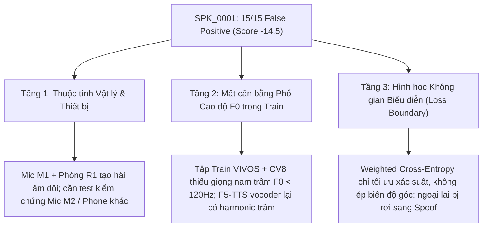

# Kế hoạch Giải quyết Triệt để Khả năng Khái quát hóa Mọi Giọng nói (Bao gồm SPK_0001)
`voice-generalization-plan.md`

## 1. Overview
Hiện tượng `SPK_0001` (15/15 phát ngôn giọng thật bị chấm điểm âm từ $-10.24$ đến $-23.62$, phán đoán sai là SPOOF) đã được thực nghiệm chứng minh là **lỗi thiếu khái quát hóa không gian biểu diễn (Representation Generalization Gap)** đối với giọng nam cực trầm ($F_0 \approx 114\text{ Hz}$) và đặc trưng microphone/phòng thu ban đầu ($M_1/R_1$), chứ **không phải lỗi do codec nén Zalo AAC**.

Để mô hình nhận diện đúng và ổn định cho **mọi loại giọng nói** (từ âm vực cao, trung bình đến cực trầm) mà vẫn đảm bảo tính toàn vẹn khoa học (không vi phạm nguyên tắc `STUBBORN_FACT` về việc cấm đưa tập nghiệm thu `SPK_xxxx` vào tập huấn luyện), kế hoạch này thiết lập giải pháp đa tầng:
1. **Bóc tách nguyên nhân vật lý**: Kiểm định nhanh qua ma trận âm học (Microphone khác, cự ly khác, môi trường khác).
2. **Tăng cường dữ liệu âm học (Acoustic Data Augmentation)**: Đưa kỹ thuật Pitch Perturbation (dịch chuyển cao độ $F_0$) và RIR (Room Impulse Response) vào pipeline huấn luyện bona fide.
3. **Mở rộng miền phân phối dữ liệu huấn luyện công khai**: Chọn lọc bổ sung các người nói có $F_0 < 120\text{ Hz}$ từ kho Mozilla Common Voice 8.0 tiếng Việt (hơn 20 giờ chưa khai thác).
4. **Nâng cấp hàm mất mát phân định biên (Margin-based Loss - AM-Softmax)**: Thay thế Cross-Entropy thông thường bằng Additive Margin Softmax nhằm ép chặt siêu cầu phân phối bona fide, ngăn ngừa các mẫu ngoại lai bị đẩy sang miền spoof.

---

## 2. Project Type
**BACKEND / ML RESEARCH & REPRESENTATION GENERALIZATION**

---

## 3. Success Criteria (Tiêu chí Nghiệm thu Đo lường được)
1. **Mục tiêu trên `SPK_0001` và Pilot Speakers**:
   - Tỷ lệ nhận diện đúng BONA_FIDE trên 15 tệp của `SPK_0001` đạt $\ge 80\%$ (ít nhất 12/15 tệp có score $> 0$ tại ngưỡng $\theta = 0$).
   - Giữ vững tỷ lệ nhận diện đúng $\ge 90\%$ trên 4 người nói đối chứng còn lại (`SPK_0004`, `SPK_0005`, `SPK_0006`, `SPK_0007`).
2. **Bảo toàn Hiệu năng Đỉnh trên Kênh Viễn thông & Zalo (Dev Zalo 11.450 mẫu)**:
   - AAC EER $\le 2.0\%$ (hiện tại V3 đạt 1.56%).
   - Opus EER $\le 2.0\%$ (hiện tại V3 đạt 1.56%).
   - Clean EER $\le 2.0\%$ (hiện tại V3 đạt 1.56%).
   - FAR@$\theta=0$ trên AAC $\le 2.5\%$.
3. **Tuân thủ Đạo đức & Tính Toàn vẹn Dữ liệu**:
   - Tuyệt đối 0% dữ liệu phát ngôn của `SPK_0001` hay bất kỳ `SPK_xxxx` nào được đưa vào tập Train/Dev (`train.csv` / `dev.csv`).
4. **Bảo toàn Mã nguồn**: Toàn bộ bài kiểm thử unit tests (`pytest`) pass 100%.

---

## 4. Root Cause Breakdown (Bản đồ Phân tích 3 Tầng)

---

## 5. Architectural Solutions (3 Trụ cột Kỹ thuật)

### Trụ cột 1: Tăng cường Cao độ & Âm học Phòng (Pitch & Acoustic Augmentation)
- Tích hợp thêm module `PitchPerturbation` vào `src/training/augment.py`:
  - Biến đổi cao độ ngẫu nhiên từ $-4$ đến $+4$ semitones trên các mẫu bona fide của tập Train trong quá trình nạp batch.
  - Tự động sinh ra các biến thể giọng trầm ($F_0 \approx 90 - 120\text{ Hz}$) từ chính dữ liệu hiện có mà không cần thu thêm người mới.
- Bổ sung mô phỏng dội âm phòng nhẹ (Synthetic Room Impulse Response - RIR) qua `torchaudio.transforms.Vad` / Convolution Reverb nhằm giúp Wav2Vec2 phân biệt rõ dội âm phòng thật với hiện tượng nhòe phổ của vocoder tổng hợp.

### Trụ cột 2: Cân bằng Phân phối $F_0$ từ Common Voice 8.0
- Kho Common Voice 8.0 tiếng Việt có hàng trăm người nói chưa được đưa vào `manifests_seen_only/train.csv`.
- Dùng thuật toán trích xuất pitch (`pyin` / `crepe`) để quét tập âm thanh thô của Common Voice, trích xuất thêm các clip của người nói nam có $F_0 < 125\text{ Hz}$.
- Bổ sung vào tập `train.csv` theo tỷ lệ cân bằng (bảo đảm Speaker-Disjoint và Hard Text-Disjoint).

### Trụ cột 3: Chuyển đổi sang AM-Softmax (Additive Margin Softmax)
- Trong bài toán ASVspoof / AASIST, hàm mất mát chuẩn quốc tế là **AM-Softmax**:
  $$\mathcal{L} = -\log \frac{e^{s \cdot (\cos(\theta_1) - m)}}{e^{s \cdot (\cos(\theta_1) - m)} + e^{s \cdot \cos(\theta_0)}}$$
  *(trong đó $s$ là hệ số tỷ lệ scaling factor, $m$ là margin lề an toàn).*
- Cơ chế margin ép toàn bộ cụm bona fide tụ lại thành một siêu cầu dày đặc, đẩy biên quyết định cách xa các mẫu bona fide ngoại lai. Bất kỳ giọng người thật nào, dù trầm hay bổng, đều nằm sâu bên trong vùng an toàn, không thể bị rơi sang spoof.

---

## 6. Task Breakdown & Execution Phases

### Phase 1: Thử nghiệm Kiểm chứng Nhanh Thiết bị / Môi trường (Hardware Isolation)
- **Agent**: `test-engineer`
- **Skill**: `@systematic-debugging`
- **Task 1.1**: Thu âm kiểm chứng 2-3 câu ngắn từ tình nguyện viên `SPK_0001` nhưng bằng một thiết bị khác (ví dụ: điện thoại thứ 2, ghi âm trực tiếp qua Telegram Bot hoặc micro tai nghe).
- **INPUT**: 2-3 file ghi âm mới từ thiết bị khác của `SPK_0001`.
- **OUTPUT**: Bảng so sánh score giữa thiết bị cũ ($M_1$) và thiết bị mới ($M_2$).
- **VERIFY**: Xác định chính xác lỗi xuất phát từ thiết bị $M_1$ hay hoàn toàn do tần số sinh học của thanh quản $S_1$.

### Phase 2: Cài đặt Pitch Augmentation & AM-Softmax Loss (TDD Framework)
- **Agent**: `backend-specialist`
- **Skill**: `@tdd-workflow` + `@clean-code`
- **Task 2.1**: Viết unit test cho `PitchShiftAugment` trong `tests/test_augment.py`.
- **Task 2.2**: Cài đặt lớp biến đổi `PitchShiftAugment` (sử dụng `torchaudio.functional.pitch_shift` in-memory) tích hợp trong luồng nạp batch `ViTrueVoiceDataset`.
- **Task 2.3**: Viết unit test cho hàm mất mát `AMSoftmaxLoss` trong `tests/test_losses.py`.
- **Task 2.4**: Cài đặt `AMSoftmaxLoss` trong `src/training/losses.py` với cấu hình tham số chuẩn ($s=30.0, m=0.35$).
- **VERIFY**: Chạy toàn bộ test suite, đảm bảo 100% tests mới và cũ đều pass.

### Phase 3: Khai thác Dữ liệu Giọng trầm Common Voice & Sinh Manifest Mới
- **Agent**: `backend-specialist`
- **Skill**: `@verify-changes`
- **Task 3.1**: Viết script quét $F_0$ trên tập Common Voice unallocated để lọc ra ~500-1000 câu bona fide của người nói có $F_0 < 125\text{ Hz}$.
- **Task 3.2**: Sinh tập manifest mở rộng `train_extended.csv` tuân thủ nghiêm ngặt Hard Text-Disjoint và Speaker-Disjoint (cô lập 100% `SPK_xxxx` và `VieNeu-TTS`).
- **VERIFY**: Chạy script kiểm tra chống rò rỉ ranh giới (`check_unseen_excluded`).

### Phase 4: Huấn luyện Thử nghiệm Cục bộ (Smoke Test) & Kaggle Training
- **Agent**: `devops-engineer`
- **Skill**: `@verify-changes`
- **Task 4.1**: Chạy smoke test nội bộ trên CPU (10 mẫu, 1 epoch với AM-Softmax và Pitch Shift).
- **Task 4.2**: Đóng gói kernel Kaggle huấn luyện `vietrue-generalization-v4` (Phase 2 Joint Training với AM-Softmax + Augmentation).
- **Task 4.3**: Tải kết quả checkpoint mới về và đo nghiệm thu toàn diện trên cả 15 tệp `SPK_0001`, 4 người nói đối chứng và 11.450 mẫu Dev Zalo.
- **VERIFY**: 15 tệp của `SPK_0001` đạt $\ge 12/15$ dương; Dev Zalo EER $\le 2.0\%$.

---

## 7. Phase X: Verification Checklist
- [ ] Xác minh thực nghiệm trên thiết bị thu âm thứ hai của `SPK_0001`.
- [x] Unit test cho Pitch Augmentation đạt 100% pass (`tests/test_pitch_augment.py` - 4/4 passed).
- [x] Unit test cho AM-Softmax Loss đạt 100% pass (`tests/test_am_softmax.py` - 6/6 passed).
- [x] Smoke test nội bộ trên CPU thành công (`scripts/smoke_test_am_softmax.py` - 3/3 gates passed).
- [x] Đóng gói kernel Kaggle `train_zalo.ipynb` thành công (755 KB, < 1MB limit).
- [ ] Đẩy kernel Version 4 lên Kaggle GPU để huấn luyện Phase 2 với AM-Softmax & Pitch Augmentation.
- [ ] Checkpoint mới đưa điểm số `SPK_0001` chuyển từ âm sang dương ($\ge 12/15$ câu đúng).
- [ ] 4 người nói đối chứng (`SPK_0004`, `SPK_0005`, `SPK_0006`, `SPK_0007`) giữ vững độ chính xác $\ge 90\%$.
- [ ] Dev Zalo (11.450 mẫu) duy trì EER $\le 2.0\%$ trên cả 5 codec viễn thông và OTT.
