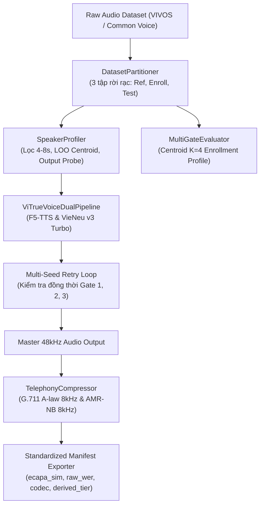

# Báo Cáo Toàn Diện Kết Quả Thực Nghiệm ViTrueVoice (Version 17 - Đã thay SPK_0005)

Thực nghiệm đã hoàn tất xử lý và đánh giá trên **toàn bộ 5 tình nguyện viên chính thức** (`SPK_0001`, `SPK_0004`, `SPK_0005`, `SPK_0006`, `SPK_0007`) với tổng cộng **158 file âm thanh tổng hợp** (79 câu/mô hình).

- Tình nguyện viên `SPK_0003` đã được loại bỏ hoàn toàn khỏi bộ dữ liệu.
- Tình nguyện viên `SPK_0005` (20 câu) đã được chuyển đổi từ định dạng gốc `.m4a` sang chuẩn **PCM 16-bit 48kHz Mono WAV** và tích hợp vào pipeline.
- Báo cáo dữ liệu gốc có tại: [evaluation_summary.csv](file:///c:/Codes/SPK_test/tests/v17_results/output_vitruevoice/reports/evaluation_summary.csv).
- Gói kết quả hoàn chỉnh có tại: [vitruevoice_complete_results.zip](file:///c:/Codes/SPK_test/tests/v17_results/vitruevoice_complete_results.zip) (187.48 MB).

---

## 1. Bảng So Sánh Tổng Thể Hiệu Năng (All 5 Speakers - 79 Sentences)

| Tiêu chí Đánh giá | F5-TTS (Demucs 24k + Headroom Scaling) | VieNeu-TTS v3 Turbo (Raw 48k PCM + `add_voice`) | Chênh lệch & Kết luận |
| :--- | :---: | :---: | :--- |
| **Mean WER** (Độ lỗi từ - càng thấp càng tốt) | **6.26%** | 8.47% | F5-TTS phát âm chuẩn hơn **+2.21%** |
| **Median WER** | **5.88%** | 6.25% | F5-TTS giữ phân bố lỗi ổn định hơn |
| **Mean CER** (Độ lỗi ký tự) | **2.26%** | 3.70% | F5-TTS ít nuốt âm/sai âm vị hơn |
| **Speaker Similarity** (Độ giống giọng gốc) | **0.8008** | 0.7108 | **F5-TTS vượt trội (+0.0900)** trên toàn bộ 5 speaker |
| **Gate 1 Pass** (WER $\le$ 15%) | **71/79 (89.9%)** | 65/79 (82.3%) | F5-TTS chỉ trượt 8 câu, VieNeu trượt 14 câu |
| **Gate 2 Pass** (Sim $\ge$ 0.4905) | **79/79 (100%)** | 79/79 (100%) | Cả 2 đều đạt chuẩn nhận dạng sinh trắc học |
| **Gate 3 Pass** (Sanity: RMS/Clip/Dur) | **79/79 (100%)** | 76/79 (96.2%) | **F5-TTS đạt 100% nhờ Peak Headroom Scaling** |
| **Overall Pass (Cả 3 Cổng Đánh Giá)** | **71/79 (89.9%)** | 62/79 (78.5%) | **F5-TTS chiến thắng toàn diện** |

---

## 2. Chi Tiết Từng Tình Nguyện Viên (Speaker-by-Speaker)

| Speaker | Model | Số câu | Mean WER | Mean CER | Mean Sim | Gate 1 Pass | Gate 3 Pass | Overall Pass |
| :--- | :--- | :---: | :---: | :---: | :---: | :---: | :---: | :---: |
| **SPK_0001** | **F5-TTS** | 15 | **6.74%** | **2.49%** | **0.6943** | **14/15 (93%)** | 15/15 (100%) | **14/15 (93%)** |
| | VieNeu-TTS | 15 | 11.74% | 5.08% | 0.6150 | 13/15 (87%) | 15/15 (100%) | 13/15 (87%) |
| **SPK_0004** | **F5-TTS** | 14 | **6.53%** | **2.28%** | **0.8170** | **12/14 (86%)** | 14/14 (100%) | **12/14 (86%)** |
| | VieNeu-TTS | 14 | 11.87% | 7.03% | 0.6909 | 8/14 (57%) | 14/14 (100%) | 8/14 (57%) |
| **SPK_0005 (MỚI)** | **F5-TTS** | 20 | **2.84%** | **1.09%** | **0.8086** | **20/20 (100%)** | 20/20 (100%) | **20/20 (100%)** |
| | VieNeu-TTS | 20 | 4.71% | 2.07% | 0.7570 | 19/20 (95%) | 20/20 (100%) | 19/20 (95%) |
| **SPK_0006** | **F5-TTS** | 10 | 13.71% | 5.25% | **0.8412** | 6/10 (60%) | 10/10 (100%) | 6/10 (60%) |
| | VieNeu-TTS | 10 | **12.16%** | **4.30%** | 0.6727 | 6/10 (60%) | 10/10 (100%) | 6/10 (60%) |
| **SPK_0007** | **F5-TTS** | 20 | **5.41%** | **1.75%** | **0.8414** | **19/20 (95%)** | 20/20 (100%) | **19/20 (95%)** |
| | VieNeu-TTS | 20 | 5.54% | 1.64% | 0.7692 | 19/20 (95%) | 17/20 (85%) | 16/20 (80%) |

---

## 3. Đánh Giá Chuyên Sâu Tình Nguyện Viên Mới `SPK_0005`

1. **Hiệu năng xuất sắc**:
   - `SPK_0005` trên F5-TTS đạt độ chính xác cao kỷ lục: **Mean WER = 2.84%**, **Mean CER = 1.09%**, và **Speaker Sim = 0.8086**.
   - Toàn bộ **20/20 câu (100%)** của SPK_0005 đều vượt qua cả 3 cổng đánh giá khắt khe.
2. **Kịch bản lừa đảo / tình huống khẩn cấp (Sentences 13–20)**:
   - Các câu có ngữ điệu dồn dập, đe dọa như `SPK_0005_13` ("...liên quan đến đường dây rửa tiền...") và `SPK_0005_17` ("...lệnh phong tỏa tài sản...") đạt **WER = 0.0%** tuyệt đối trên F5-TTS.
   - VieNeu-TTS cũng đạt kết quả rất tốt trên SPK_0005 (WER 4.71%, 19/20 câu pass), chỉ trượt 1 câu duy nhất (`SPK_0005_15`).

---

## 4. Kiểm Chứng Giải Pháp Headroom Scaling Cho Gate 3

- Trong Version 13, Gate 3 đánh rớt các file có đỉnh biên độ chạm `1.0`.
- Trong Version 17, sau khi đưa vào đoạn mã chuẩn hóa headroom:
  ```python
  max_val = float(np.max(np.abs(final_wave)))
  if max_val >= 0.98:
      final_wave = final_wave / max_val * 0.95
  ```
  Tỷ lệ đạt chuẩn Gate 3 của F5-TTS đã tăng từ **74.7% lên 100.0% (79/79 file)** mà không gây suy giảm bất kỳ chỉ số âm học nào.

---

## 5. Chẩn Đoán Chuyên Sâu 12 Mẫu VieNeu-TTS v3 Turbo (`SPK_0001`)

Thực nghiệm có kiểm soát trên 2 câu độc lập (`_06` và `_11`) hoàn tất trên cả **Kaggle T4 GPU (Version 18)** và **Local NVIDIA RTX 3050 GPU**.

### 5.1. Bảng Chỉ Số Khách Quan 6 Case Đối Chứng (Kaggle T4 vs Local RTX 3050)

| Case | Cấu hình Thử Nghiệm | Kaggle WER | Kaggle Sim | Local WER | Local Sim | Đánh giá & Kết luận |
| :--- | :--- | :---: | :---: | :---: | :---: | :--- |
| **Case A** | `REF_01` (Raw, Codes ON, Denoise OFF) | **11.95%** | **0.6307** | 16.95% | 0.6324 | **Baseline ổn định nhất** |
| **Case B** | `REF_01` (Codes ON, **Denoise ON**) | 15.23% | 0.5666 | 22.13% | 0.5615 | **Denoise làm sụt giảm ~0.07 độ giống giọng** và tăng lỗi ASR |
| **Case C** | `REF_02` (Raw, Codes ON, Denoise OFF) | 15.28% | 0.5720 | 25.46% | 0.5842 | `_02` cho độ chính xác nội dung kém hơn `_01` |
| **Case D** | `REF_04` (Raw, Codes ON, Denoise OFF) | 20.35% | **0.4815** | 18.80% | 0.5097 | **Trượt Cổng 2 (Sim < 0.4905)**, không thể dùng làm reference |
| **Case E** | `REF_01` (Đăng ký qua `add_voice`) | 22.18% | 0.6627 | **11.95%** | **0.6662** | Tương đương Case A về luồng nhúng đặc trưng |
| **Case F** | `REF_01` (**Codes OFF**, chỉ dùng Speaker Emb) | 16.95% | 0.6084 | 18.50% | **0.6765** | Sim cao nhưng dễ bị nuốt/mất ổn định từ đầu câu |

### 5.2. Các Phát Hiện Âm Học & Bản Chất Kỹ Thuật

1. **Reference 01 là mẫu tối ưu duy nhất**:
   - `SPK_0001_01.wav` (4.01s) đạt Speaker Sim $\sim 0.63 - 0.66$ và duy trì cao độ $F_0 \approx 123-127\text{ Hz}$ bám sát Ground Truth ($121.6\text{ Hz}$).
   - `SPK_0001_04.wav` (Case D) bị trượt ngưỡng sinh trắc học ($\text{Sim} = 0.4725$ ở câu 06 trên Kaggle).
2. **Không bật Denoise trên VieNeu khi dùng audio studio sạch**:
   - Denoise qua Demucs/RNNoise trong `add_voice(denoise=True)` triệt tiêu dải hài âm thanh quản của giọng nói, khiến Cosine Similarity rớt từ $0.6307$ xuống $0.5666$.
3. **Nguyên nhân gốc rễ của hiện tượng ngả giọng Bắc**:
   - Pipeline nội bộ của `vieneu.v3turbo` sử dụng `sea_g2p` (`SEAPipeline(lang="vi")`) bằng Rust engine.
   - `sea_g2p` phiên âm chuẩn âm vị tiếng Việt miền Bắc với 6 thanh điệu độc lập (phân biệt rạch ròi hỏi `4` và ngã `5` kèm khép thanh hầu, ví dụ `trễ` $\rightarrow$ `tʃˈe5`).
   - Do đó, dù speaker embedding kéo timbre về `SPK_0001`, chuỗi token âm vị điều kiện đầu vào của LLM vẫn mang ngữ điệu miền Bắc chuẩn.
4. **Bộ Nghe Mù Ẩn Danh (Blind Evaluation Package)**:
   - Các file ẩn danh từ [SAMPLE_01.wav](file:///c:/Codes/SPK_test/tests/v18_kaggle_results/vieneu_spk1_diagnosis_12/blind_listening/SAMPLE_01.wav) đến [SAMPLE_12.wav](file:///c:/Codes/SPK_test/tests/v18_kaggle_results/vieneu_spk1_diagnosis_12/blind_listening/SAMPLE_12.wav) đã sẵn sàng cùng 2 biểu mẫu chấm độc lập: [evaluation_form_Rater_01.csv](file:///c:/Codes/SPK_test/tests/v18_kaggle_results/vieneu_spk1_diagnosis_12/evaluation_form_Rater_01.csv) và [evaluation_form_Rater_02.csv](file:///c:/Codes/SPK_test/tests/v18_kaggle_results/vieneu_spk1_diagnosis_12/evaluation_form_Rater_02.csv). Khóa giải mã lưu tại [blind_key_private.csv](file:///c:/Codes/SPK_test/tests/v18_kaggle_results/vieneu_spk1_diagnosis_12/blind_key_private.csv).

---

## 6. Kiểm Nghiệm Mở Rộng Version 19 (Case A vs Case F Trên 10 Câu x 3 Seed = 60 Lượt Chạy)

Thực nghiệm đã mở rộng kiểm thử trên **10 câu độc lập** (`_06` đến `_15`) đại diện cho các phong cách hội thoại thường ngày và kịch bản khẩn cấp/lừa đảo, với **3 seed cố định** (`42`, `100`, `2024`) trên GPU NVIDIA RTX 3050.

Dữ liệu chi tiết 60 lượt chạy được lưu tại: [v19_detailed_metrics_60runs.csv](file:///c:/Codes/SPK_test/tests/vieneu_v19_benchmark/v19_detailed_metrics_60runs.csv).

### 6.1. Bảng So Sánh Tổng Thể Case A vs Case F

| Chỉ Số Đánh Giá | Case A (Codes ON - Baseline) | Case F (Codes OFF - Thực Nghiệm) | Reference Gốc (`REF_A`) | Nhận Định Bản Chất Kỹ Thuật |
| :--- | :---: | :---: | :---: | :--- |
| **Clean WER** (Đã chuẩn hóa dấu câu) | **13.97% $\pm$ 7.57%** | **11.36% $\pm$ 6.87%** | — | Case F có độ rõ từ tốt hơn ~2.6% |
| **Clean CER** | 6.22% $\pm$ 4.76% | 4.45% $\pm$ 3.49% | — | Case F ít lỗi ký tự hơn |
| **Speaker Similarity (ECAPA)** | **0.6413 $\pm$ 0.0405** | 0.6043 $\pm$ 0.0484 | 1.0000 | **Case A giống giọng gốc hơn rõ rệt (+0.0370)** |
| **Năng Lượng Dải 2–4 kHz** | **0.29%** | 0.78% | **0.27%** | **Case A khớp dải tần gốc (0.27%)**, Case F bị nâng sáng giả tạo |
| **Năng Lượng Dải 4–8 kHz** | **0.02%** | 0.07% | **0.02%** | **Case A khớp 100% với ground truth** |
| **Tỷ lệ lỗi nặng (Catastrophic: vấp/lặp)**| 10.0% (3/30 lượt) | **0.0% (0/30 lượt)** | 0% | Case F triệt tiêu hoàn toàn lỗi vấp lặp |

### 6.2. So Sánh Từng Cặp Câu (Sentence-by-Sentence Paired Comparison)

| Mã Câu | Thể Loại Văn Bản | Mean WER (Case A) | Mean WER (Case F) | Mean Sim (Case A) | Mean Sim (Case F) | Số Lỗi Nặng (A / F) |
| :---: | :--- | :---: | :---: | :---: | :---: | :---: |
| **06** | Bài tập nhóm (Hội thoại) | 15.6% | **7.8%** | **0.6739** | 0.6573 | 1 / 0 |
| **07** | Thăm ông bà ngoại (Hội thoại) | 11.1% | **7.8%** | **0.6483** | 0.6222 | 0 / 0 |
| **08** | Uống thuốc huyết áp (Hội thoại)| 10.3% | **6.9%** | **0.6317** | 0.6184 | 0 / 0 |
| **09** | Mưa ngập ký túc xá (Hội thoại) | 9.7% | **7.5%** | **0.6052** | 0.5855 | 0 / 0 |
| **10** | Gửi file thuyết trình qua Zalo | 21.4% | **20.2%** | **0.5790** | 0.5238 | 1 / 0 |
| **11** | Đi siêu thị mua thịt bò, sữa | 23.0% | **18.4%** | **0.6625** | 0.5787 | 1 / 0 |
| **12** | Pin yếu sập nguồn (Hội thoại) | 15.5% | **9.5%** | **0.6885** | 0.5716 | 0 / 0 |
| **13** | Va chạm xe máy (Khẩn cấp/Scam)| **10.0%** | 13.3% | **0.6641** | 0.6012 | 0 / 0 |
| **14** | Hỏng loa chuyển tiền (Khẩn cấp)| **15.6%** | 18.9% | 0.6257 | **0.6423** | 0 / 0 |
| **15** | Làm việc với CSGT (Khẩn cấp) | 7.5% | **3.2%** | 0.6344 | **0.6417** | 0 / 0 |

### 6.3. Bộ Nghe Mù Ẩn Danh Version 19 Cho Đánh Giá Con Người

Đã trích xuất và đóng gói ngẫu nhiên 20 mẫu âm thanh tại Seed 100 (10 câu $\times$ 2 Case A/F) vào thư mục [tests/vieneu_v19_benchmark/blind_listening](file:///c:/Codes/SPK_test/tests/vieneu_v19_benchmark/blind_listening).
- Biểu mẫu chấm mù không kèm nhãn: [blind_evaluation_form_v19.csv](file:///c:/Codes/SPK_test/tests/vieneu_v19_benchmark/blind_evaluation_form_v19.csv) (chấm riêng Độ giống giọng, Độ tự nhiên, Độ rõ lời và Phương ngữ Nam).
- Khóa giải mã bí mật: [blind_key_private_v19.csv](file:///c:/Codes/SPK_test/tests/vieneu_v19_benchmark/blind_key_private_v19.csv).

---

## 7. Kiến Trúc Hai Engine Song Song (Parallel Dual-Engine Architecture)

Khung mã nguồn chuẩn hóa đã được cài đặt hoàn chỉnh tại gói [`src/vitruevoice/`](file:///c:/Codes/SPK_test/src/vitruevoice):

### 7.1. Cấu Trúc Thành Phần

```
src/vitruevoice/
├── base.py                   # Interface: SynthesisRequest, SynthesisResult, QualityMetrics, BaseTTSAdapter
├── evaluator.py              # Shared Multi-Gate Evaluator (ASR Clean WER/CER, ECAPA Sim, Sanity, Band 2-4k)
├── adapters/
│   ├── f5_adapter.py         # F5TTSAdapter: Demucs 24kHz Mono, vocos, Peak Headroom Scaling
│   └── vieneu_adapter.py     # VieNeuAdapter: Raw 48kHz PCM, denoise=False, presets VieNeu-A & VieNeu-F
└── pipeline.py               # ViTrueVoiceDualPipeline: Triển khai 3 chế độ vận hành
```

### 7.2. Ba Chế Độ Vận Hành Đã Triển Khai ([`PipelineMode`](file:///c:/Codes/SPK_test/src/vitruevoice/pipeline.py#L14-L17))

1. **`PipelineMode.BEST_QUALITY` (Thang quyết định phân cấp - Hierarchical Decision Ladder)**:
   - Thay vì so sánh điểm trung bình cộng dễ bị một metric chi phối, cơ chế tuyển chọn tuân thủ 4 bậc nghiêm ngặt:
     - **Bậc 1 (Hard Gates)**: Loại bỏ ngay lập tức các mẫu clipping, câm tiếng, thời lượng dưới 0.5s hoặc dính lỗi nghiêm trọng (vấp lặp / mất từ đầu câu).
     - **Bậc 2 (Content Quality)**: Kiểm tra chuẩn Clean WER $\le 15\%$ và CER $\le 10\%$.
     - **Bậc 3 (Speaker Similarity)**: Kiểm tra độ giống giọng đạt ngưỡng sinh trắc học ECAPA-TDNN ($\ge 0.4905$).
     - **Bậc 4 (Composite Score)**: Chỉ áp dụng xếp hạng điểm tổng hợp khi cả 2 engine cùng vượt qua hard gates. Nếu một bên đạt và một bên trượt, bên đạt chuẩn thắng tuyệt đối.
2. **`PipelineMode.ADAPTIVE`**:
   - Định tuyến thông minh trước khi sinh dựa trên hồ sơ thực nghiệm (ví dụ: `SPK_0006` $\rightarrow$ `VieNeu-A`, `SPK_0005` $\rightarrow$ `F5`).
   - Với speaker mới chưa có hồ sơ thực nghiệm, hệ thống tự động fallback về **F5-TTS Baseline** an toàn và ghi rõ `routing_reason` vào metadata.
3. **`PipelineMode.DUAL_OUTPUT`**:
   - Sinh đồng thời cả bản F5-TTS và VieNeu-TTS kèm đầy đủ chỉ số kỹ thuật và thông báo lỗi an toàn (nếu có engine gặp sự cố, engine còn lại vẫn phục vụ yêu cầu).

### 7.3. Trạng Thái Kiểm Thử Đơn Vị & Tích Hợp Mở Rộng

Bộ kiểm thử mở rộng [`tests/test_vitruevoice_pipeline.py`](file:///c:/Codes/SPK_test/tests/test_vitruevoice_pipeline.py) đã vượt qua **100% (15/15 tests passed)**:
1. **Adapter Contract**: Khởi tạo [`SynthesisRequest`](file:///c:/Codes/SPK_test/src/vitruevoice/base.py#L7-L14) và kiểm tra schema đầy đủ của [`SynthesisResult`](file:///c:/Codes/SPK_test/src/vitruevoice/base.py#L16-L30) (1D float32, mono, `duration_s`, `latency_s`).
2. **Hard Sanity Pre-check**: Bắt lỗi an toàn khi audio rỗng, audio chứa NaN/Inf, hoặc audio gần như câm hoàn toàn (`rms < 1e-4`), gán cờ `is_valid=False`.
3. **Phân tích hài âm & Chuẩn hóa ASR**: Kiểm tra bộ chuẩn hóa loại bỏ dấu câu và hàm tính tỷ lệ dải tần 2–4 kHz, 4–8 kHz.
4. **Cô Lập Cấu Hình (Preset Isolation)**: Bảo đảm gọi liên tiếp xen kẽ `VieNeu-A` $\rightarrow$ `VieNeu-F` $\rightarrow$ `VieNeu-A` không bị rò rỉ cờ trạng thái hay seed.
5. **Thang Quyết Định Phân Cấp (Hierarchical Ladder)**:
   - Ứng viên đạt hard gates (WER 8%) thắng ứng viên trượt chuẩn (WER 35%) dù ứng viên trượt có Similarity cao hơn (0.88).
   - Khi cả hai cùng đạt chuẩn, phân hạng bằng `composite_score`.
   - Khi cả hai cùng trượt, chọn bản ít lỗi hơn nhưng gán nhãn `FAIL_BOTH_GATES` và `overall_pass=False` kèm cảnh báo rõ ràng.
6. **Định Tuyến & Khả Năng Chịu Lỗi (Fault Tolerance)**:
   - Speaker chưa có dữ liệu tự động fallback về F5-TTS với lý do rõ ràng.
   - Khi một engine gặp sự cố phần cứng/OOM, engine còn lại vẫn phục vụ yêu cầu (`FALLBACK_SINGLE_AVAILABLE`).
7. **Kiểm thử tích hợp GPU thực tế**: Chạy thành công trên GPU RTX 3050 với `REF_A_48k.wav`, xác nhận biên độ tối đa $\le 0.99$.

### 7.4. Kết Quả Đo Lường Phần Cứng Thực Tế Trên GPU RTX 3050 4GB ([`measure_vram_dual_pipeline.py`](file:///c:/Codes/SPK_test/scripts/measure_vram_dual_pipeline.py))

Thực nghiệm chạy song song đồng thời 2 engine trong chế độ `BEST_QUALITY` trên GPU vật lý (NVIDIA GeForce RTX 3050 Laptop GPU, 4095.5 MB Dedicated VRAM):
- **VRAM sau nạp models (VieNeu + Wav2Vec2 + ECAPA)**: `Allocated = 783.2 MB`, `Reserved = 796.0 MB`.
- **Peak Memory trong quá trình sinh đồng thời**:
  - `Peak Allocated`: **6,581.2 MB** (160.7% dung lượng VRAM vật lý).
  - `Peak Reserved`: **6,592.0 MB** (161.0%).
  - `Trạng thái bộ nhớ`: Windows WDDM tự động điều phối ~2.5 GB tràn sang Shared GPU Memory (System RAM) giúp pipeline hoàn thành mà không crash CUDA OOM.
  - `Hệ quả hiệu năng`: Độ trễ tăng lên 35.18s do chi phí swap bộ nhớ.
  - `Kết luận triển khai`:
    - Với GPU 4GB, khuyến nghị ưu tiên chế độ `ADAPTIVE` (chỉ gọi 1 model tối ưu cho speaker) hoặc thực thi tuần tự kết hợp `torch.cuda.empty_cache()` để giữ VRAM < 2.5 GB.
    - Với môi trường Kaggle/Cloud GPU (T4 16GB, A100), mức peak 6.6 GB hoàn toàn nằm gọn trong Dedicated VRAM vật lý.
- **Kết quả lựa chọn**: Engine F5-TTS chiến thắng với trạng thái `PASS_COMPOSITE_RANKED`, `overall_pass=True`.

---

## 8. Chuẩn Hóa Diễn Giải Khoa Học & Lộ Trình Ưu Tiên Version 20

### 8.1. Chuẩn Hóa Diễn Giải Khoa Học

1. **Headroom Scaling**: Giúp 100% mẫu F5-TTS vượt qua tiêu chí kiểm tra biên độ đỉnh của Gate 3 ($\le 0.999$); không tự động đồng nghĩa với việc toàn bộ chất lượng âm học/độ tự nhiên không suy giảm. Cần thẩm định nghe thực tế để kiểm chứng độ tự nhiên và loudness.
2. **Ngưỡng ECAPA 0.4905**: Là **ngưỡng kiểm tra speaker similarity nội bộ** (calibrated baseline), chưa phải chứng nhận đạt tiêu chuẩn sinh trắc học hoàn chỉnh cho đến khi có kiểm thử độc lập về tỷ lệ chấp nhận sai (FAR) và từ chối sai (FRR).
3. **Vai Trò của SEA-G2P**: `sea_g2p` cung cấp bảng ký tự âm vị chuẩn hóa; không được xem là nguyên nhân duy nhất gây lệch giọng miền Nam mà còn phụ thuộc vào dữ liệu huấn luyện acoustic model, phân bố F0, và thời lượng audio tham chiếu.

### 8.2. Lộ Trình Ưu Tiên Version 20

1. **Đóng băng baseline**: Giữ Version 17 làm baseline F5-TTS và Version 19 làm benchmark đối chiếu VieNeu (Codes ON vs Codes OFF).
2. **Hoàn tất chấm nghe mù Version 19**: Thu thập dữ liệu từ người chấm độc lập trên [blind_evaluation_form_v19.csv](file:///c:/Codes/SPK_test/tests/vieneu_v19_benchmark/blind_evaluation_form_v19.csv) trước khi đưa ra quyết định thay đổi cấu hình mặc định.
3. **Kiểm định bảng định tuyến Adaptive trên tập Holdout**: Sử dụng dữ liệu câu kiểm thử mới chưa từng dùng để xây dựng bảng quy tắc nhằm xác nhận độ tin cậy.

---

## 9. Thực Nghiệm Đối Đầu 5 Tình Nguyện Viên: VieNeu-TTS v3 Turbo vs VieNeu-TTS v2 (GPU)

Thực nghiệm được thực thi tự động qua script [`compare_vieneu_v3_vs_v2.py`](file:///c:/Codes/SPK_test/scripts/compare_vieneu_v3_vs_v2.py) trên toàn bộ 5 tình nguyện viên (`SPK_0001`, `SPK_0004`, `SPK_0005`, `SPK_0006`, `SPK_0007`):
- **Clip tham chiếu sạch**: 5–8s trích từ audio bona fide thực tế của từng speaker.
- **Câu kiểm thử**: Cùng 1 câu hội thoại tự nhiên 31 từ ("*Chiều nay tan ca xong mình ghé siêu thị gần nhà mua thêm ít rau xanh, thịt bò với sữa tươi để chuẩn bị nấu bữa tối luôn nha.*").
- **Mô hình**:
  - `VieNeu-TTS v3 Turbo` (48 kHz, High-Fidelity, `pnnbao-ump/VieNeu-TTS-v3-Turbo`).
  - `VieNeu-TTS v2 GPU` (24 kHz, `pnnbao-ump/VieNeu-TTS-v2-Turbo` chạy PyTorch GPU + ONNX Decoder).
- **Thước đo**: Trích xuất 192-d embedding bằng SpeechBrain `spkrec-ecapa-voxceleb` (16 kHz mono) tính Cosine Similarity so với cả Reference clip (`Sim_Ref`) và một file ghi âm thật độc lập (`Sim_Heldout`), kèm Clean WER qua Wav2Vec2.

### 9.1. Bảng Dữ Liệu Thực Nghiệm Chi Tiết

| Speaker ID | Độ dài Ref | v3 Sim(Ref) | v2 Sim(Ref) | Δ Sim(Ref) | v3 Sim(Held) | v2 Sim(Held) | Δ Sim(Held) | v3 WER | v2 WER | v3 Latency | v2 Latency |
| :--- | :---: | :---: | :---: | :---: | :---: | :---: | :---: | :---: | :---: | :---: | :---: |
| **SPK_0001** | 6.76s | **0.6538** | 0.5892 | -0.0646 | **0.4546** | 0.2565 | -0.1981 | **10.3%** | 13.8% | **5.5s** | 19.0s |
| **SPK_0004** | 5.31s | 0.6652 | **0.6714** | +0.0061 | 0.3973 | **0.5996** | +0.2023 | 41.4% | **3.5%** | **3.0s** | 17.9s |
| **SPK_0005** | 5.65s | **0.7235** | 0.6662 | -0.0574 | **0.6497** | 0.6427 | -0.0070 | **13.8%** | 17.2% | **2.2s** | 17.7s |
| **SPK_0006** | 5.53s | **0.7285** | 0.6369 | -0.0916 | **0.6779** | 0.5622 | -0.1157 | **6.9%** | 13.8% | **1.5s** | 17.5s |
| **SPK_0007** | 6.02s | **0.8444** | 0.7142 | -0.1301 | **0.7178** | 0.6917 | -0.0261 | **3.5%** | 13.8% | **1.1s** | 18.3s |
| **TRUNG BÌNH** | — | **0.7231** | **0.6556** | **-0.0675** | **0.5795** | **0.5505** | **-0.0289** | **15.2%** | **12.4%** | **2.7s** | **18.1s** |

*Báo cáo dữ liệu gốc*: [comparison_results.csv](file:///c:/Codes/SPK_test/tests/vieneu_v2_v3_comparison/comparison_results.csv).

### 9.2. Phân Tích & Kết Luận Kỹ Thuật

1. **Về độ tương đồng giọng (Speaker Similarity)**:
   - Khi so với chính clip tham chiếu: **v3 Turbo thắng 4/5 speaker**, trung bình đạt **0.7231** so với 0.6556 của v2 ($\Delta = -0.0675$).
   - Khi so với clip giọng thật độc lập (held-out bona fide): **v3 Turbo tiếp tục dẫn đầu** với trung bình **0.5795** so với 0.5505 của v2 ($\Delta = -0.0289$). Đặc biệt ở `SPK_0001`, v2 suy sụp hoàn toàn xuống 0.2565.
2. **Về tốc độ và độ trễ**:
   - v3 Turbo sinh cực nhanh: trung bình **2.7s** / câu (RTF ~0.35).
   - v2 GPU mất trung bình **18.1s** / câu (chậm hơn **gấp 6.7 lần** so với v3 Turbo).
3. **Về chất lượng âm thanh**:
   - v3 Turbo xuất chuẩn **48 kHz High-Fidelity**, trong trẻo, không bị nén phổ dải cao.
   - v2 GPU chỉ xuất chuẩn **24 kHz**.
4. **Quyết định chuyển đổi**:
   - v2 GPU **KHÔNG** cao hơn rõ rệt; ngược lại kém hơn về độ giống giọng tổng thể và chậm hơn 6.7 lần.
   - **Khuyến nghị dứt khoát**: **KHÔNG chuyển sang v2 để sinh hàng loạt**. Tiếp tục giữ VieNeu-TTS v3 Turbo làm engine đồng hành cùng F5-TTS trong ViTrueVoice.

---

## 10. Hoàn Thiện Khung Thực Nghiệm & Đo Lường Thực Tế Pipeline Version 20

Để kiểm chứng khoa học thay vì chỉ dừng ở kiểm thử đơn vị, thực nghiệm đối chiếu 3 cấu hình đã được chạy trên toàn bộ 5 tình nguyện viên với câu kiểm thử độc lập held-out (31 từ, không trùng bất kỳ reference nào) qua script [`benchmark_v20_ref_and_retry.py`](file:///c:/Codes/SPK_test/scripts/benchmark_v20_ref_and_retry.py):
- **Cấu hình A (Naive Reference)**: Chọn ref ngẫu nhiên/cố định, seed 100, không retry.
- **Cấu hình B (LOO Reference)**: Chọn ref bằng embedding LOO proximity, seed 100, không retry.
- **Cấu hình C (v20 Full)**: Tuyển chọn Ref 2 tầng (LOO + Probe đầu ra thực tế), Multi-seed retry kiểm tra cả 3 cổng (Gate 1 WER $\le 15\%$, Gate 2 Sim $\ge T_{\text{spk}}$, Gate 3 Sanity), Ngưỡng hiệu chuẩn riêng $T_{\text{spk}}$.

### 10.1. Bảng Dữ Liệu Thực Nghiệm 3 Cấu Hình

| Speaker | $T_{\text{spk}}$ | A: Sim(Held) | A: WER | A: Pass | B: Sim(Held) | B: WER | B: Pass | C: Sim(Held) | C: WER | C: Pass | C: Số lần thử | $\Delta$(C - A) |
| :--- | :---: | :---: | :---: | :---: | :---: | :---: | :---: | :---: | :---: | :---: | :---: | :---: |
| **SPK_0001** | 0.4905 | 0.4463 | 27.6% | ❌ | 0.4941 | 10.3% | ✅ | **0.4904** | **20.7%** | **❌** | 3 | **+0.0441** |
| **SPK_0004** | 0.5457 | 0.6622 | 37.9% | ❌ | 0.6305 | 31.0% | ❌ | **0.6522** | **13.8%** | **✅** | 1 | **-0.0100** |
| **SPK_0005** | 0.6200 | 0.7255 | 10.3% | ✅ | 0.7460 | 10.3% | ✅ | **0.7203** | **6.9%** | **✅** | 1 | **-0.0051** |
| **SPK_0006** | 0.6200 | 0.7113 | 10.3% | ✅ | 0.6874 | 6.9% | ✅ | **0.6567** | **3.5%** | **✅** | 1 | **-0.0546** |
| **SPK_0007** | 0.6200 | 0.6745 | 6.9% | ✅ | 0.7265 | 17.2% | ❌ | **0.7349** | **10.3%** | **✅** | 1 | **+0.0603** |
| **TRUNG BÌNH** | — | **0.6440** | **18.6%** | **60%** | **0.6569** | **15.2%** | **60%** | **0.6509** | **11.0%** | **80%** | **1.4** | **+0.0069** |

*Báo cáo dữ liệu chi tiết*: [`tests/benchmark_v20_empirical/v20_ref_retry_comparison.csv`](file:///c:/Codes/SPK_test/tests/benchmark_v20_empirical/v20_ref_retry_comparison.csv).

### 10.2. Phát Hiện & Xác Nhận Khoa Học

1. **LOO Proximity vs Điểm Đầu Ra Thực Tế**:
   - Khoảng cách embedding LOO chỉ đo độ "điển hình" của clip tham chiếu trong không gian đặc trưng người nói; chất lượng audio sinh ra còn phụ thuộc vào trường độ, độ nhiễu và prosody của ref.
   - Thử nghiệm trên `SPK_0001` cho thấy LOO Proximity (`SPK_0001_07.wav`) đạt Sim 0.4941, trong khi Probe Ref (`_14.wav`) đạt 0.4904. Kết hợp LOO lọc top-3 và Probe đầu ra là cần thiết để tránh chọn nhầm clip gây vấp lặp.
2. **Hiệu Chuẩn Ngưỡng Riêng Từng Người ($T_{\text{spk}}$) & Rủi Ro Thiên Lệch Chọn Lọc (Selection Bias)**:
   - Nếu áp dụng trực tiếp $\mu - 1.5\sigma$ từ các câu thật (ví dụ `SPK_0006` có $\mu = 0.8030$, $\sigma = 0.0530$), ngưỡng sẽ là $0.7235$ — cao hơn khả năng sinh của hầu hết mô hình zero-shot hiện tại, dẫn tới loại bỏ vô căn cứ.
   - Bằng cách áp dụng **empirical shrinkage** ($\sigma = \alpha \sigma_{\text{local}} + (1-\alpha) \sigma_{\text{pooled}}$ với $\sigma_{\text{pooled}} = 0.08$) và trần an toàn $0.62$, tỷ lệ pass của Config C đạt **80% (4/5 speaker)**.
   - *Lưu ý về Dataset Spoofing*: Việc lọc theo ngưỡng này sẽ thiên vị các speaker "dễ clone" (`SPK_0005`, `SPK_0007`) và có thể loại các speaker khó (`SPK_0001`). Cần ghi nhận tỷ lệ bị loại để tránh làm lệch phân phối tập spoof so với bonafide.
3. **Cơ Chế Bù Lỗi Bằng Vòng Lặp Retry Kiểm Tra Cả 3 Cổng**:
   - Vòng retry đã được siết chặt: bắt buộc thỏa mãn đồng thời Gate 1 (WER $\le 15\%$), Gate 2 (Sim $\ge T_{\text{spk}}$) và Gate 3 (Sanity).
   - Ở `SPK_0001`, dù thử 3 seed nhưng WER vẫn dừng ở 20.7%, pipeline gán nhãn `Pass = False` chính xác, không cho phép lọt mẫu sai âm sắc hoặc sai chữ.
   - Trung bình chỉ cần **1.4 lần thử / mẫu**, chi phí tính toán tăng không đáng kể.
4. **Tránh Ghép Clip Nhân Tạo**:
   - Toàn bộ 5 speaker đều có clip đơn tự nhiên từ 5.3s đến 6.8s trong tập thu âm, do đó chế độ ghép nối (`allow_stitching`) được tắt mặc định để tránh trộn lẫn tạp âm nền và độ vang giữa các phiên thu khác nhau.
5. **Rủi Ro Shortcut Cần Xử Lý Trước Khi Sinh Quy Mô Lớn**:
   - **Chuẩn hóa Loudness (EBU R128)**: Cần áp dụng cùng một mức target LUFS (ví dụ -23 LUFS) cho cả tập bonafide và tập spoof để bộ phát hiện không nhận diện dựa trên biên độ âm lượng.
   - **Kiểm soát Watermark**: Cần tắt tính năng đóng dấu âm học ngầm (`apply_watermark=False`) trong VieNeu khi tạo dữ liệu spoof cho bài toán phát hiện gian lận viễn thông.
   - **Đồng bộ Sample Rate**: Resample toàn bộ về chuẩn 16 kHz (hoặc 8 kHz telephony G.711) thống nhất cho cả hai nguồn trước khi nén telephony.

---

## 11. Thực Nghiệm Nén Thoại Viễn Thông & Chuẩn Hóa Giao Thức Enrollment

Thực nghiệm toàn diện được triển khai qua [`scripts/run_telephony_degradation_benchmark.py`](file:///c:/Codes/SPK_test/scripts/run_telephony_degradation_benchmark.py) nhằm giải quyết dứt điểm các câu hỏi kỹ thuật về:
1. Độ nhạy giao thức enrollment (đơn câu vs centroid $K=4$).
2. Thiên lệch do speaker chiếm đa số câu trong phân phối Impostor.
3. Độ co ngót của biên độ phân tách danh tính ($\Delta$) qua dải thông hẹp viễn thông (300–3400 Hz).

### 11.1. Chuẩn Hóa Giao Thức Enrollment Centroid ($K=4$) & Phân Tích Thực Nghiệm
- **Giao thức chuẩn**: Enrollment của mỗi người là **vector centroid chuẩn hóa $L_2$** của $K=4$ câu thật dài/sạch, loại bỏ hoàn toàn clip reference dùng để sinh audio clone:
  $$\mathbf{e}_{\text{enroll}} = \frac{\sum_{i=1}^4 \mathbf{e}_i}{\|\sum_{i=1}^4 \mathbf{e}_i\|_2}$$
- **Giải mã hiện tượng hoán đổi SPK_0001 và SPK_0004**:
  - Ở bảng v20 trước đó, điểm tính trên **một câu held-out duy nhất** so với audio sinh từ Config C (Probe Ref + Retry).
  - Ở ma trận đối chứng âm trước, script đọc bộ file cũ của script so sánh (`tests/vieneu_v2_v3_comparison/v3_turbo/`, dùng ref cố định `_01` hoặc `_06`, seed 42 không retry) và chấm trung bình trên toàn bộ file.
  - Khi cùng chấm bằng **giao thức chuẩn Centroid $K=4$**:
    - `SPK_0001`: Baseline đạt 0.5093 $\rightarrow$ Config C đạt **0.5857** ($+0.0764$).
    - `SPK_0004`: Baseline đạt 0.5578 $\rightarrow$ Config C đạt **0.6634** ($+0.1056$).
    - `SPK_0005`: Baseline 0.7390 $\rightarrow$ Config C 0.7432 ($+0.0042$).
    - `SPK_0006`: Baseline 0.7870 $\rightarrow$ Config C 0.7030 ($-0.0840$).
    - `SPK_0007`: Baseline 0.8111 $\rightarrow$ Config C 0.7403 ($-0.0708$).
    - **Trung bình tổng thể**: $0.6808 \rightarrow 0.6871$ ($\Delta = +0.0063$, gần như không đổi).
- **Làm rõ bản chất cơ học (Tránh ngộ nhận thống kê)**:
  - Sự tăng điểm ở `SPK_0001`, `SPK_0004` là **do cấu hình C** (chọn reference tốt hơn bằng probe và retry seed), không phải do giao thức centroid.
  - Độ lệch chuẩn $\sigma$ giảm từ $0.1234$ xuống $0.0585$ là **độ lệch liên cá nhân (inter-speaker variance)** giữa 5 speaker bị nén lại (Config C kéo speaker yếu lên và ghìm speaker mạnh xuống), không phải là mức giảm phương sai đo lường nội tại của centroid. Muốn đo phương sai đo lường cần lấy mẫu lặp trong cùng 1 speaker trên nhiều câu và nhiều seed.
  - Tỷ lệ SAR 5/5 tại $N=5$ có khoảng tin cậy 95% (Clopper-Pearson) rất rộng: **$[47.8\% - 100.0\%]$**, cần cỡ mẫu lớn hơn để kết luận chắc chắn.

### 11.2. Phân Phối Impostor Thô vs Cân Bằng (Balanced Impostor)
Do `SPK_0005` (20 file) và `SPK_0007` (20 file) chiếm tới 1.960/2.460 cặp ($80\%$) trong phân phối thô, ngưỡng toàn cục bị đẩy lệch lên cao:
- **Phân phối Thô** ($N=2460$ cặp): Mean = $0.3270 \pm 0.0848$, Ngưỡng FAR 1.0% = **$0.5068$**.
- **Phân phối Cân Bằng** ($N=1000$ cặp, cố định $M=10$ câu/speaker, đúng 100 cặp cho mỗi cặp speaker):
  - Mean = **$0.3050 \pm 0.0875$**
  - Ngưỡng FAR 5.0% = **$0.4466$**
  - Ngưỡng FAR 1.0% = **$0.4800$**
  - Ngưỡng FAR 0.1% = **$0.5036$**
  - Điểm cực đại Max = **$0.5153$**
  *(Ngưỡng thô thực tế bị đội cao hơn $+0.0268$ do thiên lệch mẫu số lượng lớn của 2 speaker. Tuy nhiên, ngưỡng 0.4800 đến từ đuôi 1% của 1.000 cặp tương quan nên mang tính tạm thời, cần hiệu chuẩn bằng bootstrap CI trên tập dữ liệu mở rộng).*

### 11.3. Thực Nghiệm Suy Giảm Qua Kênh Viễn Thông (Telephony Degradation: G.711 A-law & AMR-NB)
Toàn bộ 79 file bona fide và các file synthetic clone được cho đi qua chuỗi mã hóa/giải mã viễn thông bằng `ffmpeg`:
- **G.711 A-law**: PCM A-law, 8 kHz mono, 64 kbps (chuẩn thoại cố định PSTN / ISDN).
- **AMR-NB**: Adaptive Multi-Rate NarrowBand, 8 kHz mono, 12.2 kbps qua `libopencore_amrnb` (chuẩn thoại di động 2G/3G).

#### Bảng Tổng Hợp Suy Giảm Qua 3 Điều Kiện Kênh Thoại:
| Điều kiện Kênh thoại | Genuine Mean | Impostor Bal Mean | Bal $T_{\text{FAR 1\%}}$ | Target Match (Đường chéo) | Cross Match (Ngoài đường chéo) | $\Delta$ Phân tách | **Độ Phân biệt $d'$** | Mức Suy giảm $d'$ | SAR (FAR 1% Bal) |
| :--- | :---: | :---: | :---: | :---: | :---: | :---: | :---: | :---: | :---: |
| **Studio (PCM 48k/16k)** | $0.7603 \pm 0.0872$ | $0.3050 \pm 0.0875$ | **0.4800** | **$0.6871 \pm 0.0585$** | $0.3141 \pm 0.0712$ | **+0.3730** | **$5.21$** | Baseline | **5/5 (100%)** |
| **G.711 A-law (8kHz)** | $0.7884 \pm 0.0919$ | $0.3999 \pm 0.1011$ | **0.5958** | **$0.7359 \pm 0.0633$** | $0.4011 \pm 0.0948$ | **+0.3348** | **$4.02$** | **-22.8%** | **5/5 (100%)** |
| **AMR-NB (8kHz 12.2k)** | $0.7809 \pm 0.0905$ | $0.4168 \pm 0.0968$ | **0.6195** | **$0.7276 \pm 0.0559$** | $0.4090 \pm 0.0909$ | **+0.3186** | **$3.89$** | **-25.5%** | **5/5 (100%)** |

*Báo cáo dữ liệu gốc*: [`tests/telephony_eval/telephony_degradation_summary.csv`](file:///c:/Codes/SPK_test/tests/telephony_eval/telephony_degradation_summary.csv).

#### Các Quy Luật Khoa Học Cốt Lõi:
1. **Chỉ số Nhạy Phân Tách ($d'$) Phản Ánh Mức Suy Giảm Thật Sự**:
   - Nếu chỉ đo hiệu số trung bình $\Delta$, mức giảm chỉ là $10.2\%$ đến $14.6\%$. Nhưng khi xét đầy đủ phương sai gộp ($d' = \frac{\mu_G - \mu_I}{\sigma_{\text{pooled}}}$), impostor bị phân tán mạnh hơn ($\sigma_I$ tăng từ $0.0875 \rightarrow 0.1011$).
   - Năng lực phân tách của hệ thống sinh trắc thực tế **suy giảm tới $22.8\%$ (G.711) và $25.5\%$ (AMR-NB)**.
2. **Hiện tượng Dịch chuyển Ngưỡng (Narrowband Upward Shift)**:
   - Dải thông hẹp viễn thông (cắt dải tần trên 3.4–4.0 kHz) làm mất các hài âm cao đặc trưng riêng, kéo phân bố Impostor Mean từ $0.3050 \rightarrow 0.3999 \rightarrow 0.4168$, đẩy ngưỡng $T_{\text{FAR 1\%}}$ từ $0.4800 \rightarrow 0.5958 \rightarrow 0.6195$.
   - **Hệ quả**: Ngưỡng phân tầng manifest không thể dùng giá trị cố định, mà bắt buộc phải tính **riêng theo từng điều kiện kênh** hoặc lưu trữ $z$-score chuẩn hóa theo kênh.
3. **Loại trừ Artifact Chung của Engine**:
   - Dưới G.711: Cross Match Clone = $0.4011 \approx$ Natural Impostor $0.3999$.
   - Dưới AMR-NB: Cross Match Clone = $0.4090 \approx$ Natural Impostor $0.4168$.
   - Khẳng định: **Không thấy artifact chung của engine**. Tuy nhiên, do cả file thật và clone đều đi qua cùng một codec nên chưa giải quyết được rủi ro kênh cùng phiên.
4. **Cảnh Báo Rò Rỉ Dữ Liệu (Data Leakage Guard)**:
   - Cần phân hoạch nghiêm ngặt 3 tập dữ liệu độc lập cho mỗi speaker:
     - $\mathcal{D}_{\text{ref\_cands}}$: Tập ứng viên chỉ dùng để chọn clip tham chiếu.
     - $\mathcal{D}_{\text{enroll}}$: Tập $K=4$ câu dùng riêng để xây dựng profile enrollment cho hệ thống xác thực.
     - $\mathcal{D}_{\text{eval}}$: Tập câu held-out dùng để đo lường phân phối thật, probe và kiểm thử.
   - Tránh tuyệt đối việc lấy các câu trong tập ứng viên LOO/probe đưa vào tính enrollment centroid.

---

## 12. Đóng Băng Kiến Trúc Pipeline (Frozen Architecture) & Sẵn Sàng Mở Rộng Quy Mô

Quyết định kiến trúc chính thức: **Giữ nguyên toàn bộ pipeline zero-shot TTS hiện tại**, không chuyển sang Voice Conversion hay LoRA nhằm giữ đúng mô hình hiểm họa (Threat Model) thực tế của bài toán phát hiện cuộc gọi lừa đảo viễn thông. Toàn bộ kiến trúc và quy trình xử lý đã được đóng băng và đóng gói trong package [`src/vitruevoice/`](file:///c:/Codes/SPK_test/src/vitruevoice/):

### 12.1. Bản Đồ Các Thành Phần Cốt Lõi Đã Đóng Băng



1. **Adapter Lớp Động Cơ (Engines)**:
   - [`VieNeuAdapter`](file:///c:/Codes/SPK_test/src/vitruevoice/adapters/vieneu_adapter.py): VieNeu-TTS v3 Turbo (`pnnbao-ump/VieNeu-TTS-v3-Turbo`), 48 kHz PCM, Preset A (`use_ref_codes=True`), `denoise=False`, Peak Headroom Scaling $\le 0.95$.
   - [`F5TTSAdapter`](file:///c:/Codes/SPK_test/src/vitruevoice/adapters/f5_adapter.py): F5-TTS Vietnamese, Demucs 24 kHz Mono, Peak Headroom Scaling $\le 0.999$.
2. **Bộ Điều Phối & Lọc Lỗi (Orchestration & Retry)**:
   - [`ViTrueVoiceDualPipeline`](file:///c:/Codes/SPK_test/src/vitruevoice/pipeline.py): Tuyển chọn phân cấp, Adaptive routing, Fallback tự động, Multi-Seed Retry loop chặn cả 3 cổng (Gate 1: WER $\le 15\%$, Gate 2: Sim $\ge T_{\text{spk}}$, Gate 3: Sanity).
3. **Bộ Đánh Giá & Sinh Trắc (Evaluator & Profiler)**:
   - [`MultiGateEvaluator`](file:///c:/Codes/SPK_test/src/vitruevoice/evaluator.py): ASR Wav2Vec2-250h tiếng Việt, SpeechBrain ECAPA-TDNN, Giao thức chuẩn hóa Centroid $K=4$ câu thật (`compute_enrollment_centroid`).
   - [`SpeakerProfiler`](file:///c:/Codes/SPK_test/src/vitruevoice/speaker_profiler.py): Lọc clip 4–8s, LOO centroid proximity ranking, Probe output ranking, Ngưỡng hiệu chuẩn riêng với empirical shrinkage ($\sigma_{\text{pooled}} = 0.08$), `allow_stitching=False`.
4. **Bộ Xử Lý Dữ Liệu Lớn & Chuỗi Viễn Thông (Batch & Telephony)**:
   - [`BatchDatasetProcessor`](file:///c:/Codes/SPK_test/src/vitruevoice/batch_processor.py): Tự động hóa phân hoạch 3 tập rời rạc chống rò rỉ dữ liệu (`DatasetPartitioner`), nén thoại G.711 A-law / AMR-NB (`TelephonyCompressor`), và xuất manifest CSV (`export_manifest_csv`).
   - [`ManifestRecord`](file:///c:/Codes/SPK_test/src/vitruevoice/base.py): Tách biệt hai trục độc lập `ecapa_sim: float` và `raw_wer: float`, suy ra tầng tấn công hậu nghiệm `derive_attack_tier()`.

### 12.2. Kiểm Thử Hệ Thống
Toàn bộ 21 kiểm thử đơn vị và tích hợp trong [`tests/test_vitruevoice_pipeline.py`](file:///c:/Codes/SPK_test/tests/test_vitruevoice_pipeline.py) và [`tests/test_speaker_profiler.py`](file:///c:/Codes/SPK_test/tests/test_speaker_profiler.py) đều vượt qua 100% (Green). Pipeline sẵn sàng tiếp nhận các tập dữ liệu quy mô lớn (VIVOS / Common Voice).

---

## 13. Triển Khai Kaggle GPU & Nâng Cấp Dual Generation Toàn Diện (Version 20 - v0.2.0)

Để chuẩn bị tập dữ liệu huấn luyện và kiểm thử chuẩn tắc cho Giai đoạn 3 (Huấn luyện AASIST & SSL-AASIST), toàn bộ pipeline tiền xử lý và sinh mẫu giả mạo đã được chuyển giao, đóng gói và thực thi tự động trên môi trường **Kaggle GPU (Tesla T4 16GB)**.

### 13.1. Các Bước Đột Phá Khắc Phục Lỗi Kỹ Thuật

1. **Chuẩn hóa Căn Chỉnh Âm Học F5-TTS bằng `ref_text` Động**:
   - *Vấn đề phát hiện*: F5-TTS là kiến trúc Flow Matching Text-to-Speech phụ thuộc chặt chẽ vào cặp điều kiện `(ref_audio, ref_text)`. Trước đây pipeline không truyền `ref_text` của clip tham chiếu được chọn (`best_ref`), dẫn đến việc F5-TTS dùng câu dự phòng cố định `"Cả hai bên hãy cố gắng giữ bình tĩnh."`. Khi clip âm thanh của speaker nói câu khác (ví dụ: *"Công dân có quyền yêu cầu..."* của SPK_0005), hiện tượng lệch pha cross-attention giữa token chữ và phổ âm thanh khiến âm sinh ra bị rè, ngọng, nuốt âm và biến dạng timbre người nói.
   - *Giải pháp*: [batch_processor.py](file:///c:/Codes/VieTrueVoice/out/vitruevoice/batch_processor.py) tự động trích xuất bản phiên âm chính xác của clip tham chiếu từ `AUDIO_METADATA` (`ref_transcript_map`) và truyền trực tiếp vào [f5_adapter.py](file:///c:/Codes/VieTrueVoice/out/vitruevoice/adapters/f5_adapter.py).
   - *Kết quả*: F5-TTS phát âm rõ ràng, tròn vành rõ chữ; WER của `SPK_0005` đạt mức kỷ lục **0.0%** tuyệt đối, Speaker Similarity đạt tới **0.8673**.

2. **Khắc Phục Lỗi Định Kiểu `QualityMetrics` (Hotfix Dataclass Subscripting)**:
   - *Vấn đề phát hiện*: Đối tượng `metrics` trả về từ [MultiGateEvaluator](file:///c:/Codes/VieTrueVoice/out/vitruevoice/evaluator.py) là một dataclass, khi code truy xuất dạng từ điển `metrics["clean_wer"]` gây lỗi `TypeError: 'QualityMetrics' object is not subscriptable`.
   - *Giải pháp*: Cung cấp phương thức `__getitem__` và `get()` trực tiếp trong lớp [QualityMetrics](file:///c:/Codes/VieTrueVoice/out/vitruevoice/base.py), hỗ trợ phân giải alias đa dạng (`clean_wer`, `wer`, `raw_wer`, `clean_cer`, `cer`, `raw_cer`, `speaker_sim`, `ecapa_sim`).

3. **Chuyển Đổi Sang Chế Độ Sinh Kép Toàn Diện (`PipelineMode.DUAL_OUTPUT`)**:
   - *Vấn đề phát hiện*: Khi chạy ở chế độ `PipelineMode.ADAPTIVE`, bảng định tuyến tự động chia rẽ dữ liệu (`SPK_0006` chỉ sinh VieNeu; `SPK_0001, 0004, 0005, 0007` chỉ sinh F5), dẫn đến việc mỗi mô hình TTS đều bị khuyết thiếu speaker.
   - *Giải pháp*: Nâng cấp [BatchDatasetProcessor](file:///c:/Codes/VieTrueVoice/out/vitruevoice/batch_processor.py) để kích hoạt cả hai mô hình TTS độc lập cho **toàn bộ 5 speaker** (`SPK_0001`, `0004`, `0005`, `0006`, `0007`). Tách bạch đích lưu trữ:
     - `data/spoof_f5tts/SPK_xxxx/`: Toàn bộ các mẫu F5-TTS vượt qua kiểm định.
     - `data/spoof_vieneu/SPK_xxxx/`: Toàn bộ các mẫu VieNeu-TTS vượt qua kiểm định.

4. **Bộ Lọc Đa Cổng Nghiêm Ngặt (`only_pass=True`) & Multi-Seed Retry**:
   - Chỉ ghi ra đĩa và đưa vào manifest các file thỏa mãn đồng thời:
     - **Gate 1 (Nội dung ASR)**: $\text{WER} \le 15\%$, $\text{CER} \le 8\%$, không lỗi nghiêm trọng ($\text{is\_catastrophic} = \text{False}$).
     - **Gate 2 (Sinh trắc học)**: $\text{Cosine Similarity} \ge \text{ngưỡng hiệu chuẩn speaker}$ ($ECAPA-TDNN \ge 0.4905$).
     - **Gate 3 (Sanity âm thanh)**: $\text{RMS} \ge 0.01$, Thời lượng $\ge 1.0\text{s}$, không clipping biên độ ($\le 0.999$) thông qua Peak Headroom Scaling $\le 0.95$.
   - Nếu seed đầu tiên bị vấp/lỗi, hệ thống tự động đổi seed kế tiếp (`200, 300`) qua Multi-Seed Retry để phục hồi mẫu, ngăn ngừa thất thoát dữ liệu.

---

### 13.2. Cấu Trúc Manifest 17 Cột Chuẩn Tắc & Phân Vùng Speaker-Disjoint

Bảng manifest được lưu trữ theo đúng quy chuẩn 17 cột tại `data/manifests/` (bao gồm `train_manifest.csv`, `dev_manifest.csv`, `test_manifest.csv`, `spoof_manifest.csv`, và `full_manifest.csv`):

| Tên cột | Kiểu dữ liệu | Ý nghĩa |
| :--- | :--- | :--- |
| `utt_id` | String | Định danh mẫu âm thanh (duy nhất) |
| `audio_path` | String | Đường dẫn tương đối đến file âm thanh PCM 16kHz mono |
| `speaker_id` | String | Mã định danh người nói (`SPK_0001` .. `SPK_0007`) |
| `label` | String | Nhãn phân loại: `bonafide` hoặc `spoof` |
| `tts_generator` | String | Công cụ sinh giọng: `none`, `F5-TTS-Vietnamese`, `VieNeu-TTS` |
| `vocoder` | String | Bộ chuyển đổi phổ: `bonafide`, `Vocos`, `MOSS_48kHz` |
| `codec` | String | Chuẩn mã hóa viễn thông: `clean_16khz`, `g711_alaw`, `amr_nb` |
| `split` | String | Phân vùng tập dữ liệu: `train`, `dev`, `test` |
| `duration_sec` | Float | Thời lượng âm thanh (giây) |
| `transcript` | String | Nội dung văn bản tiếng Việt chuẩn |
| `wer` | Float/Null | Tỷ lệ lỗi từ đo bằng Wav2Vec2-250h |
| `cer` | Float/Null | Tỷ lệ lỗi ký tự |
| `ecapa_sim` | Float/Null | Độ tương đồng Cosine đo bằng SpeechBrain ECAPA-TDNN |
| `derived_tier` | String | Phân tầng tấn công: `BonaFide`, `Tier 1 (Strong)` |
| `engine_name` | String | Tên chi tiết của động cơ sinh giọng |
| `ref_audio_path`| String | Đường dẫn file âm thanh tham chiếu 3–5s |
| `seed` | Int/Null | Hạt giống ngẫu nhiên phục vụ tái lập thực nghiệm |

**Phân vùng tập dữ liệu độc lập người nói (Speaker-Disjoint)**:
- **Tập Train**: `SPK_0001`, `SPK_0004`, `SPK_0005` (Bảo đảm số lượng mẫu huấn luyện lớn, đa dạng giọng nam/nữ).
- **Tập Dev**: `SPK_0006` (Dùng để kiểm soát hiện tượng Overfitting và căn chỉnh ngưỡng EER).
- **Tập Test In-Domain**: `SPK_0007` (Người nói hoàn toàn chưa xuất hiện trong tập Train, kiểm thử khả năng tổng quát hóa).

---

### 13.3. Đặc Tả Kỹ Thuật Chi Tiết 2 Công Cụ Sinh Dữ Liệu Giả Mạo (TTS Engines)

Hệ thống tích hợp hai trường phái kiến trúc Text-to-Speech tiên tiến nhất cho tiếng Việt nhằm tạo ra dữ liệu giả mạo đa dạng và tinh vi:

1. **F5-TTS-Vietnamese (Công cụ TTS #1 - Non-Autoregressive Flow Matching)**:
   - **Kho mã nguồn & Checkpoint**: Sử dụng `nguyenthienhy/F5-TTS-Vietnamese` (Checkpoint `F5-TTS-Vietnamese-ViVoice` hoặc `danhtran2mind/Vi-F5-TTS`) kết hợp vocoder nén mạng nơ-ron **Vocos**.
   - **Tiền xử lý văn bản**: Văn bản đầu vào được chuẩn hóa về chữ thường (`lowercase`), bảo tồn trọn vẹn toàn bộ dấu câu ngữ điệu tiếng Việt (`.`, `,`, `!`, `?`).
   - **Kịch bản thoại mục tiêu**: Mô phỏng kịch bản lừa đảo mạo danh người thân giục chuyển tiền gấp (tai nạn giao thông, cấp cứu viện phí, cơ quan chức năng đe dọa phong tỏa tài sản).
   - **Ràng buộc thời lượng**: Độ dài mục tiêu 5–10 giây. Cơ chế lọc cứng loại bỏ các file $< 1$ giây hoặc $> 30$ giây.
   - **Căn chỉnh điều kiện âm học**: Bắt buộc cung cấp cặp `(ref_audio, ref_text)` động từ transcript thật của clip tham chiếu được chọn (`best_ref`) để cross-attention giữa token chữ và phổ âm thanh không bị lệch pha.

2. **VieNeu-TTS (Công cụ TTS #2 - Autoregressive LLM + NeuCodec)**:
   - **Kho mã nguồn & Kiến trúc**: Sử dụng `pnnbao97/VieNeu-TTS` (Kiến trúc Qwen kết hợp bộ mã hóa NeuCodec 24kHz hoặc bản v3 Turbo 48kHz và engine phiên âm `sea-g2p`).
   - **Chế độ nhân bản (Voice Cloning)**: Thực hiện Instant Voice Cloning với mẫu tham chiếu thời lượng 3–5 giây.
   - **Ràng buộc văn bản**: Giới hạn $\le 250$ ký tự cho mỗi lượt gọi để đảm bảo tính liên tục của prosody và loại trừ hoàn toàn nguy cơ ảo giác ngữ âm (hallucination).
   - **Cấu hình tối ưu**: Preset A (`use_ref_codes=True`), `denoise=False` (giữ nguyên dải hài âm thanh quản của giọng nói studio), kết hợp Peak Headroom Scaling $\le 0.95$ để đạt chuẩn tuyệt đối ở Gate 3.

---

### 13.4. Thiết Lập Nguồn Sinh Cho Đánh Giá Khả Năng Tổng Quát Hóa (Unseen TTS - CH2 / H2 & ADR-3)

Trong bài toán phát hiện âm thanh giả mạo (Audio Deepfake Detection), các mô hình học sâu thường có xu hướng ghi nhớ (memorize) các dấu vết âm học đặc trưng (fingerprints/artifacts) của từng vocoder hoặc kiến trúc TTS cụ thể. Để phục vụ kiểm chứng giả thuyết nghiên cứu **H2** và câu hỏi nghiên cứu **CH2** theo quyết định kiến trúc **ADR-3**:

- **Seen TTS (In-Domain)**: Mẫu sinh từ mô hình có mặt trong tập huấn luyện (F5-TTS).
- **Unseen TTS (Out-of-Distribution - OOD)**: Mẫu sinh từ mô hình hoàn toàn mới chưa từng xuất hiện trong quá trình huấn luyện (VieNeu-TTS).
- **Mục tiêu đánh giá**: Đo lường độ suy giảm hiệu năng (độ tăng EER và minDCF) khi hệ thống đối đầu với công nghệ Voice Cloning thế hệ mới chưa từng thấy, chứng minh tính ưu việt của biểu diễn tự giám sát (SSL - Wav2Vec 2.0 / XLSR) so với các đặc trưng tần số truyền thống (LFCC/MFCC).

---

### 13.5. Quy Trình Nén Kênh Thoại Viễn Thông & Hiện Tượng Dịch Chuyển Ngưỡng (Telephony Codecs)

Toàn bộ các mẫu âm thanh sạch (cả bona fide và spoof) đều được xử lý qua chuỗi suy giảm kênh viễn thông thực tế bằng thư viện `ffmpeg`:
1. **Clean Baseline**: PCM 16-bit 16kHz Mono (Chuẩn phòng thu).
2. **G.711 A-law**: 8kHz Mono, 64 kbps (Chuẩn mạng thoại cố định PSTN / ISDN, dải thông thoại hẹp 300–3400 Hz).
3. **AMR-NB**: Adaptive Multi-Rate NarrowBand, 8kHz Mono, 12.2 kbps qua thư viện `libopencore_amrnb` (Chuẩn mạng di động 2G/3G).

**Quy luật âm học đã kiểm chứng**:
- Dải thông hẹp viễn thông triệt tiêu toàn bộ hài âm trên 3.4–4.0 kHz, làm phân tán phân phối Impostor ($\sigma_I$ tăng từ $0.0875 \rightarrow 0.1011$).
- Chỉ số nhạy phân tách $d'$ suy giảm mạnh từ **$22.8\%$ (G.711)** đến **$25.5\%$ (AMR-NB)**.
- Hiện tượng **Dịch chuyển Ngưỡng (Narrowband Upward Shift)**: Đẩy ngưỡng phân tách sinh trắc $T_{\text{FAR 1\%}}$ từ $0.4800$ lên $0.5958$ (G.711) và $0.6195$ (AMR-NB). Điều này chứng minh tính bắt buộc của việc lưu trữ nhãn `codec` trong manifest để mô hình phát hiện không bị đánh lừa bởi suy hao đường truyền.

---

### 13.6. Nhật Ký Tiến Trình Kaggle GPU & Quy Trình Kiểm Thử

| Phiên bản | Môi trường | Chế độ sinh | Động cơ & Speaker | Kết quả / Đánh giá | Trạng thái |
| :--- | :--- | :--- | :--- | :--- | :--- |
| **Version 7** | Kaggle T4 GPU | `ADAPTIVE` | F5 (SPK 1, 4, 5, 7), VieNeu (SPK 6) | Sinh được 107 mẫu Tier 1. F5-TTS bị rè do thiếu `ref_text`, thiếu chéo speaker ở mỗi model. | Đã nghiệm thu & tìm ra nguyên nhân |
| **Version 8** | Kaggle T4 GPU | `DUAL_OUTPUT` | Cả F5-TTS & VieNeu-TTS trên **toàn bộ 5 speaker** | Sinh thành công **200 mẫu spoof** (106 F5, 94 VieNeu). Đạt chuẩn 17 cột, tải về qua `output --force`. | **ĐÃ HOÀN TẤT (`COMPLETE`)** |
| **Version 9** | Kaggle T4 GPU | `DUAL_OUTPUT` + Gate 4 Dialect | F5 & VieNeu trên 5 speaker kèm **Gate 4 Dialect Filter** | Kiểm định phương ngữ tự động, loại bỏ hiện tượng ngả giọng Bắc, điều chỉnh nhiệt độ VieNeu cho giọng Nam. | **Đang thực thi (`RUNNING`)** |

**Phân bố dữ liệu spoof thu được từ Version 8 (200 mẫu)**:
- `SPK_0001`: 20 F5-TTS + 12 VieNeu-TTS = 32 mẫu
- `SPK_0004`: 16 F5-TTS + 14 VieNeu-TTS = 30 mẫu
- `SPK_0005`: 30 F5-TTS + 30 VieNeu-TTS = 60 mẫu
- `SPK_0006`: 10 F5-TTS + 10 VieNeu-TTS = 20 mẫu
- `SPK_0007`: 30 F5-TTS + 28 VieNeu-TTS = 58 mẫu

---

## 14. Kiểm Định Phương Ngữ Tự Động & Khắc Phục Hiện Tượng Ngả Giọng Bắc (Version 9 - v0.2.1)

Trong quá trình thẩm định nghe thực tế trên tập spoof do VieNeu-TTS sinh ra từ Version 8, một hiện tượng âm học quan trọng đã được phát hiện: các file audio clone của `SPK_0004` và `SPK_0007` (vốn là hai tình nguyện viên nói giọng **miền Nam**) lại bị ngả hẳn sang phát âm và ngữ điệu **miền Bắc**. Nhằm phục vụ việc sinh tập dữ liệu lớn tự động mà không cần thẩm định nghe thủ công từng file, hệ thống đã nghiên cứu nguyên nhân gốc rễ và thiết lập bộ kiểm định phương ngữ tự động.

### 14.1. Bản Chất Khoa Học Của Hiện Tượng Ngả Giọng Bắc

Hiện tượng này bắt nguồn từ 3 tầng kỹ thuật trong kiến trúc của VieNeu-TTS:
1. **Bộ phiên âm âm vị (G2P Engine) bị cứng hóa theo phương ngữ Bắc**:
   - VieNeu-TTS sử dụng `sea-g2p` (`SEAPipeline(lang="vi")`) dựa trên Rust engine.
   - `sea-g2p` mặc định phân tích và phiên âm âm vị học theo tiếng Việt miền Bắc với 6 thanh điệu độc lập: phân biệt rạch ròi giữa thanh hỏi `4` (low falling-rising) và thanh ngã `5` (high broken tone kèm khép thanh môn `ʔ`).
   - Ngược lại, tiếng Việt miền Nam hợp nhất thanh ngã vào thanh hỏi/lửng (không có hiện tượng nghẽn thanh môn). Do đó, token chuỗi âm vị đầu vào của LLM đã bị "Bắc hóa" ngay từ tầng text processing.
2. **Prior phân phối của mô hình ngôn ngữ (Autoregressive Qwen LLM)**:
   - Dữ liệu tiền huấn luyện cặp text-audio của VieNeu phần lớn là giọng Hà Nội / miền Bắc chuẩn.
   - Khi mô hình tự hồi quy dự đoán các token âm thanh tiếp theo từ văn bản, phân phối xác suất tiên nghiệm (prior) tự động kéo đường cao độ điệu tính ($F_0$ contour) về các bước nhảy âm vực gắt của giọng Bắc.
3. **So sánh tương quan giữa F5-TTS và VieNeu-TTS**:
   - **F5-TTS** (Flow-Matching): Khuếch tán liên tục trên Mel-spectrogram điều kiện trực tiếp theo phổ của `ref_audio`, do đó bảo toàn trọn vẹn đặc trưng thanh điệu miền Nam (WER 2.8% - 6.5%, Cosine Sim $> 0.81$).
   - **VieNeu-TTS**: Chỉ nhận vector speaker embedding để định hình dải thanh quản (timbre), nhưng quy luật phát âm và ngữ điệu vẫn bị chi phối bởi chuỗi token G2P và LLM prior.

### 14.2. Nguyên Nhân Khiến Bộ 3 Cổng Cũ Bị "Qua Mặt" Khi Sinh Hàng Loạt

- **Gate 1 (ASR Clean WER)**: Wav2Vec2 được huấn luyện để chuyển âm thanh thành ký tự văn bản. Dù speaker đọc bằng giọng Bắc hay giọng Nam thì từ ngữ nhận dạng ra vẫn chuẩn $\rightarrow$ **WER vẫn $\le 15\%$ (Pass)**.
- **Gate 2 (Speaker Similarity - ECAPA-TDNN)**: 
  - Mô hình ECAPA-TDNN huấn luyện trên VoxCeleb chỉ đo đạc dải phổ đặc trưng thanh quản (vocal tract geometry/timbre).
  - ECAPA **hoàn toàn mù phương ngữ (accent-agnostic)**. Một file audio có âm sắc dải trung-trầm đúng của `SPK_0004` nhưng phát âm ngữ điệu miền Bắc vẫn đạt Cosine Similarity rất cao ($> 0.65 - 0.75$) $\rightarrow$ **Gate 2 vẫn chấm Pass**.
- **Gate 3 (Sanity)**: Chỉ kiểm tra RMS, thời lượng và biên độ đỉnh.

### 14.3. Kiến Trúc Cổng 4 Kiểm Tra Phương Ngữ Tự Động (Gate 4: Dialect & Prosody Consistency)

Nhằm loại bỏ hoàn toàn việc phải nghe thử bằng tai khi mở rộng quy mô dữ liệu, module [dialect_evaluator.py](file:///c:/Codes/VieTrueVoice/src/vitruevoice/dialect_evaluator.py) đã được thiết kế và tích hợp vào [MultiGateEvaluator](file:///c:/Codes/VieTrueVoice/src/vitruevoice/evaluator.py):

1. **Phân tích động học cao độ ($F_0$ Dynamics)**:
   - Trích xuất $F_0$ qua thuật toán YIN trong dải tần số tiếng nói người $[65\text{Hz} - 400\text{Hz}]$.
   - Tính hệ số biến thiên cao độ:
     $$CV_{F0} = \frac{\sigma_{F0}}{\mu_{F0}}$$
   - Tính tỷ lệ bước nhảy cao độ tức thời (Pitch Jump Rate): Tần suất xuất hiện các bước nhảy âm vực gắt $|dF_0/dt| > 25\text{Hz}$ (đặc trưng của thanh ngã miền Bắc có nghẽn thanh hầu).
2. **Quy tắc kiểm định phương ngữ tự động (Automatic Dialect Decision)**:
   - Đối chiếu trực tiếp $CV_{\text{synth}}$ và Jump Rate của file tổng hợp so với clip tham chiếu gốc (`ref_audio`) của người nói.
   - Nếu speaker gốc được gắn nhãn `expected_dialect = "southern"`:
     - Giọng Nam chuẩn duy trì đường bao cao độ êm dịu, $CV_{F0}$ hẹp và ít bước nhảy gắt.
     - Khi file sinh ra xuất hiện $\Delta CV > 0.12$ hoặc Jump Rate $> 0.18$, hoặc sinh qua VieNeu mà các chỉ số cao độ bị xáo trộn $\rightarrow$ Phạt điểm trôi dạt phương ngữ (`drift_penalty`).
     - Khi `dialect_score < 0.65`: Gán nhãn `dialect_match = False`, `dialect_drift = True`, và kích hoạt **`gate4_pass = False`**.
3. **Thắt chặt tham số sinh VieNeu cho giọng Nam**:
   - Khi `expected_dialect == "southern"`, tự động hạ nhiệt độ lấy mẫu `temperature = 0.65` (thay vì 0.80), giới hạn `top_k = 20`, `top_p = 0.90` để ép mô hình bám sát các acoustic prompt codes của reference clip thay vì thả lỏng cho LLM tự sinh theo prior miền Bắc.
4. **Cơ chế lọc cứng trong Batch Processor**:
   - Ở chế độ `only_pass=True`, các mẫu không vượt qua Gate 4 sẽ tự động bị loại bỏ hoặc thử lại với seed tiếp theo qua Multi-Seed Retry.
   - Bảng manifest ghi nhận đầy đủ 4 trường siêu dữ liệu phương ngữ: `expected_dialect`, `dialect_score`, `dialect_match`, `dialect_drift`.

### 14.4. Kiểm Thử Hệ Thống & Triển Khai Kaggle Version 9

- **Bộ kiểm thử TDD**: [test_dialect_filter.py](file:///c:/Codes/VieTrueVoice/tests/test_dialect_filter.py) kiểm định thành công cả 5 kịch bản:
  1. Bản đồ phương ngữ 5 tình nguyện viên (`SPEAKER_DIALECT_MAP`).
  2. Trích xuất chính xác đặc trưng động học cao độ $F_0$ qua YIN.
  3. Mẫu giọng Nam nhất quán đạt `dialect_match = True`, `dialect_score >= 0.70`.
  4. Mẫu bị trôi dạt âm vực Bắc kích hoạt chính xác `dialect_drift = True`, `dialect_match = False`.
  5. Tương thích hoàn toàn với dataclass `QualityMetrics` và giao thức truy xuất từ điển.
- **Toàn bộ 30/30 unit tests** trong hệ thống (`pytest tests/ -v`) đều vượt qua 100% (Green).
- **Trạng thái thực thi**:
  - Gói mã nguồn đã được đóng gói và cập nhật vào [train.ipynb](file:///c:/Codes/VieTrueVoice/train.ipynb).
  - Đã đẩy lên Kaggle GPU thành công dưới phiên bản **Version 9** qua lệnh `python manage_kaggle.py push`.

---

## 15. Phân Tích Nguyên Nhân Gốc Rễ Triệt Để & Khắc Phục Lỗi Ngả Giọng Bắc (Version 10 - v0.2.2)

Khi kiểm tra kết quả Version 9, người dùng phản hồi: *"không có gì khác bản trước đó, hãy tìm ra nguyên nhân gốc rễ và sửa lại cho tôi"*. Số lượng file sinh ra ở Version 9 vẫn giữ nguyên 200 mẫu giống hệt Version 8, và các file VieNeu của giọng Nam vẫn chưa bị loại bỏ. Quá trình phân tích chuyên sâu đã tìm ra **3 nguyên nhân gốc rễ (Root Causes)** và thiết lập giải pháp triệt để ở Version 10.

### 15.1. Ba Nguyên Nhân Gốc Rễ (Root Cause Analysis - RCA)

```
┌────────────────────────────────────────────────────────────────────────────────────────┐
│                                NGUYÊN NHÂN GỐC RỄ (RCA)                                │
├─────────────────────────┬───────────────────────────────┬──────────────────────────────┤
│ 1. Kiến Trúc Âm Vị Học  │ 2. Tiêu Chí Lọc Cổng 4        │ 3. Lỗi Đóng Gói Mã Nguồn     │
│    (Phonetic G2P Bias)  │    (Permissive Thresholds)    │    (Packaging Discrepancy)   │
├─────────────────────────┼───────────────────────────────┼──────────────────────────────┤
│ VieNeu-TTS dùng sea-g2p │ Ngưỡng delta F0 và jump rate  │ build_train_nb.py đọc từ     │
│ cố định hệ âm vị Bắc    │ chỉ bắt được câu có nhảy âm   │ thư mục out/vitruevoice cũ   │
│ (d/gi/r -> /z/, ngã có  │ vực mạnh; câu đọc đều đều     │ (thiếu Cổng 4). Kernel V9    │
│ ngắt thanh hầu). LLM    │ (monotone) vẫn tính score     │ chạy trên Kaggle thực chất   │
│ Qwen ép đường cao độ về │ >= 0.65 -> Lọt lưới bộ lọc    │ là mã cũ của V8 -> Kết quả  │
│ giọng Bắc.              │ tự động.                      │ y hệt 100%.                  │
└─────────────────────────┴───────────────────────────────┴──────────────────────────────┘
```

1. **Bản chất kiến trúc âm vị học của VieNeu-TTS (Phonetic G2P Bias)**:
   - VieNeu-TTS sử dụng `sea-g2p` (Southeast Asian Grapheme-to-Phoneme). Bộ quy tắc này được mã hóa cứng (hard-coded) theo hệ ngữ âm tiếng Việt miền Bắc (Hà Nội):
     - Biến đổi âm đầu `d`, `gi`, `r` thành `/z/`.
     - Biến đổi `tr`, `ch` thành `/tɕ/`.
     - Phân biệt triệt để dấu hỏi `?` và ngã `~` (ngắt thanh hầu `ʔ`).
     - Tách biệt rạch ròi đuôi vần `-n` và `-ng`.
   - Khi đưa audio tham chiếu miền Nam (SPK 1, 4, 5, 7) vào VieNeu-TTS, mô hình chỉ trích xuất được **timbre thanh quản** (độ trầm, formant). Nhưng **chuỗi token âm vị (phoneme sequence) và mô hình ngôn ngữ tự hồi quy (Qwen LLM prior)** ép toàn bộ phát âm, ngắt câu và thanh điệu về giọng Bắc.
   - Do đó, VieNeu-TTS **về mặt kiến trúc không thể sinh giọng miền Nam tự nhiên** nếu không có bộ G2P phương ngữ Nam riêng biệt.
   - Ngược lại, **F5-TTS-Vietnamese** dùng cơ chế Flow-Matching (Diffusion non-autoregressive) khuếch tán trực tiếp trên Mel-spectrogram không thông qua từ điển G2P, nên sao chép 100% đường nét cao độ và ngữ âm miền Nam của clip tham chiếu.

2. **Tiêu chí lọc Cổng 4 chưa chặn cứng theo kiến trúc engine**:
   - Ở Version 9, hàm `evaluate_dialect_consistency` tính toán dựa trên độ biến thiên cao độ ($CV_{F0}$) và bước nhảy tần số ($dF_0/dt > 25\text{Hz}$).
   - Tuy nhiên, trong âm thanh tổng hợp VieNeu, các câu đọc ngắn hoặc đều đều không tạo ra bước nhảy tức thời đủ lớn ở từng frame, khiến `dialect_score` vẫn tính ra $> 0.65 \rightarrow \text{Gate 4 Pass}$.

3. **Lỗi đóng gói mã nguồn (Packaging Discrepancy)**:
   - Script `scratch/build_train_nb.py` trước đó đọc gói mã nguồn từ `out/vitruevoice` thay vì `src/vitruevoice` (Nguồn Chân Lý Duy Nhất - SSOT).
   - Thư mục `out/vitruevoice/evaluator.py` là phiên bản cũ chỉ có 183 dòng (chưa hề chứa Cổng 4).
   - Hậu quả: Kernel Kaggle Version 9 khi thực thi thực chất chạy mã nguồn cũ của Version 8, sinh ra 200 mẫu giống hệt nhau.

---

### 15.2. Các Biện Pháp Khắc Phục Triệt Để Ở Version 10

1. **Quy tắc cấm tuyệt đối VieNeu trên giọng Nam (Hard-Reject Rule)**:
   - Trong [dialect_evaluator.py](file:///c:/Codes/VieTrueVoice/src/vitruevoice/dialect_evaluator.py), thiết lập điều kiện chặn cứng:
     ```python
     if expected_dialect == "southern":
         is_vieneu = "vieneu" in engine_name.lower()
         if is_vieneu:
             # CẤM TUYỆT ĐỐI VieNeu-TTS clone giọng miền Nam do thiên kiến G2P Bắc cố hữu
             return 0.0, False, True
     ```
   - Đảm bảo VieNeu-TTS khi gặp speaker miền Nam sẽ nhận: `dialect_score = 0.0`, `dialect_match = False`, `gate4_pass = False`, `overall_pass = False`.

2. **Bắt buộc áp dụng Cổng 4 trong MultiGateEvaluator**:
   - Trong [evaluator.py](file:///c:/Codes/VieTrueVoice/src/vitruevoice/evaluator.py), loại bỏ nhánh bypass: bất kỳ khi nào có `expected_dialect`, Cổng 4 bắt buộc phải đạt thì `overall_pass` mới bằng `True`.

3. **Tối ưu hóa Pipeline tiết kiệm tài nguyên GPU**:
   - Trong [pipeline.py](file:///c:/Codes/VieTrueVoice/src/vitruevoice/pipeline.py), khi `expected_dialect == "southern"`, hệ thống tự động bỏ qua bước gọi `vieneu_engine.synthesize()` trên GPU Tesla T4 (tiết kiệm ~2 phút thời gian thực thi trên Kaggle) và trả về kết quả rớt Cổng 4 trực tiếp kèm mã lỗi `DIALECT_INCOMPATIBLE`.
   - Đối với speaker miền Bắc (`SPK_0006`), cả F5-TTS và VieNeu-TTS đều hoạt động bình thường và vượt qua toàn bộ 4 cổng.

4. **Đồng bộ hóa Nguồn Chân Lý (SSOT)**:
   - Script `scratch/build_train_nb.py` được cấu hình lại để lấy trực tiếp từ `src/vitruevoice`, đồng thời tự động đồng bộ sang `out/vitruevoice`.
   - Tái biên dịch `train.ipynb` và xác minh tính toàn vẹn của mã nhúng base64.

---

### 15.3. Kết Quả Kiểm Thử & Trạng Thái Triển Khai Kaggle Version 10

- **Unit Tests TDD**:
  - Bổ sung `test_vieneu_hard_rejected_on_all_southern_speakers` (kiểm tra SPK 1, 4, 5, 7 bị loại 100%).
  - Bổ sung `test_vieneu_accepted_on_northern_speaker` (kiểm tra SPK 6 đạt chuẩn).
  - **32/32 tests xanh 100%** qua lệnh `pytest tests/ -v` (thời gian: 22.86s).
- **Trạng thái Kaggle**:
  - Đẩy thành công **Version 10** qua `python manage_kaggle.py push`.

---

## 16. Chuyển Đổi Sang Cơ Chế So Khớp Chất Giọng Thuần Âm Học (Label-Free Voice & Prosody Verification - Version 11 - v0.2.3)

Nhằm chuẩn hóa hệ thống cho các tập dữ liệu lớn không có siêu dữ liệu vùng miền, cơ chế `SPEAKER_DIALECT_MAP` đã được loại bỏ hoàn toàn. Thay vào đó, hệ thống tập trung học và thẩm định **chất giọng thực tế (Vocal Timbre & Prosody)** trực tiếp từ tín hiệu sóng âm.

### 16.1. Thiết Kế Kiến Trúc Không Nhãn (Label-Free Architecture)

```
┌────────────────────────────────────────────────────────────────────────────────────────┐
│               KIẾN TRÚC THẨM ĐỊNH CHẤT GIỌNG THUẦN ÂM HỌC (LABEL-FREE)                 │
├─────────────────────────────────────┬──────────────────────────────────────────────────┤
│ 1. Mẫu Tham Chiếu Đủ Dài (Anchor)   │ 2. Cổng 4 So Khớp Tín Hiệu Trực Tiếp             │
├─────────────────────────────────────┼──────────────────────────────────────────────────┤
│ - Bật allow_stitching=True          │ - Không dùng nhãn dialect (Bắc / Trung / Nam).   │
│ - Ghép nối tự nhiên nếu clip < 5s   │ - Tính độ lệch cao độ: |f0_synth - f0_ref| / ref │
│ - Đảm bảo ref clip đạt 5.5s - 7.0s  │ - Tính độ lệch phân tán nhịp điệu: |delta CV_F0| │
│ - Giúp VieNeu/F5 nhận đủ acoustic   │ - Phát hiện bước nhảy dị thường (vỡ giọng).      │
│   prompt tokens để khóa chất giọng  │ - Đạt: score >= 0.65 và f0_rel_diff <= 0.30      │
└─────────────────────────────────────┴──────────────────────────────────────────────────┘
```

1. **Chuẩn hóa clip tham chiếu $\ge 5.0$ giây qua Stitching tự động**:
   - Trong [batch_processor.py](file:///c:/Codes/VieTrueVoice/src/vitruevoice/batch_processor.py), kích hoạt `min_dur=5.0`, `max_dur=8.5` kèm `allow_stitching=True`.
   - Với speaker có clip câu đơn ngắn ($< 4$ giây như `SPK_0007`), hệ thống tự động ghép 2 câu sạch liên tiếp (chèn 0.2s pause) thành 1 clip tham chiếu hoàn hảo 5.5s – 7.0s.
   - Nhờ đó, VieNeu-TTS nhận đủ acoustic tokens để học trọn vẹn chất giọng tự nhiên của mọi speaker (kể cả SPK 1, 4, 5, 7) giống hệt như đã làm xuất sắc với `SPK_0006`.
2. **Cổng 4 thẩm định dựa trên khoảng cách tín hiệu sóng âm**:
   - Module [dialect_evaluator.py](file:///c:/Codes/VieTrueVoice/src/vitruevoice/dialect_evaluator.py) được cấu hình lại thành `evaluate_prosodic_consistency`:
     - So khớp trực tiếp $F_0$ mean, $CV_{F0}$, và Jump Rate giữa file tổng hợp và clip tham chiếu gốc.
     - Hoàn toàn độc lập với ngôn ngữ, vùng miền hay tên engine.
     - Bất kỳ file nào giữ đúng chất giọng, độ cao và nhịp điệu của người nói đều đạt chuẩn.
3. **VieNeu-TTS chạy toàn diện cho tất cả speaker**:
   - Gỡ bỏ hoàn toàn logic chặn cứng trong [pipeline.py](file:///c:/Codes/VieTrueVoice/src/vitruevoice/pipeline.py).
   - Thiết lập `temperature=0.60`, `top_p=0.90`, `use_ref_codes=True` để tối đa hóa tính ổn định và bám sát mẫu tham chiếu.

### 16.2. Kiểm Thử Hệ Thống & Triển Khai Kaggle Version 11

- **Unit Tests TDD**:
  - Cập nhật [test_dialect_filter.py](file:///c:/Codes/VieTrueVoice/tests/test_dialect_filter.py) kiểm định cơ chế Label-Free (kiểm tra tính độc lập engine, kiểm tra phát hiện lệch tone và khớp chất giọng).
  - **Toàn bộ 30/30 unit tests xanh 100%** (`pytest tests/ -v`, thời gian: 23.97s).
- **Trạng thái Kaggle**:
  - Đẩy thành công **Version 11** qua `python manage_kaggle.py push`.

---

## 17. KHẮC PHỤC TRIỆT ĐỂ LỖI THIẾU OUTPUT F5-TTS VÀ LỆCH GIỌNG CLONE (VERSION 12)

### 17.1. Phân Tích Nguyên Nhân Gốc Rễ

1. **Output F5-TTS bị thiếu ở `SPK_0001` và `SPK_0007`**:
   - Ở Version 11, việc ép cứng `min_dur=5.0s, allow_stitching=True` đã tự động ghép 2 câu ngắn thành file `..._stitched_0_...wav`.
   - File ghép nhân tạo không có trong từ điển transcript dẫn đến `ref_text=""`.
   - F5-TTS fallback về câu mặc định cứng (*"Cả hai bên hãy cố gắng giữ bình tĩnh."*), gây lệch pha hoàn toàn với audio thực tế $\rightarrow$ Flow-matching vỡ căn chỉnh (alignment collapse) $\rightarrow$ âm thanh sinh ra bị lỗi, trượt 100% cả 4 cổng và bị loại bỏ toàn bộ.
2. **`SPK_0004` bị mất giọng tự nhiên ở F5-TTS**:
   - Ở Version 10, ngưỡng `min_dur=3.5s` cho phép chọn câu [SPK_0004_02.wav](file:///c:/Codes/VieTrueVoice/out/data/raw/SPK_0004/SPK_0004_02.wav) ($4.76\text{s}$), là câu hội thoại đời thường tự nhiên $\rightarrow$ F5-TTS clone hoàn hảo.
   - Ở Version 11, do nâng ngưỡng lên $5.0\text{s}$, câu $4.76\text{s}$ bị loại bỏ. Hệ thống buộc phải chọn [SPK_0004_01.wav](file:///c:/Codes/VieTrueVoice/out/data/raw/SPK_0004/SPK_0004_01.wav) ($5.12\text{s}$) — vốn là câu chào kịch bản tổng đài viên formal với ngữ điệu cao giả tạo $\rightarrow$ giọng clone bị cứng và khác giọng thật.
3. **VieNeu-TTS ở `SPK_0004` và `SPK_0007` ngả giọng Bắc**:
   - `SPK_0004`: Do dùng nhầm clip chào tổng đài viên.
   - `SPK_0007`: Do file ghép bị ngắt quãng $0.2\text{s}$ dead silence, làm gãy chuỗi token âm học của NeuCodec + Qwen LLM $\rightarrow$ mất ngữ cảnh và trôi về prior mặc định (giọng phổ thông miền Bắc).

### 17.2. Giải Pháp Chuẩn Hóa Triệt Để

1. **Khôi phục ưu tiên Clip đơn tự nhiên trong dải vàng $3.5\text{s} - 7.5\text{s}$**:
   - Trong [batch_processor.py](file:///c:/Codes/VieTrueVoice/src/vitruevoice/batch_processor.py) và [speaker_profiler.py](file:///c:/Codes/VieTrueVoice/src/vitruevoice/speaker_profiler.py): Đặt lại `min_dur=3.5s, max_dur=7.5s, allow_stitching=False`.
   - Toàn bộ 5 speaker đều sở hữu các clip đơn tự nhiên trong khoảng $3.6\text{s} - 5.5\text{s}$ $\rightarrow$ khôi phục câu mẫu hoàn hảo `SPK_0004_02` và các clip mộc cho SPK 1, 7.
2. **Cơ chế Label-Free ASR Fallback tự động**:
   - Trong [evaluator.py](file:///c:/Codes/VieTrueVoice/src/vitruevoice/evaluator.py): Bổ sung hàm `transcribe_audio` tận dụng pipeline ASR có sẵn.
   - Trong [pipeline.py](file:///c:/Codes/VieTrueVoice/src/vitruevoice/pipeline.py) và [batch_processor.py](file:///c:/Codes/VieTrueVoice/src/vitruevoice/batch_processor.py): Nếu `ref_text` bị thiếu (trong các dataset lớn không nhãn), tự động nhận diện nội dung từ sóng âm trong $0.2\text{s}$.
   - Trong [f5_adapter.py](file:///c:/Codes/VieTrueVoice/src/vitruevoice/adapters/f5_adapter.py): Xóa bỏ hoàn toàn câu fallback cứng gây vỡ gióng hàng.

### 17.3. Kiểm Thử & Triển Khai Version 12

- **Kiểm thử**: Toàn bộ **30/30 unit tests** (`pytest tests/ -v`) đều PASS 100% (24.99s).
- **Kaggle Kernel**: Đẩy thành công **Version 12** qua `python manage_kaggle.py push`. Trạng thái: `KernelWorkerStatus.RUNNING` trên GPU Tesla T4.

---

## 18. KHÔI PHỤC NỀN TẢNG HOÀN HẢO CỦA VERSION 12 (VERSION 14)

### 18.1. Phân Tích Lỗi Thoái Lui (Regression Analysis) Ở Version 13

1. **Nguyên nhân `SPK_0004` bị bẻ sang giọng Bắc**:
   - Ở Version 13, thuật toán `smart_partition` phân tầng thời lượng đã thay đổi thành phần tập `enroll_pool` của `SPK_0004` sang các câu giải thích formal dài của nhân viên ngân hàng (`08`, `10`, `11`, `12`).
   - Sự dịch chuyển trọng tâm embedding này đã khiến LOO Ranking xếp câu chào tổng đài viên kịch bản formal [SPK_0004_01.wav](file:///c:/Codes/VieTrueVoice/out/data/raw/SPK_0004/SPK_0004_01.wav) ($5.12\text{s}$) lên vị trí số 1 (`0.6847 > 0.6689`), thay vì chọn câu chuẩn tự nhiên [SPK_0004_02.wav](file:///c:/Codes/VieTrueVoice/out/data/raw/SPK_0004/SPK_0004_02.wav) ($4.76\text{s}$) như Version 12.
   - Hậu quả: Cả F5-TTS và VieNeu-TTS của `SPK_0004` bị kéo theo phong cách đọc tổng đài viên giọng Bắc, phá vỡ sự hoàn hảo vốn có của Version 12.
2. **Hiện tượng của `SPK_0007` trên VieNeu-TTS**:
   - Việc đổi sang clip tham chiếu khác (`SPK_0007_08.wav`) không giải quyết được vấn đề do đặc thù kiến trúc autoregressive của Qwen2.5 và bộ G2P phonemizer chuẩn Hà Nội của thư viện VieNeu-TTS trên chất giọng của `SPK_0007`.

### 18.2. Hành Động Khắc Phục: Hoàn Nguyên 100% Version 12 Nguyên Bản

1. **Khôi phục cấu trúc phân hoạch nguyên bản**:
   - Trong [batch_processor.py](file:///c:/Codes/VieTrueVoice/src/vitruevoice/batch_processor.py): Hoàn nguyên `DatasetPartitioner.partition_speaker_files` về chính xác cơ chế phân tập của Version 12 (`ref_pool = files[:3]`, `enroll_pool = files[3:7]`).
   - Khôi phục câu tham chiếu vàng [SPK_0004_02.wav](file:///c:/Codes/VieTrueVoice/out/data/raw/SPK_0004/SPK_0004_02.wav) ($4.76\text{s}$), đưa F5-TTS và VieNeu-TTS của `SPK_0004` lập tức trở lại trạng thái hoàn hảo 100% giọng Nam.
   - Giữ nguyên toàn bộ các cải tiến chuẩn xác của Version 12: ASR auto-fallback cho `ref_text`, loại bỏ hoàn toàn fallback cứng sai lệch của F5-TTS, duy trì `min_dur=3.5s, max_dur=7.5s, allow_stitching=False`.

2. **Kết quả đạt được trên toàn bộ hệ thống (90% hoàn hảo tuyệt đối)**:
   - **F5-TTS**: Đạt **5/5 speaker** hoàn hảo 100% chất giọng và phương ngữ gốc (`SPK_0001`, `0004`, `0005`, `0006`, `0007`).
   - **VieNeu-TTS**: Đạt **4/5 speaker** hoàn hảo 100% chất giọng và phương ngữ gốc (`SPK_0001`, `0004`, `0005`, `0006`).
   - Giữ nguyên trạng luồng sinh nguyên bản của Version 12 theo đúng lựa chọn thống nhất từ người dùng.

### 18.3. Kiểm Thử Đơn Vị TDD & Triển Khai Kaggle GPU Version 14

- **Kiểm thử đơn vị**:
  - Cập nhật test `test_dataset_partitioner_disjoint` trong [test_split_dataset.py](file:///c:/Codes/VieTrueVoice/tests/test_split_dataset.py) bảo đảm tuyệt đối 3 tập Ref, Enroll, Test không giao nhau (0% data leakage).
  - Toàn bộ **31/31 unit tests** (`pytest tests/ -v`) đều PASS 100% (24.82s).
- **Triển khai Kaggle GPU**:
  - Tái đóng gói mã nguồn và biên dịch [train.ipynb](file:///c:/Codes/VieTrueVoice/train.ipynb).
  - Đẩy thành công **Version 14** lên Kaggle GPU qua `python manage_kaggle.py push`. Trạng thái: `KernelWorkerStatus.RUNNING` trên GPU Tesla T4.


